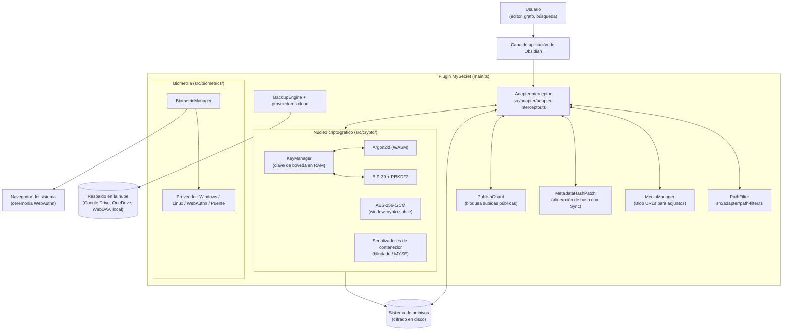

# MySecret — Guía Exhaustiva para Desarrolladores y Arquitectura

[English Version](DEVELOPER_GUIDE.md) • **Español**

Bienvenido a la **Guía para Desarrolladores y Arquitectura de MySecret**: la referencia de ingeniería completa
del plugin `obsidian-mysecret`, una capa de cifrado transparente en reposo para bóvedas de Obsidian.

Este documento está pensado para ingenieros que van a **modificar, revisar, auditar o extender** el plugin.

> 📖 **¿Buscas el manual de usuario paso a paso?** Consulta la **[Guía de Usuario en Español (USER_GUIDE.es.md)](USER_GUIDE.es.md)**.  
> 🛡️ **¿Buscas el modelado de amenazas o auditoría?** Consulta **[SECURITY.es.md](SECURITY.es.md)** y **[SECURITY_AUDIT.es.md](SECURITY_AUDIT.es.md)**.

El objetivo de esta guía es hacer legible el código *real*: dónde vive cada responsabilidad, qué invariantes no debe romper un cambio, cómo compilar y probar de forma determinista, y cómo descifrar una bóveda sin Obsidian.

> **Procedencia de este documento.** Cada afirmación fue verificada contra el código fuente de la **versión
> 1.0.6** del plugin (`package.json` / `manifest.json`). Los fragmentos de código son extractos de la
> implementación real, no ilustraciones. Cuando el código y la documentación anterior discrepan, **manda el
> código** y la diferencia se señala explícitamente en la sección *"Correcciones frente a revisiones
> anteriores"*.

---

## Tabla de Contenidos

1. [Orientación: qué es MySecret — y qué no es](#1-orientación-qué-es-mysecret--y-qué-no-es)
2. [Anatomía del repositorio](#2-anatomía-del-repositorio)
3. [Compilar, ejecutar y probar](#3-compilar-ejecutar-y-probar)
4. [Topología en tiempo de ejecución](#4-topología-en-tiempo-de-ejecución)
5. [Ciclo de vida del plugin](#5-ciclo-de-vida-del-plugin)
6. [El motor de intercepción (`src/adapter/`)](#6-el-motor-de-intercepción-srcadapter)
7. [El núcleo criptográfico (`src/crypto/`)](#7-el-núcleo-criptográfico-srccrypto)
8. [Formatos de contenedor en disco](#8-formatos-de-contenedor-en-disco)
9. [El sobre de la bóveda (`vault-envelope.json`)](#9-el-sobre-de-la-bóveda-vault-envelopejson)
10. [Subsistema biométrico (`src/biometrics/`)](#10-subsistema-biométrico-srcbiometrics)
11. [Motor de respaldo y restauración (`src/backup/`)](#11-motor-de-respaldo-y-restauración-srcbackup)
12. [Proveedores en la nube y retención](#12-proveedores-en-la-nube-y-retención)
13. [Internacionalización (`src/i18n/`)](#13-internacionalización-srcicn)
14. [Capa de interfaz (`src/ui/`)](#14-capa-de-interfaz-srcui)
15. [Publicación y cadena de releasing](#15-publicación-y-cadena-de-releasing)
16. [La suite de pruebas](#16-la-suite-de-pruebas)
17. [Descifrado independiente (Python, Node.js, Web Crypto)](#17-descifrado-independent-python-nodejs-web-crypto)
18. [El paquete ECHO Protocol (`packages/echo-protocol/`)](#18-el-pquete-echo-protocol-packagesecho-protocol)
19. [Invariantes de seguridad — la lista de "no rompas esto"](#19-invariantes-de-seguridad--la-lista-de-no-rompas-esto)
20. [Guía de extensión](#20-guía-de-extensión)
21. [Resolución de problemas](#21-resolución-de-problemas)
22. [Limitaciones conocidas (léelas antes de prometer nada)](#22-limitaciones-conocidas-léelas-antes-de-prometer-nada)
23. [Apéndice A — referencia de constantes](#23-apéndice-a--referencia-de-constantes)
24. [Apéndice B — glosario](#24-apéndice-b--glosario)
25. [Correcciones frente a revisiones anteriores](#25-correcciones-frente-a-revisiones-anteriores)

---

## 1. Orientación: qué es MySecret — y qué no es

### 1.1 El resumen en un párrafo

MySecret es un plugin de Obsidian que instala un **proxy criptográfico transparente** entre la API de archivos
de Obsidian y el sistema de ficheros del sistema operativo. Desde dentro de Obsidian el usuario ve notas
normales y legibles; en disco, cada nota, canvas y adjunto es un contenedor cifrado y autenticado. La clave
maestra nunca sale de la RAM del dispositivo, y el código fuente del plugin está publicado para que cualquiera
pueda verificar que no hay ninguna puerta trasera.

### 1.2 Lo que el plugin hace realmente

| Capacidad | Mecanismo | Fuente de verdad |
| :--- | :--- | :--- |
| Cifrar notas (`.md`, `.canvas`, `.txt`) | Contenedor "blindado" ASCII, AES-256-GCM | `src/crypto/envelope.ts` |
| Cifrar adjuntos (imágenes, PDF, audio…) | Contenedor binario compacto (`MYSE`), AES-256-GCM | `src/crypto/envelope.ts` |
| Vincular el cifrado a su ruta | Ruta normalizada a NFC como **AAD** de AES-256-GCM | `src/adapter/path-filter.ts` |
| Envolver la clave de bóveda con la contraseña | Argon2id → AES-256-GCM, AAD `vault-envelope` | `src/crypto/key-manager.ts` |
| Ofrecer una frase de rescate de 24 palabras | BIP-39 → PBKDF2-HMAC-SHA512 → AES-256-GCM, AAD `recovery-envelope` | `src/crypto/bip39.ts` |
| Desbloquear sin escribir la contraseña | Proveedores biométricos de plataforma, o puente WebAuthn en móvil | `src/biometrics/` |
| Respaldar la bóveda | Instantáneas ZIP (`fflate`) a disco, Google Drive, OneDrive, WebDAV o carpeta local | `src/backup/` |
| Proteger Obsidian Sync | El descifrado ocurre **solo** en `Vault.readBinary`, nunca en `DataAdapter.readBinary` | `src/adapter/adapter-interceptor.ts` |

### 1.3 Lo que el plugin **no** es

* **No es cifrado de sistema de ficheros.** La caché de metadatos de Obsidian, otros plugins y el editor pueden
  seguir teniendo texto claro en RAM. El bloqueo es un *bloqueo de interfaz* (ver §22).
* **No es un gestor de contraseñas.** La contraseña maestra nunca se almacena, ni se verifica por hash, ni se
  transmite. Se usa para *derivar* una clave que desenvuelve la clave de la bóveda.
* **No es multiusuario.** Una bóveda = una clave maestra = un propietario.
* **No es ECHO Protocol.** Ver §18: el repositorio contiene una segunda biblioteca biométrica independiente
  (`packages/echo-protocol/`) que el plugin **no** importa. No confundas los dos sistemas.

### 1.4 Cómo leer esta guía

| Si eres… | Lee primero | Después |
| :--- | :--- | :--- |
| Colaborador nuevo | §2, §3 | §16 (cómo se escriben las pruebas) |
| Revisando un cambio cripto | §7, §8, §9, §19 | §22 |
| Tocando los hooks de archivos | §6 | §19 (invariantes 1–8) |
| Construyendo un flujo de UI | §14 | §13 (todo texto pasa por `t()`) |
| Auditando el plugin | §19 | §17 (descifrado independiente) |
| Publicando una release | §15 | §16 |

---

## 2. Anatomía del repositorio

El árbol de trabajo contiene **tres entregables independientes**. Confundirlos es la fuente más común de
tiempo perdido en este repositorio.

```text
MySecret/
├── src/                     ← (A) EL PLUGIN. Lo único que se publica como main.js
├── tests/                   ← (A) Suite de pruebas del plugin (node:test, sin framework)
├── tools/                   ← (A) Descifradores independientes + script de sincronización
├── auth-bridge/             ← (B) PWA estática desplegada en Cloudflare Pages (biometría móvil)
├── packages/echo-protocol/  ← (C) Biblioteca Apache-2.0 independiente (NO la usa el plugin)
├── Github/                  ← (D) Espejo de publicación: un repositorio git aparte
├── styles.css               # Hoja de estilos del plugin (se publica tal cual, nunca se empaqueta)
├── manifest.json            # Manifiesto del plugin de Obsidian
├── package.json             # Scripts de compilación/prueba y dependencias
├── esbuild.config.mjs       # Configuración del empaquetador
├── tsconfig.json            # Configuración de TypeScript
├── eslint.config.mjs        # Configuración flat de ESLint (ver la advertencia en §3.5)
├── main.js                  # Artefacto de compilación (versionado; ~750 KB)
├── .github/workflows/       # CI: release, CodeQL, OSV-Scanner
├── SECURITY.md              # Arquitectura de seguridad + limitaciones conocidas
├── SECURITY_AUDIT.md        # Informes completos de auditoría (muy largos; léelos antes de auditar)
├── USER_GUIDE.md            # Manual de usuario
├── DEVELOPER_GUIDE.md       # ← este archivo
└── COMPARISON.md            # Comparativa de producto frente a otros enfoques
```

### 2.1 (A) El código del plugin

```text
src/
├── main.ts                       # Ciclo de vida, comandos, ajustes, orquestación de bloqueo/desbloqueo
├── constants.ts                  # Parámetros criptográficos, bytes mágicos, límites duros
├── types.ts                      # PluginSettings, VaultEnvelopeConfig, contratos de respaldo
├── adapter/
│   ├── adapter-interceptor.ts    # ★ El núcleo: monkey-patching de DataAdapter + Vault.readBinary
│   ├── decrypt.ts                # Detección y descifrado de contenedores (compartido)
│   ├── path-filter.ts            # Decide qué se cifra y normaliza rutas (el AAD)
│   ├── media-manager.ts          # Renderizado de medios con Blob URLs y MutationObserver
│   ├── metadata-hash-patch.ts    # Alinea el hash de metadataCache con el de Obsidian Sync
│   └── publish-guard.ts          # Impide que Obsidian Publish suba texto claro
├── crypto/
│   ├── aes.ts                    # AES-256-GCM sobre window.crypto.subtle
│   ├── argon2.ts                 # Argon2id (hash-wasm/WASM) y límites de parámetros
│   ├── bip39.ts                  # Generación/validación de mnemonico de 24 palabras y PBKDF2
│   ├── envelope.ts               # Serializadores blindado (texto) y binario (MYSE)
│   ├── hash.ts                   # SHA-256 hex, compatible byte a byte con Obsidian
│   ├── key-manager.ts            # Ciclo de vida de claves: init, unlock, lock, cambio de contraseña
│   └── wordlist-english.ts       # La lista de 2048 palabras BIP-39 en inglés
├── biometrics/
│   ├── biometric-manager.ts      # Selección de proveedor y orquestación de inscripción
│   ├── types.ts                  # Contrato BiometricProvider e interfaz del sobre
│   ├── kdf.ts                    # HKDF-SHA256, AAD biométrico, comparación en tiempo constante
│   ├── device-storage.ts         # Almacén localStorage, identidad del dispositivo
│   ├── windows-provider.ts       # Windows Hello + DPAPI (PowerShell por stdin)
│   ├── linux-provider.ts         # Verificación fprintd + keyring de Secret Service
│   ├── webauthn-provider.ts      # WebAuthn de plataforma con extensión PRF
│   ├── webauthn-assertion.ts     # Verificación de la firma de la aserción WebAuthn
│   ├── external-bridge-provider.ts # Ceremonia móvil a través de una PWA fuera de banda
│   ├── rp-id.ts                  # Cálculo del dominio registrable (fijado del RP ID)
│   ├── bridge-url.ts             # Validación de la URL del puente (solo HTTPS)
│   └── system-exec.ts            # Ejecutor de procesos sin shell
├── backup/
│   ├── backup-engine.ts          # Creación de ZIP, restauración, manifiesto
│   └── cloud/
│       ├── provider-interface.ts # Contrato CloudProvider
│       ├── index.ts              # Fábrica createCloudProvider()
│       ├── google-drive.ts  onedrive.ts  webdav.ts  local-sync.ts
│       └── retention.ts           # Qué respaldos antiguos se pueden borrar
├── i18n/
│   ├── index.ts                  # Detección de idioma, búsqueda t(), interpolación
│   ├── types.ts                  # TranslationDictionary (tipado estricto)
│   └── locales/                  # en.ts, es.ts, ru.ts, zh.ts
├── ui/
│   ├── settings-tab.ts           # Panel de ajustes (8 encabezados)
│   ├── lock-screen.ts            # Modal de desbloqueo (contraseña / frase / biometría)
│   ├── setup-wizard.ts           # Asistente de incorporación de 3–4 pasos
│   ├── migration-modal.ts        # Cifrado/descifrado masivo con progreso
│   ├── export-modal.ts  restore-modal.ts  cloud-backup-modal.ts
│   ├── change-password-modal.ts  reauth-modal.ts  recovery-phrase-modal.ts
│   ├── folder-picker-modal.ts  assets.ts
└── utils/
    ├── buffer.ts                 # Conversiones Hex/Base64/Base64URL y comparación en tiempo constante
    ├── credential-store.ts       # Cifrado en reposo de las credenciales de nube
    ├── http.ts                   # Wrapper requestUrl/fetch con validación del esquema de URL
    ├── path-sanitizer.ts         # Rechazo de Zip Slip y traversals sobre rutas no confiables
    ├── sha256.ts                 # SHA-256 puro en JS (respaldo cuando no hay WebCrypto)
    └── zeroize.ts                # Limpieza de memoria
```

### 2.2 (B) El puente móvil (`auth-bridge/`)

Una PWA estática sin dependencias (HTML + CSS + JS + service worker) que realiza la ceremonia WebAuthn en un
navegador real, donde el WebView embebido de Obsidian no puede. No contiene **ningún** material secreto y
habla con Obsidian mediante el esquema personalizado `obsidian://mysecret-auth`. Su `auth.js` es la mitad
navegador del protocolo descrito en §10.4. El archivo `_headers` lo aplica automáticamente Cloudflare Pages y es
**obligatorio** (contiene la CSP y las cabeceras anti-clickjacking; ver §15.4).

### 2.3 (C) `packages/echo-protocol/`

Una biblioteca Apache-2.0 con versionado propio, su propio build `tsup`, sus propias pruebas y su propia
documentación (`packages/echo-protocol/DEVELOPER_GUIDE.md`, `SPECIFICATION.md`). Implementa un apretón de manos
biométrico genérico fuera de banda con transportes enchufables (deep link, postMessage, loopback).

> ⚠️ **El plugin no la usa.** No existe ni un solo `import` desde `packages/` en todo `src/`. La pila biométrica
> propia del plugin (`src/biometrics/` + `auth-bridge/`) es una *implementación independiente*. Si cambias una,
> no supongas que los invariantes de la otra aplican. Ver §18 para las diferencias.

### 2.4 (D) `Github/` — el espejo de publicación

`Github/` es un **repositorio git aparte** con los archivos que realmente se publican a los usuarios. Se
actualiza con `npm run sync:gh` (§15.2). No edites a mano los archivos de `Github/`: se sobrescriben. El único
lugar donde el espejo no es copia es las pruebas: los artefactos `tests/bundle-*.mjs` se excluyen.

---

## 3. Compilar, ejecutar y probar

### 3.1 Requisitos previos

| Requisito | Versión | Notas |
| :--- | :--- | :--- |
| Node.js | **18+** (20 LTS recomendado) | Necesarios `node --test` y el runner nativo |
| npm | 9+ | `npm ci` reproduce el lockfile exacto |
| Obsidian | 1.5.0+ | `minAppVersion` en `manifest.json` |

Las dependencias de runtime son intencionadamente mínimas: **`fflate`** (ZIP) y **`hash-wasm`** (Argon2id en
WASM). No hay framework, ni gestor de estado, ni librería criptográfica: todas las primitivas vienen de la
plataforma (`window.crypto.subtle`) o de WASM.

### 3.2 Comandos habituales

```bash
npm install            # o: npm ci  (reproducible; es lo que usa CI)
npm run dev            # esbuild en modo watch → main.js (sourcemaps en línea)
npm run build          # bundle de producción → main.js (sin sourcemap)
npm test               # empaqueta y ejecuta toda la suite con node:test
npm run sync:gh        # replica en Github/ los archivos publicables
```

### 3.3 `npm run dev` / `npm run build`

`esbuild.config.mjs` produce un **único archivo CommonJS** (`main.js`) que Obsidian carga directamente:

```javascript
const context = await esbuild.context({
  entryPoints: ['src/main.ts'],
  bundle: true,
  external: [
    'obsidian', 'electron',
    '@codemirror/autocomplete', '@codemirror/collab', '@codemirror/commands',
    '@codemirror/language', '@codemirror/lint', '@codemirror/search',
    '@codemirror/state', '@codemirror/view',
    '@lezer/common', '@lezer/highlight', '@lezer/lr',
    ...builtinModules,
  ],
  format: 'cjs',
  target: 'es2020',
  logLevel: 'info',
  sourcemap: prod ? false : 'inline',
  treeShaking: true,
  outfile: 'main.js',
});
```

Puntos que conviene conocer:

* `obsidian` y los paquetes de CodeMirror/Lezer son **externos**: Obsidian los aporta en tiempo de ejecución, y
  empaquetarlos duplicaría las copias del anfitrión.
* Los módulos nativos de Node también son externos, por eso las rutas de código exclusivas de escritorio deben
  estar protegidas (ver §10.2).
* `target: 'es2020'` es la línea base de Obsidian/Electron; las características de `es2022` (`await` de nivel
  superior, `.at()`) **no** son seguras aquí.
* `treeShaking: true` y sin `minify`: el `main.js` publicado sigue siendo legible, y eso es deliberado en un
  plugin auditable.

### 3.4 Verificación de tipos

```bash
npx tsc --noEmit
```

`tsconfig.json` es estricto donde importa en un plugin de seguridad:

```json
{
  "compilerOptions": {
    "module": "ESNext", "target": "ES6", "moduleResolution": "node",
    "noImplicitAny": true,
    "strictNullChecks": true,
    "isolatedModules": true,
    "importHelpers": true,
    "lib": ["DOM", "ES5", "ES6", "ES7", "ES2017", "ES2020", "ES2021", "ES2022"]
  },
  "include": ["src/**/*.ts"]
}
```

`strict` **no** está activado, así que `strictPropertyInitialization` queda fuera; de ahí los frecuentes
`public settings!: PluginSettings;` (aserciones de asignación definitiva) en la clase del plugin. El código
nuevo debería evitar `any` salvo los `as any` deliberados que hacen de puente con los internos sin tipar de
Obsidian.

### 3.5 ESLint — estado actual (léelo antes de confiar en él)

`eslint.config.mjs` existe y es una configuración flat estándar:

```javascript
export default tseslint.config(
  js.configs.recommended,
  ...tseslint.configs.recommended,
  {
    ignores: ["main.js", "node_modules/**", "Github/**", "backup/**", "tests/**", "tools/**"],
    rules: {
      "@typescript-eslint/no-explicit-any": "warn",
      "@typescript-eslint/no-unused-vars": ["warn", { "argsIgnorePattern": "^_" }],
      "no-console": "off"
    }
  }
);
```

Sin embargo, **`eslint`, `@eslint/js` y `typescript-eslint` no están en las `devDependencies` de
`package.json`**, así que un `npm install` limpio no aporta el binario del linter. Tampoco hay script `lint` en
`package.json`. Trata ESLint como *configuración disponible, no como puerta automática*: hoy las puertas que se
ejecutan de verdad son `tsc --noEmit` y `npm test`. (Añadir las devDependencies que faltan es una mejora
pequeña y autocontenida; ver §20.6.)

### 3.6 Ejecutar el plugin en local

1. `npm run dev` (modo watch).
2. Copia `main.js`, `manifest.json` y `styles.css` a
   `<bóveda>/.obsidian/plugins/mysecret/`.
3. Recarga Obsidian (⌘/Ctrl+P → "Reload app without saving") y activa el plugin.

Para pruebas en móvil, despliega `auth-bridge/` (ver `auth-bridge/README.md`) y pega la URL
`https://<proyecto>.pages.dev` en **Ajustes → MySecret → Biometría**.

---

## 4. Topología en tiempo de ejecución



### 4.1 El modelo de lectura de dos capas (la decisión de diseño más importante)

Obsidian expone **dos** APIs capaces de leer un archivo, y MySecret las trata de forma deliberadamente
distinta:

| Punto de entrada | Quién lo llama | Qué devuelve MySecret |
| :--- | :--- | :--- |
| `DataAdapter.readBinary(path)` | **Obsidian Sync** (directo), plugins | **Cifrado en bruto**, tal cual está en disco |
| `Vault.readBinary(file)` | Indexador de metadatos, Obsidian Publish, el editor | **Texto claro** (descifrado en memoria) |

El motivo está en los comentarios del código de `src/adapter/adapter-interceptor.ts` y merece repetirse aquí,
porque invertirlo sube texto claro a la nube del usuario sin avisar:

* Si `DataAdapter.readBinary` descifrara, Sync subiría las notas **en claro**.
* Obsidian Publish lee por `Vault.readBinary`, así que hace falta un `PublishGuard` para que no publique texto
  claro en una web pública (§10 de `SECURITY.md`).
* Descifrar en la capa `Vault` también corrige un bug real de corrupción: Sync descarga el cifrado y lo
  reescribe con `writeBinary`. Si el hook de escritura cifrara otra vez, cada archivo sincronizado quedaría
  cifrado dos veces e ilegible para siempre. `isAuthenticContainer()` (§6.6) lo evita.

El indexador de metadatos ve por tanto texto claro (búsqueda, enlaces y notas al pie funcionan), mientras que
Sync ve cifrado (el almacenamiento en la nube sigue opaco).

---
## 5. Ciclo de vida del plugin

`src/main.ts` (1 320 líneas) es el orquestador. El orden de `onload()` es significativo: varios hooks dependen de
objetos creados antes.

### 5.1 `onload()` — secuencia ordenada

```typescript
await this.loadSettings();
initI18n(this.settings.language);

this.pathFilter = new PathFilter(this.settings.excludedFolders, this.settings.encryptAttachments);
this.keyManager = new KeyManager();
this.biometricManager = new BiometricManager(this.settings.biometrics?.bridgeUrl);
this.mediaManager = new MediaManager(this.app, this.pathFilter, this.keyManager);

this.registerObsidianProtocolHandler('mysecret-auth', async (params) => { /* → biometricManager */ });

await this.loadVaultEnvelope();                 // §9.3

this.interceptor = new AdapterInterceptor(
  this.app.vault.adapter, this.pathFilter, this.keyManager, this.mediaManager, this.app.vault
);
this.interceptor.install();                     // hooks del DataAdapter
this.interceptor.setPendingRebinds(this.settings.pendingRebinds, list => { /* persistir */ });
this.interceptor.installVaultHooks();           // hook de Vault.readBinary (§4.1)

this.metadataHashPatch = new MetadataHashPatch(this.app);
this.metadataHashPatch.install();
this.interceptor.setMetadataHashPatch(this.metadataHashPatch);

this.publishGuard = new PublishGuard(this.app);
this.publishGuard.install();
this.registerInterval(window.setInterval(() => this.publishGuard?.refresh(), 15_000));

this.registerMarkdownPostProcessor(el => this.mediaManager.scanAndPatch(el));
this.registerEvent(this.app.vault.on('rename', (file, oldPath) => {
  void this.interceptor.handleVaultRename(file, oldPath);
}));
```

Después registra el icono de cinta, siete comandos (§5.3), la pestaña de ajustes, los seguimientos de actividad
para el autobloqueo, el menú contextual del explorador de archivos, el temporizador de autobackup y, por
último, la decisión de arranque en `onLayoutReady()`.

### 5.2 La decisión de arranque (y la rama más peligrosa del plugin)

```typescript
this.app.workspace.onLayoutReady(() => {
  if (!this.keyManager.isInitialized) {
    if (this.envelopeLoadError) {
      // El sobre EXISTE pero es inservible → NO crear una bóveda nueva.
      new Notice('⚠️ MySecret: vault-envelope.json existe pero está dañado …', 0);
      return;
    }
    void this.openSetupWizard();
  } else {
    this.preserveAndCloseOpenNotes();
    document.body.classList.add('is-mysecret-locked');
    this.openLockScreen();
  }
});
```

* Si el sobre **no existe** → se ejecuta el asistente (crea una clave de bóveda nueva).
* Si el sobre existe pero está **corrupto** → el asistente **no** se ofrece. Crear una clave nueva sobre una
  bóveda cifrada haría que cada nota quedara ilegible para siempre, así que el plugin se niega y pide
  restaurar `vault-envelope.json` o su `.bak`.
* `openSetupWizard()` además llama a `countEncryptedFiles(500)`: si hay archivos cifrados sin sobre, avisa
  explícitamente y exige una confirmación antes de continuar.

### 5.3 Comandos

| ID de comando | Efecto |
| :--- | :--- |
| `mysecret-lock-vault` | Bloquea la bóveda (solo se ofrece desbloqueada) |
| `mysecret-unlock-vault` | Abre la pantalla de bloqueo (solo se ofrece bloqueada) |
| `mysecret-change-password` | Abre el modal enmascarado de cambio de contraseña |
| `mysecret-bulk-encrypt` | Abre el modal de migración en modo "cifrar" |
| `mysecret-export-zip` | Exporta un respaldo ZIP |
| `mysecret-cloud-backup` | Configura el proveedor de respaldo en la nube |
| `mysecret-restore-backup` | Restaura desde un archivo ZIP |

### 5.4 Bloquear (`lockVault()`)

La secuencia de bloqueo está ordenada, y reordenarla introduce bugs sutiles:

1. `mediaManager.revokeAll()` — revoca cada Blob URL en memoria.
2. `preserveAndCloseOpenNotes()` — guarda el estado y desacopla las hojas abiertas del editor (markdown, image,
   canvas, pdf).
3. `document.body.classList.add('is-mysecret-locked')` — velo CSS de todo el espacio de trabajo.
4. **Captura** la clave de bóveda *antes* de borrarla, si hay un autobackup "on-lock" pendiente, para que el
   respaldo pueda cifrar archivos que siguen en claro en disco.
5. `dropPlaintextCaches()` — intenta `file.cache(null)` en los archivos cifrados, para que `vault.cachedRead()`
   deje de devolver el cuerpo de las notas.
6. `keyManager.lock()` — borra la clave cruda, suelta la referencia `CryptoKey` y limpia la frase de rescate.
7. `reauthValidUntil = 0` — la ventana de gracia de reautenticación ganada en esta sesión **no** debe sobrevivir
   al siguiente desbloqueo (por ejemplo, uno hecho con la huella).
8. Refresca el icono de cinta, muestra un aviso y abre la pantalla de bloqueo.

El autobackup iniciado en el punto 4 continúa en segundo plano *después* de borrar la clave.

### 5.5 Desbloquear (`unlockVaultSuccess()`)

1. Quita la clase CSS de bloqueo, refresca el icono, reinicia el temporizador de inactividad.
2. `interceptor.processPendingRebinds()` — reproduce los renombrados/copias cuyo re-vinculado de AAD no pudo
   completarse con la bóveda bloqueada (§6.7).
3. `restoreSavedOpenNotes()` — reabre las notas que estaban abiertas antes del bloqueo, con su estado de vista.
4. Reindexa las notas cifradas cuya entrada de la caché de metadatos falte o esté incompleta, mediante
   `metadataCache.computeFileMetadataAsync()`.

### 5.6 `onunload()`

`onunload()` debe dejar el anfitrión tal cual: limpiar los temporizadores, destruir el `MediaManager`, quitar la
clase CSS de bloqueo, `keyManager.lock()`, `interceptor.uninstall()` (restaura **todos** los métodos parcheados),
`metadataHashPatch.uninstall()` y `publishGuard.uninstall()`. Obsidian llama a `onunload()` al deshabilitar el
plugin, al cambiar de bóveda y al actualizar, así que una fuga aquí no es cosmética.

---

## 6. El motor de intercepción (`src/adapter/`)

`adapter-interceptor.ts` tiene 1 158 líneas y es el corazón del plugin. Sustituye métodos en la instancia viva
de `DataAdapter` y en la de `Vault`.

### 6.1 El conjunto exacto de métodos parcheados

| Método | Comportamiento | Notas |
| :--- | :--- | :--- |
| `getResourcePath(path)` | Devuelve un Blob URL descifrado de los adjuntos | Si no hay caché, cae al original |
| `read(path)` | Devuelve texto claro | Lanza error si la bóveda está bloqueada |
| `write(path, data)` | Cifra | Serializado por ruta |
| `readBinary(path)` | **Devuelve el cifrado en bruto** | Deliberado — ver §4.1 |
| `writeBinary(path, data)` | Cifra | Detecta payloads ya cifrados |
| `append(path, data)` | Leer‑modificar‑escribir, cifrado | Serializado por ruta |
| `appendBinary(path, data)` | Leer‑modificar‑escribir, cifrado | Serializado por ruta |
| `process(path, fn)` | Leer‑transformar‑escribir, cifrado | Serializado por ruta |
| `copy(path, newPath)` | Copia **y re-vincula el AAD** | §6.8 |
| `Vault.readBinary(file)` | Devuelve texto claro | El único punto de descifrado |

`rename()` **no** se parchea. Los renombrados se atienden mediante el evento público `vault.on('rename')`
(§6.8), porque ese evento se dispara en todos los caminos de renombrado — arrastrar y soltar, el explorador de
archivos, el comando de renombrado, los plugins de sincronización—, mientras que parchear
`DataAdapter.rename` se perdería los que no pasan por el adaptador.

`uninstall()` los restaura todos, incluido el parche de `Vault.readBinary`.

### 6.2 La guarda de bloqueo

Cada ruta de lectura/escritura que necesita la clave comprueba primero el estado de bloqueo:

```typescript
if (self.keyManager.isLocked) {
  throw new Error(`[MySecret] Access denied: Vault is locked (${path})`);
}
```

El bloqueo por tanto se **impone**, no es solo cosmético: los archivos cifrados no se pueden leer (ni
escribir) con la bóveda bloqueada, incluso desde dentro de Obsidian.

### 6.3 Qué se considera "cifrable" (`PathFilter`)

`src/adapter/path-filter.ts` es el único punto de decisión:

```typescript
public isSystemExcluded(path: string): boolean {
  const normalized = this.normalizePath(path);
  for (const prefix of SYSTEM_EXCLUDED_PREFIXES) {          // '.obsidian/', '.git/', '.trash/'
    if (normalized.startsWith(prefix) || normalized === prefix.replace('/', '')) return true;
  }
  const segments = normalized.split('/');
  // Un DIRECTORIO oculto a cualquier profundidad nunca es contenido del usuario.
  for (let i = 0; i < segments.length - 1; i++) {
    if (segments[i].startsWith('.')) return true;
  }
  const baseName = segments[segments.length - 1] || '';
  if (baseName.startsWith('.')) {
    // Una NOTA de texto oculta dentro de una carpeta SÍ es contenido del usuario
    // y no debe quedar en claro; cualquier otro dotfile anidado queda excluido.
    if (segments.length === 1 || !this.isTextNote(normalized)) return true;
  }
  return false;
}

public shouldEncrypt(path: string): boolean {
  if (this.isSystemExcluded(path)) return false;
  if (this.isUserExcluded(path)) return false;
  if (this.isTextNote(path)) return true;        // .md, .canvas, .txt → siempre
  return this.encryptAttachments;                // binario → según el ajuste
}
```

Puntos clave para quien revise:

* `.obsidian/`, `.git/` y `.trash/` **nunca** se cifran (cifrar la carpeta de configuración rompería la
  aplicación anfitriona).
* Los **directorios** ocultos a cualquier profundidad quedan excluidos.
* Una **nota de texto** oculta dentro de una carpeta (`Notas/.privada.md`) **sí** se cifra: es contenido del
  usuario. Esta asimetría es deliberada y tiene su test de regresión.
* `isTextNote()` reconoce `.md`, `.canvas` y `.txt` (sin distinguir mayúsculas).

### 6.4 Normalización de rutas — el contrato del AAD

```typescript
public normalizePath(path: string): string {
  return (path || '').normalize('NFC').replace(/^[/\\]+/, '').replace(/[/\\]+$/, '').replace(/\\/g, '/');
}
```

Esta única función define los **Datos Autenticados Adicionales** de cada archivo: la ruta relativa
normalizada de la bóveda, codificada en UTF-8. De ahí se siguen dos consecuencias, ambas determinantes:

* **Unicode NFC.** Una nota llamada `café.md` puede estar en disco como NFC o NFD según el sistema operativo y
  el cliente de sincronización. Normalizar hace que la misma nota se descifre con cualquiera de las dos
  representaciones.
* **Vinculación a la ruta.** Como la ruta se autentica, el cifrado no puede moverse a otra ruta y seguir siendo
  válido. Un archivo copiado de `secreto/passwords.md` a `public/readme.md` falla la autenticación, y eso es
  exactamente lo que hace obligatorio el re-vinculado de §6.8.

> La guía anterior documentaba un helper llamado `normalizeAadPath()` que devolvía `Uint8Array`. **Esa función
> no existe en el código.** El AAD lo produce `PathFilter.normalizePath()` (un `string`), que
> `encryptAesGcm()`/`decryptAesGcm()` codifican internamente con `stringToBytes()`. Ver §25.

### 6.5 Serialización por ruta (`withPathLock`)

`process()`, `append()` y `appendBinary()` son ciclos leer‑modificar‑escribir. Las implementaciones nativas son
atómicas; las versiones parcheadas son tres pasos de E/S separados, así que dos llamadas concurrentes sobre la
misma nota perderían una de las actualizaciones. El interceptor las serializa por ruta:

```typescript
private pathQueues: Map<string, Promise<unknown>> = new Map();

private withPathLock<T>(path: string, task: () => Promise<T>): Promise<T> { /* encadena sobre pathQueues */ }
```

`write()`, `rebindAad()` y las operaciones compuestas comparten la misma cola para una ruta dada, de modo que un
renombrado no puede intercalarse con una escritura al mismo archivo.

### 6.6 `isAuthenticContainer()` — la guarda contra el doble cifrado

Cuando Obsidian Sync descarga un archivo y lo reescribe en disco, el payload **ya es un cifrado**. Si el hook
de escritura lo cifrara otra vez, el archivo quedaría cifrado dos veces y no volvería a ser legible.

La comprobación es criptográfica, no estructural:

```typescript
export async function isAuthenticContainer(
  rawBytes: Uint8Array, aad: string, keyManager: KeyManager
): Promise<boolean> {
  const format = detectContainerFormat(rawBytes);
  if (format === 'plain') return false;
  const vaultKey = keyManager.getVaultKey();
  if (!vaultKey) return false;
  try {
    /* descifrar con el AAD vinculado a la ruta destino */
    return true;   // el tag verificó → es un contenedor producido por MySecret
  } catch {
    return false;  // no es auténtico → se cifra normalmente
  }
}
```

Un archivo que *solo parece* un contenedor (p. ej. un PNG cuyos primeros bytes casualmente son `MYSE`) falla la
autenticación y por tanto se cifra normalmente: nunca se filtra en claro.

### 6.7 Re-vinculados diferidos (`pendingRebinds`)

Si un archivo se renombra con la bóveda **bloqueada**, el plugin no puede re-vincular el AAD (no hay clave en
RAM). Dejarlo así haría la nota ilegible para siempre, así que el renombrado se encola:

```typescript
private pendingRebinds: Array<{ from: string; to: string }> = [];
```

* La cola se **persiste** mediante `setPendingRebinds()` / `onPendingRebindsChanged()` en
  `settings.pendingRebinds` (parte de `data.json`), así que sobrevive a un fallo.
* `processPendingRebinds()` reproduce la cola en el siguiente desbloqueo y es **idempotente**: una entrada ya
  vinculada se omite (comprobación `authenticatesUnder()`), y solo se persisten las que quedan.
* Las entradas duplicadas se rechazan en el momento de insertarlas.

### 6.8 Renombrados y re-vinculado del AAD

`handleVaultRename(file, oldPath)`:

1. Calcula la nueva ruta normalizada.
2. Si el elemento renombrado es un **archivo** → `rebindOrQueue(oldPath, newPath)`.
3. Si es una **carpeta** → captura el subárbol (`collectSubtreeFiles()`, que usa `adapter.list()` y devuelve
   rutas **absolutas**, según el contrato de Obsidian) y re-vincula cada descendiente.

`rebindAadLocked()` lee los bytes en bruto y ramifica según el tipo de contenedor:

```typescript
const oldAad = this.pathFilter.normalizePath(fromAbs);
const newAad = this.pathFilter.normalizePath(toAbs);

// contenedor binario   → descifrar con oldAad, recifrar con newAad
// contenedor blindado → descifrar con oldAad, recifrar con newAad
// archivo en claro     → cifrarlo con newAad
```

Dos sutilezas de esa función que son fáciles de romper:

* Si el descifrado con el AAD **antiguo** falla, el código comprueba si el payload ya autentica bajo el AAD
  **nuevo** (`authenticatesUnder()`). Si es así, el re-vinculado ya ocurrió (p. ej. se reprodujo desde la cola) y
  la función vuelve sin tocar el archivo.
* Si el destino **ya no** debe cifrarse (el usuario excluyó esa carpeta), el archivo se escribe de nuevo en
  **claro**, descifrado con el AAD antiguo.

La distinción binario/claro debe decidirse sobre los **bytes en bruto**. Un bug histórico leía el archivo como
UTF-8 primero, lo que convertía un adjunto binario cifrado en texto ilegible y lo trataba como claro,
corrompiendo el adjunto de forma permanente. `detectContainerFormat()` en `src/adapter/decrypt.ts` existe
justo para evitar esa clase de bug y se comparte con el gestor de medios.

### 6.9 `MediaManager` — adjuntos en el editor

Los adjuntos están cifrados en disco, así que Obsidian no puede renderizarlos. `MediaManager` lo resuelve con
Blob URLs en memoria:

* `getOrResolveMediaBlob(path)` — descifra el contenedor y crea un `Blob` con el tipo MIME deducido de la
  extensión (`MIME_MAP`).
* `registerPlaintextMedia(path, data)` — registra el texto claro *antes* de cifrar el archivo, para que una
  imagen pegada aparezca al instante.
* `patchDomForPath()` / `scanAndPatch()` — un `MutationObserver` que reescribe los `src` de los `` con el
  Blob URL en la vista de lectura y en las tarjetas markdown.
* `invalidate(path)` — descarta un Blob URL obsoleto cuando los bytes cambiaron detrás del plugin (p. ej. Sync
  escribió el cifrado) y lo vuelve a resolver.
* `revokeAll()` — revoca todas las URL al bloquear (no sobrevive ningún blob en claro).
* `handleRename(oldPath, newPath)` — mueve la entrada de caché a la nueva ruta.

### 6.10 `MetadataHashPatch` — mantener sano a Obsidian Sync

Obsidian calcula **dos** hashes del mismo archivo:

* el indexador de metadatos hashea el **texto claro** (`vault.readBinary`, ahora descifrado), y
* Obsidian Sync hashea el **cifrado** (`adapter.readBinary`).

Sync reutiliza el hash cacheado por el indexador para decidir si un archivo cambió. Si los dos nunca coinciden,
Sync consideraría que *todos* los archivos cambian en *cada* ejecución: volvería a descargar y reescribir toda la
bóveda indefinidamente.

`MetadataHashPatch` sustituye `metadataCache.getFileInfo()` para que el hash expuesto a Sync sea el del
cifrado:

```typescript
metadataCache.getFileInfo = function (path: string): any {
  const info = self.origGetFileInfo!(path);
  if (!info) return info;
  const ciphertextHash = self.ciphertextHashes.get(path);
  if (!ciphertextHash || info.hash === ciphertextHash) return info;
  // Se devuelve una COPIA: el hash original es la clave del mapa que guarda
  // los metadatos parseados, y mutarlo rompería enlaces y notas al pie.
  return { ...info, hash: ciphertextHash };
};
```

Devolver una **copia** es esencial: `metadataCache[hash]` es el índice de los metadatos parseados.

### 6.11 `PublishGuard` — bloquear subidas públicas

Obsidian Publish sube las notas a una **web pública**, leyéndolas por `vault.readBinary()` — el mismo hook que
entrega el texto claro. `PublishGuard` envuelve `instance.apiUploadFile` y rechaza la subida de cualquier
archivo que esté cifrado en disco, con un mensaje de error accionable.

Decisiones de diseño que conviene preservar:

* **No** desactiva el plugin Publish (eso mutaría en silencio la configuración del usuario y depende de
  internos inestables).
* **No** sube el cifrado tampoco (la página publicada mostraría un sobre, y el hash que Publish calcula sobre
  el texto claro no coincidiría con los bytes subidos).
* **Sigue a la instancia del plugin**: `refresh()` se ejecuta cada 15 segundos y reinstala la guarda si Publish
  se activó *después* de que MySecret cargara, o si se desactivó y se reactivó (lo que crea una instancia
  nueva).
* La salida explícita es la acción "Descifrar todo" de MySecret, que convierte las notas en claro y hace que
  Publish funcione con normalidad.

---

## 7. El núcleo criptográfico (`src/crypto/`)

### 7.1 AES-256-GCM (`aes.ts`)

```typescript
export async function encryptAesGcm(
  plainBytes: Uint8Array, key: CryptoKey, aad?: string
): Promise<AesGcmResult> {
  const iv = generateIv();                                   // 12 bytes aleatorios
  const additionalData = aad ? stringToBytes(aad) : undefined;
  const encryptedBuffer = await window.crypto.subtle.encrypt(
    { name: 'AES-GCM', iv, additionalData, tagLength: 128 }, key, plainBytes
  );
  // WebCrypto anexa el tag de 16 bytes al cifrado.
  const ciphertextLength = encryptedBytes.length - AES_GCM_TAG_LENGTH;
  return { iv, tag: encryptedBytes.slice(ciphertextLength), ciphertext: encryptedBytes.slice(0, ciphertextLength) };
}
```

* `importAesKey()` importa la clave cruda con `extractable: false` — WebCrypto no permite reexportar el
  `CryptoKey` a bytes crudos.
* `decryptAesGcm()` vuelve a concatenar `ciphertext + tag`, que es lo que espera WebCrypto.
* Cualquier discrepancia de clave, de AAD o un byte manipulado lanza un `OperationError`: la garantía de
  integridad AEAD es lo que hace detectable la corrupción silenciosa.

### 7.2 Argon2id (`argon2.ts`)

```typescript
export async function deriveKeyArgon2id(
  password: string, salt: Uint8Array,
  memoryKib = ARGON2_MEMORY_KIB,   // 65536 KiB = 64 MiB
  iterations = ARGON2_ITERATIONS,   // 3
  parallelism = ARGON2_PARALLELISM  // 1
): Promise<Uint8Array> {
  assertArgon2CostParams({ memoryKib, iterations, parallelism });   // ← control de seguridad
  return new Uint8Array(await argon2id({ password, salt, parallelism, iterations, memorySize: memoryKib,
    hashLength: 32, outputType: 'binary' }));
}
```

`assertArgon2CostParams()` **no** es una comprobación de cordura: es un control de seguridad. Los parámetros de
coste viven dentro de `vault-envelope.json`, que vive dentro de la bóveda y por tanto es controlable por
cualquiera que pueda copiar la bóveda del disco. Sin los mínimos, un atacante podría reescribir el sobre con
`memory=8 KiB, iterations=1` y convertir una derivación de ~240 ms en una de ~2 ms, haciendo trivial un
ataque de diccionario offline.

| Límite | Mínimo | Máximo | Justificación |
| :--- | :--- | :--- | :--- |
| `memoryKib` | 65 536 (64 MiB) | 1 048 576 (1 GiB) | Suelo anti-degradación; techo anti-DoS |
| `iterations` | 3 | 20 | Ídem |
| `parallelism` | 1 | 16 | Ídem |

Los sobres con parámetros fuera de rango se **rechazan**, nunca se actualizan en silencio (actualizar derivaría
una clave distinta y haría la bóveda indescifrable).

### 7.3 BIP-39 (`bip39.ts`)

* **Generación**: 32 bytes de entropía CSPRNG → 24 palabras (256 bits + checksum SHA-256 de 8 bits).
* **Validación**: se verifican el número de palabras, la pertenencia a la lista y el checksum.
* **Derivación**: PBKDF2-HMAC-**SHA512**, 2 048 iteraciones, salida de 32 bytes, sobre la frase *normalizada*
  (`trim().toLowerCase()` con espacios colapsados).

> El checksum SHA-256 lo calcula una **implementación compacta en JS puro** (`computeSha256FirstByte`) en lugar
> de WebCrypto, porque el generador debe ser síncrono. Solo necesita el primer byte del digest y procesa un
> único bloque de 64 bytes, así que la implementación es deliberadamente mínima.

### 7.4 `KeyManager` — el ciclo de vida de las claves

```typescript
export class KeyManager {
  private _isLocked = true;
  private vaultKey: CryptoKey | null = null;       // no exportable
  private rawVaultKey: Uint8Array | null = null;   // solo mientras está desbloqueada
  private envelope: VaultEnvelopeConfig | null = null;
  private recoveryMnemonic: string | null = null;  // solo en RAM, nunca se persiste
}
```

Superficie pública:

| Método | Comportamiento |
| :--- | :--- |
| `isLocked` / `isInitialized` | Getters de estado |
| `getVaultKey()` | El `CryptoKey`, o `null` si está bloqueada |
| `getRawVaultKey()` | Una **copia** de los 32 bytes crudos, o `null` si está bloqueada |
| `initializeVault(password, withRecovery)` | Crea el sobre; devuelve `{ mnemonic, envelope, commit }` |
| `unlockWithPassword(pw)` / `unlockWithRecoveryPhrase(m)` / `unlockWithRawVaultKey(k)` | Las tres vías de desbloqueo |
| `verifyPassword(pw)` | Comprueba una contraseña **sin** desbloquear |
| `changeMasterPassword(new, current)` | Re-envuelve la clave de bóveda (§7.5) |
| `addRecoveryPhrase()` / `removeRecoveryPhrase()` | Gestiona el sobre de recuperación |
| `snapshotRecoveryState()` / `restoreRecoveryState(s)` | Soporte de rollback para la UI |
| `lock()` | Borra todo (§7.6) |

El callback `commit()` que devuelve `initializeVault()` es significativo: quien llama persiste el sobre y solo
después lo confirma en el gestor, así que un fallo de escritura en disco no deja al gestor con un sobre que no
existe.

### 7.5 Cambiar la contraseña maestra

```typescript
public async changeMasterPassword(newPassword: string, currentPassword: string): Promise<VaultEnvelopeConfig> {
  if (this._isLocked || !this.rawVaultKey || !this.envelope) {
    throw new Error('[MySecret] Vault must be unlocked to change password');
  }
  if (!(await this.verifyPassword(currentPassword))) {
    throw new Error('[MySecret] The current password is incorrect');
  }
  assertArgon2CostParams({ /* los propios parámetros del sobre */ });

  const newSalt = generateSalt();
  try {
    newPassKeyBytes = await deriveKeyArgon2id(newPassword, newSalt, /* mismos parámetros */);
    const vaultKeyEnc = await encryptAesGcm(this.rawVaultKey, newPassKey, 'vault-envelope');
    if (!this.envelope.vaultId) {
      // Los sobres antiguos usaban la sal como identificador; mantenerlo estable
      // para que las inscripciones biométricas sigan funcionando.
      this.envelope.vaultId = this.envelope.argon2.salt;
    }
    this.envelope.argon2.salt = bytesToHex(newSalt);
    this.envelope.vaultKeyEnvelope = { /* nuevo iv/tag/ciphertext */ };
    this.envelope.updatedAt = Date.now();
  } finally {
    zeroize(newPassKeyBytes);   // se borra tanto en éxito como en fallo
  }
}
```

Tres propiedades importan:

1. **Se exige la contraseña actual.** Estar desbloqueada (por biometría, o por una sesión desatendida) no basta
   para sustituir la credencial que protege la bóveda.
2. **La clave de bóveda no se rota.** Solo cambia su envoltorio, así que ningún archivo en disco se recifra. La
   consecuencia —una copia antigua del sobre junto con la contraseña *anterior* sigue descifrando la bóveda—
   está documentada en §22.
3. **`vaultId` se fija antes de que cambie la sal**, para que las inscripciones biométricas no queden
   huérfanas al cambiar la contraseña.

### 7.6 Bloqueo y zeroización

```typescript
public lock(): void {
  this._isLocked = true;
  this.vaultKey = null;
  this.recoveryMnemonic = null;      // la frase de rescate también es material secreto
  if (this.rawVaultKey) {
    zeroize(this.rawVaultKey);
    this.rawVaultKey = null;
  }
}
```

`zeroize()` (`src/utils/zeroize.ts`) sobrescribe el buffer con ceros, con un respaldo byte a byte para buffers
congelados. Se llama en bloques `finally` a lo largo de las rutas de derivación y autenticación, así que el
material temporal de clave se borra tanto en el camino **de éxito** como en el **de error**.

> Advertencia realista: JavaScript no garantiza que el recolector de basura nunca copiara el buffer, y el sistema
> operativo pudo haberlo escrito en swap. La zeroización es una mitigación de mejor esfuerzo, no una garantía.

---

## 8. Formatos de contenedor en disco

Dos formatos, elegidos según el tipo de archivo. Ambos llevan versión (`CURRENT_ENVELOPE_VERSION = 1`).

### 8.1 Contenedor blindado (notas de texto: `.md`, `.canvas`, `.txt`)

```text
-----BEGIN MYSECRET ENCRYPTED FILE-----
Version: 1
IV: <base64 de 12 bytes>
Tag: <base64 de 16 bytes>

<cifrado en base64, plegado a 64 caracteres por línea>
-----END MYSECRET ENCRYPTED FILE-----
```

* El **IV y el Tag van en base64**, no en hexadecimal. (Una revisión anterior de esta guía los documentaba en hex;
  ver §25.)
* El payload se pliega a 64 columnas para que el archivo siga siendo legible y diferenciable.
* `deserializeArmored()` tolera la ausencia del separador de cuerpo (una nota recién creada, vacía) y acepta
  tanto LF como CRLF.
* `isArmoredBytesEncrypted()` salta un BOM UTF-8 y los espacios iniciales antes de comparar la cabecera, así que
  una nota editada por otra herramienta sigue detectándose como cifrada.

### 8.2 Contenedor binario (adjuntos)

Una cabecera de **33 bytes** (no 32) antepuesta al cifrado en bruto:

| Offset | Tamaño | Contenido |
| :--- | :--- | :--- |
| 0–3 | 4 | Magia `MYSE` (`0x4D 0x59 0x53 0x45`) |
| 4 | 1 | Versión del contenedor (`0x01`) |
| 5–16 | 12 | IV |
| 17–32 | 16 | Tag de autenticación AES-GCM |
| 33+ | … | Cifrado |

```typescript
export const BINARY_HEADER_LENGTH = 33; // 4 + 1 + 12 + 16
```

> La guía anterior decía "cabecera de 32 bytes". La constante en `src/constants.ts` es **33**: la cabecera es
> magia (4) + versión (1) + IV (12) + tag (16).

### 8.3 Reglas de detección

`detectContainerFormat(rawBytes)` devuelve `'binary' | 'armored' | 'plain'`:

* `binary` — los cinco primeros bytes son `MYSE` + versión `1`.
* `armored` — los bytes empiezan (tras un BOM opcional y espacios) por
  `-----BEGIN MYSECRET ENCRYPTED FILE-----`.
* `plain` — cualquier otra cosa.

La detección **debe** hacerse sobre los bytes en bruto. Decidirla tras decodificar como UTF-8 produce texto
ilegible que ya no casa con la cabecera mágica y corrompe silenciosamente los adjuntos binarios.

---

## 9. El sobre de la bóveda (`vault-envelope.json`)

### 9.1 Ubicación

```typescript
export const VAULT_ENVELOPE_PATH = '.obsidian/plugins/mysecret/vault-envelope.json';
```

El plugin lo escribe en `this.manifest.dir` (la carpeta real del plugin) y además mantiene sincronizada la copia
en `.obsidian/plugins/mysecret/` como respaldo. Al cargar, se prueban ambas ubicaciones y sus copias `.bak`, en
ese orden.

### 9.2 Forma

```jsonc
{
  "version": 1,
  "vaultId": "<hex>",            // identificador estable; sobrevive a los cambios de contraseña
  "argon2": {
    "memory": 65536,             // KiB
    "iterations": 3,
    "parallelism": 1,
    "salt": "<32 hex>"           // 16 bytes
  },
  "vaultKeyEnvelope": {          // la clave de bóveda, envuelta con la clave derivada de la contraseña
    "iv": "<24 hex>",            // 12 bytes
    "tag": "<32 hex>",           // 16 bytes
    "ciphertext": "<64 hex>"     // 32 bytes = la clave de bóveda envuelta
  },
  "recoveryEnvelope": {          // opcional: la clave de bóveda, envuelta con la clave de recuperación
    "salt": "<32 hex>",
    "iv": "<24 hex>",
    "tag": "<32 hex>",
    "ciphertext": "<64 hex>"
  },
  "createdAt": 1750000000000,
  "updatedAt": 1750000000000
}
```

Todos los campos binarios van en **hexadecimal**. Los AAD son cadenas fijas: `'vault-envelope'` para el sobre
de contraseña y `'recovery-envelope'` para el de recuperación. Son contextos distintos a propósito, para que un
sobre nunca pueda confundirse con un archivo ni con el otro sobre.

### 9.3 Validación y escritura atómica

* **Validación al cargar**: `isValidEnvelopeShape()` comprueba la estructura y la longitud exacta en bytes de
  cada campo hex. El sobre vive dentro de la bóveda, así que es **entrada no confiable**: un archivo malformado
  debe producir un error claro en lugar de un `TypeError` en lo más hondo del flujo de desbloqueo.
* **Escritura atómica**: `writeEnvelopeFile()` escribe en `<ruta>.tmp`, lo relee y lo compara byte a byte, copia
  la versión anterior a `<ruta>.bak` y por último renombra. Si el renombrado falla (algunas plataformas se niegan
  a renombrar sobre un archivo existente), cae a una escritura directa, dejando el `.bak` y el `.tmp` en su sitio.

### 9.4 La jerarquía de claves

```text
[Contraseña maestra] ──Argon2id(64 MiB, 3)──► [passKey 32B] ──┐
                                                           ├─AES-256-GCM, AAD "vault-envelope"──► [vaultKey 32B]
[Entropía aleatoria de 256 bits] ────────────────────────────┘        │
                                                                    │ AES-256-GCM, AAD = ruta normalizada
[24 palabras BIP-39] ──PBKDF2-HMAC-SHA512(2048, recSalt)──► [recoveryKey 32B] ──AES-256-GCM, AAD "recovery-envelope"──► [vaultKey 32B]
```

La **clave de bóveda** cifra los archivos. La contraseña y la frase de rescate solo la *envuelven* nunca.

---
## 10. Subsistema biométrico (`src/biometrics/`)

### 10.1 Selección de proveedor

`BiometricManager.selectProvider()` elige el proveedor a partir del `Platform` de Obsidian:

```typescript
if (Platform.isWin)                                  → new WindowsHelloProvider()
else if (Platform.isLinux && !Platform.isAndroidApp) → new LinuxBiometricProvider()
else if (Platform.isAndroidApp || Platform.isIosApp || Platform.isMobile)
                                                     → new ExternalBridgeProvider(bridgeUrl)
else                                                  → new WebAuthnProvider()
```

`BiometricProvider` es un contrato de dos métodos:

```typescript
export interface BiometricProvider {
  readonly type: BiometricProviderType;
  readonly name: string;
  isAvailable(): Promise<boolean>;
  enroll(rawVaultKey: Uint8Array, deviceId: string, vaultId: string): Promise<DeviceBiometricEnvelope>;
  verifyAndDecrypt(envelope: DeviceBiometricEnvelope, vaultId: string): Promise<Uint8Array | null>;
}
```

### 10.2 La matriz de proveedores

| Proveedor | Plataforma | Puerta de acceso | Almacén del secreto | Notas |
| :--- | :--- | :--- | :--- | :--- |
| `windows-hello` | Windows | `UserConsentVerifier` (Hello) | DPAPI (`CurrentUser`) | PowerShell por **stdin** (`-Command -`), nunca en la línea de comandos |
| `linux-secret-service` | Linux | **Huella `fprintd`** | Keyring de Secret Service | El keyring por sí solo no es una puerta aceptable (§10.3) |
| `webauthn` | macOS / escritorio | WebAuthn de plataforma + PRF | Autenticador del navegador | RP ID y origen fijados en el sobre |
| `external-bridge` | Android / iOS | WebAuthn en un **navegador externo** | Nada local; la ceremonia es fuera de banda | Los WebViews móviles no tienen WebAuthn nativo |
| `none` | — | — | — | Se informa como "no compatible" |

### 10.3 Linux: la puerta debe autenticar a alguien

El proveedor admite dos modos, y solo uno es aceptable:

* `fprintd` — una coincidencia real de huella vía `fprintd-verify`. **Es el único modo que permite inscribirse.**
* `secret-service` — modo heredado. Solo leía un secreto del keyring del sistema, que normalmente ya está
  desbloqueado en una sesión iniciada: no autenticaba a *nadie*. Se rechaza la inscripción con él y las
  inscripciones existentes **fallan cerradas**.

Endurecimiento adicional en Linux:

* Los binarios (`fprintd-verify`, `fprintd-list`, `secret-tool`) se resuelven a **rutas absolutas en directorios
  del sistema propiedad de root**, para que una entrada hostil en el `$PATH` no pueda suplantarlos.
* El secreto envoltorio es un **valor aleatorio generado con CSPRNG** y almacenado en el keyring. La
  implementación anterior lo derivaba de `SHA256("/etc/machine-id" + deviceId + USER)` — todos esos datos son
  públicos, así que cualquier proceso capaz de leer el almacenamiento del plugin podía recalcular la clave y
  descifrar la clave de bóveda sin ninguna comprobación biométrica.

### 10.4 El protocolo del puente móvil (v2)

Como el WebView móvil de Obsidian no puede llamar a WebAuthn para un esquema personalizado, la ceremonia se
traslada al navegador del sistema:

1. **Obsidian → Navegador.** Obsidian abre
   `https://<puente>/#session=…&action=verify&pub=…&ch=…&vb=…` en el navegador del sistema. Los parámetros van
   en el **fragmento** de la URL, que nunca se envía al servidor.
2. **ECDH P-256.** Obsidian genera un par de claves efímero; el navegador genera otro. El secreto compartido
   pasa por **HKDF-SHA256** antes de usarse como clave AES.
3. **Ceremonia.** El navegador llama a `navigator.credentials.get()` con la extensión PRF; la plataforma muestra
   el diálogo biométrico.
4. **Callback.** El navegador cifra `{prfSecret, credentialId, assertion}` con la clave de sesión y redirige a
   `obsidian://mysecret-auth?session=…&pub=…&iv=…&tag=…&data=…`.
5. **Verificación.** Obsidian descifra y **verifica la firma de la aserción WebAuthn** contra la clave pública
   guardada en el momento de la inscripción. Solo entonces desenvuelve la clave de bóveda.

El paso de verificación es lo sutil. El puente es una **página remota de terceros**: si Obsidian confiara en el
secreto PRF sin más, un puente comprometido podría devolver 32 bytes cualesquiera y la bóveda se desbloquearía
sin que jamais hubiera ocurrido una comprobación biométrica. Como solo el autenticador inscrito posee la clave
privada, una firma válida prueba que el secreto salió de una ceremonia real con verificación de usuario.

Garantías adicionales:

* El AAD vincula la versión del protocolo, la sesión, la acción y la bóveda.
* El identificador de bóveda nunca sale del plugin: solo viaja un enlace unidireccional SHA-256 (`vb`).
* El token de sesión se compara en **tiempo constante**, y cada parámetro del protocolo se valida (hex estricto,
  longitudes exactas).
* El **desafío lo genera el plugin** y debe usarse literalmente en la ceremonia del navegador; si no, el
  *relying party* no podría verificarlo y la aserción sería replayable.
* `BRIDGE_PROTOCOL_VERSION = 2` va incrustado en cada mensaje y en el AAD, así que un descenso al protocolo más
  débil no puede ocurrir en silencio.
* Tiempo de espera de la ceremonia: **75 segundos** (`BRIDGE_TIMEOUT_MS`).

### 10.5 El sobre biométrico

```typescript
export const BIOMETRIC_ENVELOPE_VERSION = 2;

export function biometricAad(providerType: string, vaultId: string): string {
  return `mysecret-bio:v${BIOMETRIC_ENVELOPE_VERSION}:${providerType}:${vaultId}`;
}
```

El AAD **vincula el sobre a exactamente una bóveda y un proveedor**. Copiar un sobre (o su entrada de
`localStorage`) a otra bóveda de la misma máquina hace que el descifrado falle cerrado en lugar de instalar en
silencio una clave equivocada. Los sobres de versión 1 se rechazan y hay que reinscribirlos.

El almacenamiento es local al dispositivo (`localStorage`), indexado por el identificador de bóveda:

```typescript
const DEVICE_ID_KEY = 'mysecret_device_id_v1';
const ENVELOPE_PREFIX = 'mysecret_bio_envelope_v1_';
```

El identificador de dispositivo se genera con el CSPRNG y se persiste; si `localStorage` no está disponible, se
deriva uno de sesión a partir del CSPRNG — **nunca** desde `Math.random()`, y si no existe ningún CSPRNG el
proveedor se niega a funcionar en lugar de degradarse a un identificador predecible.

### 10.6 `vaultId` — un identificador por bóveda

```typescript
public getVaultId(): string {
  const envelope = this.keyManager.getEnvelope();
  if (envelope?.vaultId) return envelope.vaultId;          // estable, sobrevive a cambios de contraseña
  if (envelope?.argon2?.salt) return envelope.argon2.salt;  // respaldo heredado
  return this.getVaultPathFingerprint();                    // SHA-256 de la ruta absoluta de la bóveda
}
```

El respaldo anterior era `app.appId`, una **constante compartida por todas las bóvedas** abiertas con la misma
instalación de Obsidian: dos bóvedas compartían el mismo hueco biométrico, y desbloquear la A desbloqueaba
también la B. La huella de la ruta de la bóveda lo corrige; se usa SHA-256 porque el identificador participa en
un AAD (donde un hash de 32 bits haría realistas las colisiones).

### 10.7 Puerta de reautenticación

Estar desbloqueada **no** prueba que quien está al teclado conoce la contraseña maestra. Por eso
`requireReauth()` vuelve a pedirla (mediante el `ReauthModal` enmascarado) antes de las acciones sensibles:

* revelar o eliminar la frase de rescate,
* habilitar/deshabilitar biometría (la inscripción entrega la clave de bóveda a una vía de desbloqueo local),
* exportar en claro,
* cambiar la contraseña maestra (que además exige la contraseña *actual*).

Una comprobación correcta se recuerda durante una **ventana de gracia de 2 minutos** (`REAUTH_GRACE_MS`) para
que una secuencia de acciones relacionadas no moleste. La ventana **se reinicia en cada bloqueo**: una ventana
ganada en una sesión no debe sobrevivir al siguiente desbloqueo.

---

## 11. Motor de respaldo y restauración (`src/backup/`)

### 11.1 Crear un respaldo

`BackupEngine.createVaultZip(plugin, options, onProgress?)` produce un ZIP con `fflate`:

| Opción | Por defecto | Significado |
| :--- | :--- | :--- |
| `mode` | — | `'encrypted'` o `'decrypted'` |
| `includeAttachments` | `true` | Incluir adjuntos binarios |
| `includeEnvelope` | `mode === 'encrypted'` | Incluir `vault-envelope.json` |
| `vaultKey` | `keyManager.getVaultKey()` | Clave usada para cifrar archivos que siguen en claro |

El archivo contiene:

* los archivos de la bóveda (contenedores cifrados, o texto claro en modo `'decrypted'`),
* `mysecret-manifest.json` — `{ version, plugin, mode, createdAt, vaultName, totalFiles, files[] }`,
* en modo cifrado, `vault-envelope.json` **dos veces**: en su ruta real y en la raíz del archivo como copia de
  comodidad.

El nombre del archivo codifica la bóveda y el instante:

```typescript
const dateStr = new Date(startTime).toISOString().replace(/[:.]/g, '-').slice(0, 19);
const modeTag = mode === 'encrypted' ? 'Cifrado' : 'Descifrado';
const filename = `MySecret_${manifest.vaultName}_${modeTag}_${dateStr}.zip`;
```

Ese nombre es además el contrato que usa la política de retención (§12.2).

### 11.2 No se descarta nada en silencio

Cualquier archivo que no se pueda empaquetar se anota en `BackupStats.skippedFiles` con su motivo, y se avisa al
usuario:

```typescript
skipped.push({ path, reason: 'plaintext file and the vault key is not available' });
```

El caso interesante es el autobackup "on-lock": se ejecuta *después* de que la clave se haya borrado del gestor,
así que `lockVault()` captura la clave **antes** de `keyManager.lock()` y se la pasa a la tarea de respaldo. Sin
eso, los archivos en claro se habrían excluido en silencio del archivo.

### 11.3 Restaurar — el archivo es entrada no confiable

`BackupEngine.restoreFromZip()` aplica, en este orden:

1. **La bóveda debe estar desbloqueada.** Las entradas se juzgan por lo que *contienen*, y eso exige la clave.
2. **Límites de tamaño**: archivo ≤ 512 MiB, entradas ≤ 50 000, entrada individual ≤ 512 MiB, total
   descomprimido ≤ 2 GiB.
3. **Presupuesto previo a la inflating.** El callback `unzipSync({ filter })` recibe el tamaño **declarado** de
   cada entrada *antes* de inflarla. El total se comprueba ahí, porque medirlo después es demasiado tarde: un ZIP
   pequeño puede expandirse a gigabytes y tumbar el renderer antes de que se pueda aplicar ningún límite.
4. **Validación de rutas** para cada nombre de entrada (§11.4).
5. **Validación por contenido**: un cifrado solo se acepta si autentica con la clave de *esta* bóveda y con *esta*
   ruta. Las entradas en claro se cifran al entrar. La declaración `mode` del propio manifiesto **nunca** se
   confía.

Cada entrada rechazada se informa en `RestoreResult.errors`.

### 11.4 Defensa contra Zip Slip y traversal (`path-sanitizer.ts`)

`sanitizeVaultRelativePath()` **rechaza** en lugar de reparar. Una ruta con `..` nunca se reescribe en algo
seguro: repararla en silencio escondería un ataque en vez de detenerlo.

Rechazado:

| Regla | Ejemplo |
| :--- | :--- |
| Rutas POSIX absolutas | `/etc/passwd` |
| Rutas Windows absolutas | `C:\Windows` |
| Rutas UNC | `\\server\share` |
| Segmentos de traversal | `../../tmp/pwned.txt` |
| Segmentos ocultos/sistema | `.obsidian/plugins/…`, `.git/…` |
| Bytes nulos | `a\0b` |
| Nombres de segmento reservados | `__proto__` |
| Caracteres ilegales | `< > : " \| ? *` y caracteres de control |
| Longitud/profundidad excesiva | > 1024 caracteres, > 64 segmentos |

La regla de `__proto__` merece una nota: solo `__proto__` es especial (asignarlo muta el prototipo en lugar de
crear una propiedad). `constructor` y `prototype` son propiedades propias ordinarias al asignarlas, así que
rechazarlas haría desaparecer carpetas legítimas de los respaldos.

### 11.5 Los cambios de política descifran primero

Excluir una carpeta, o desactivar el cifrado de adjuntos, primero convierte de vuelta a texto claro los
archivos ya cifrados en disco (`decryptBeforePolicyChange()`). Si no, Obsidian seguiría sirviendo cifrado en
bruto y el siguiente guardado corrompería el archivo. Si algún archivo falla al descifrarse, **todo el cambio de
política se aborta** y se le dice al usuario qué archivo falló.

---

## 12. Proveedores en la nube y retención

### 12.1 El contrato del proveedor

```typescript
export interface CloudProvider {
  readonly id: CloudProviderType;
  readonly name: string;
  testConnection(): Promise<CloudTestResult>;
  uploadBackup(filename: string, data: Uint8Array): Promise<CloudUploadResult>;
  pruneBackups(filenamePrefix: string, keep: number): Promise<CloudPruneResult>;
}
```

`createCloudProvider(settings)` es la fábrica; devuelve `null` para `'none'`.

| Proveedor | Transporte | Notas |
| :--- | :--- | :--- |
| `google-drive` | API REST de Drive | Los borrados van a la papelera, no al borrado permanente |
| `onedrive` | Microsoft Graph | Misma protección tipo papelera |
| `webdav` | `PROPFIND` / `MKCOL` / `PUT` | Cae a `OPTIONS` cuando un proxy filtra `PROPFIND` |
| `local-sync` | `fs` vía `window.require` | Solo escritorio; valida que el destino esté dentro del directorio base configurado |

Las peticiones salientes pasan por `requestHttp()` (`src/utils/http.ts`), que valida el esquema de la URL
(solo `https:`/`http:`) **antes** de adjuntar cualquier credencial, y prefiere el `requestUrl` de Obsidian sobre
`fetch`.

### 12.2 Retención — borrar archivos remotos es lo más peligroso

`retention.ts` aísla la decisión como una función pura y la mantiene deliberadamente estrecha:

* Solo son candidatos los archivos con exactamente el nombre que sube este plugin
  (`MySecret_<bóveda>_Cifrado_<YYYY-MM-DDTHH-mm-ss>.zip`).
* Solo los archivos de la **misma bóveda** (mismo prefijo) — otra bóveda que comparta carpeta nunca se toca.
* La antigüedad sale de la **marca de tiempo del nombre**, no de los metadatos remotos (que un proveedor puede
  reescribir).
* Se conservan los `keep` archivos más recientes; `keep` se normaliza a un entero ≥ 1, así que "borrar todo" es
  imposible.
* Si el listado remoto falla, **no se borra nada** (fail-safe).

### 12.3 Credenciales en reposo

`data.json` es JSON plano dentro de la bóveda, así que los tokens OAuth y la contraseña de WebDAV se cifran con la
**clave de bóveda** bajo un AAD distinto:

```typescript
export const ENCRYPTED_CREDENTIAL_PREFIX = 'enc:v1:';
const CREDENTIAL_AAD = 'mysecret-credential-v1';
```

* El prefijo hace que el formato se autodestribe; `isEncryptedCredential()` lo detecta.
* Como la clave de bóveda no cambia cuando cambia la contraseña, las credenciales sobreviven al cambio de
  contraseña sin necesidad de recifrarlas.
* Con la bóveda bloqueada las credenciales no se pueden descifrar — por eso el respaldo "on-lock" las resuelve
  **antes** de borrar la clave.
* La interfaz de ajustes nunca muestra una credencial cifrada en claro: el campo aparece vacío.

---

## 13. Internacionalización (`src/i18n/`)

Cuatro idiomas: `en`, `es`, `ru`, `zh`.

```typescript
export function detectObsidianLocale(): SupportedLanguage {
  // 1. localStorage 'language'  2. window.moment.locale()  3. navigator.language  → 'en'
}

export function t(path: string, params?: Record<string, string | number>): string {
  // búsqueda por notación de puntos, respaldo a inglés y, al final, la propia ruta
}
```

### 13.1 Reglas para nuevos textos

1. Añade la clave a **`src/i18n/types.ts`** (la interfaz `TranslationDictionary`) — el esquema está tipado.
2. Añádela a **los cuatro** idiomas. Un test comprueba que todos los diccionarios tienen la misma estructura de
   nivel superior, pero solo el nivel superior: una clave anidada ausente cae silenciosamente al inglés.
3. Usa `t('seccion.clave')` en todas partes. Los textos visibles incrustados en el código son un bug (el propio
   selector de idioma de los ajustes es la única excepción documentada).
4. Para interpolar usa marcadores: `t('notices.backupFailed', { error })`.

### 13.2 La interpolación es deliberadamente segura

```typescript
text = text.replace(new RegExp(`\\{${escapeRegExp(key)}\\}`, 'g'), () => String(val));
```

Dos detalles de endurecimiento:

* La **clave** se escapa como expresión regular, así que un nombre de parámetro como `a.b` o `a{1,2}` no puede
  convertir la búsqueda en un patrón no previsto (ni lanzar un `SyntaxError`).
* El **valor** se aplica mediante una *función* de reemplazo, así que `$&`, `` $` `` y `$'` del valor se insertan
  literalmente en lugar de expandirse como patrones de reemplazo (lo que corrompería el mensaje y filtraría la
  plantilla circundante dentro de él).

### 13.3 Búsqueda a prueba de contaminación de prototipo

La búsqueda rechaza los segmentos `__proto__`, `constructor` y `prototype`, y solo lee propiedades **propias**
(`Object.prototype.hasOwnProperty.call`). Una clave ausente devuelve la propia ruta, lo que hace visibles los
errores tipográficos en lugar de renderizar `undefined`.

---

## 14. Capa de interfaz (`src/ui/`)

| Archivo | Responsabilidad |
| :--- | :--- |
| `settings-tab.ts` | Panel de ajustes (8 encabezados: autobloqueo, biometría, exclusiones, contraseña y rescate, respaldos en la nube, exportar y restaurar, mantenimiento, idioma) |
| `lock-screen.ts` | Modal de desbloqueo: contraseña, frase de rescate (textarea de 24 palabras con contador en vivo), botón biométrico |
| `setup-wizard.ts` | Incorporación: contraseña y modo → frase de rescate → verificación → paso opcional de huella |
| `migration-modal.ts` | Cifrado/descifrado masivo con barra de progreso y lista de errores |
| `export-modal.ts` | Exportación ZIP (cifrada o en claro) con opciones de adjuntos |
| `restore-modal.ts` | Restauración desde un ZIP con informe por entrada |
| `cloud-backup-modal.ts` | Configuración del proveedor, prueba de conexión, copia manual |
| `change-password-modal.ts` | Contraseña actual y nueva, con aviso explícito de que la clave de bóveda **no** se rota |
| `reauth-modal.ts` | Prompt enmascarado de contraseña maestra para acciones sensibles |
| `recovery-phrase-modal.ts` | Revela la frase de rescate (exige reautenticación) |
| `folder-picker-modal.ts` | Selector difuso de carpetas para las exclusiones |
| `assets.ts` | El logo incrustado como data URL |

### 14.1 Convenciones

* Los modales extienden `Modal` (o `PluginSettingTab` / `FuzzySuggestModal`) y nunca tocan el sistema de
  archivos directamente: llaman a métodos de `MySecretPlugin`.
* Las operaciones largas (migración, exportación, restauración, respaldo) muestran progreso y deshabilitan su
  botón mientras se ejecutan (`this.isProcessing` hace de guardia).
* La pestaña de ajustes aplica **debounce** a los campos de credenciales: antes recifraban y reescribían
  `data.json` en cada pulsación de tecla.
* Todo texto visible pasa por `t()`.

### 14.2 Los pasos del asistente

El asistente es un *stepper* cuya longitud depende del modo elegido:

* Con frase de rescate: `1. Contraseña y modo` → `2. Frase de auxilio` → `3. Verificación` →
  `4. Huella digital` (opcional).
* Sin ella: `1. Contraseña y modo` → `2. Bóveda protegida` → `3. Huella digital` (opcional).

El paso 3 es un **desafío de verificación**: se pide al usuario que escriba algunas palabras al azar, lo que
demuestra que la frase quedó realmente anotada antes de confirmar la clave de bóveda.

### 14.3 Ganchos de accesibilidad

Los elementos interactivos llevan atributos `data-mysecret-testid` (p. ej. `reauth-password-input`,
`reauth-confirm`), que es lo que conducen las pruebas end-to-end.

---

## 15. Publicación y cadena de releasing

### 15.1 Qué se publica

Obsidian instala exactamente tres archivos:

```text
<bóveda>/.obsidian/plugins/mysecret/
├── main.js       # compilado por esbuild
├── manifest.json
└── styles.css
```

### 15.2 `npm run sync:gh`

`tools/sync-to-github.mjs` copia los archivos publicables del árbol de trabajo a `Github/`:

* Archivos de raíz: `main.js`, `manifest.json`, `styles.css`, `package.json`, `package-lock.json`,
  `tsconfig.json`, `esbuild.config.mjs`, `LICENSE`, `.gitignore`, `README*.md`, `SECURITY*.md`,
  `SECURITY_AUDIT*.md`, `USER_GUIDE*.md`, `DEVELOPER_GUIDE*.md`, `COMPARISON*.md`, `logo.webp`.
* Directorios: `src/`, `auth-bridge/`, `tools/` (menos `sync-*`), `docs/`, `.github/`, `media/`, `tests/` (menos
  `bundle-*`).
* `node_modules/` y `.git` nunca se copian.

El script es determinista e idempotente: ejecútalo tras cada cambio que deba llegar a los usuarios.

### 15.3 Workflows de CI (`.github/workflows/`)

| Workflow | Disparador | Qué hace |
| :--- | :--- | :--- |
| `release.yml` | Push de una **tag de versión semántica** (`[0-9]+.[0-9]+.[0-9]+`, sin prefijo `v`) | `npm ci` → `npm test` → `npm run build` → publica `main.js`, `manifest.json`, `styles.css` |
| `codeql.yml` | Push/PR a `main`, semanal | Análisis CodeQL para `javascript-typescript` |
| `osv-scanner.yml` | Push/PR a `main`, tags, semanal, manual | OSV-Scanner con `fail-on-vuln: true` |

Todas las acciones de terceros están **fijadas a SHA de commit**, y el workflow de release se niega a publicar si
la suite completa de pruebas no pasa.

> El prefijo `v` importa: la convención de Obsidian es una tag desnuda `1.0.6`. Una tag `v1.0.6` no disparará
> ninguna release.

### 15.4 El archivo `_headers` del puente no es opcional

`auth-bridge/_headers` lleva la CSP, `X-Frame-Options`, `Referrer-Policy`, `Cross-Origin-Opener-Policy` y la
`Permissions-Policy` que restringe `publickey-credentials-*` a la propia página. Cloudflare Pages lo aplica
automáticamente **solo si se despliega la carpeta completa**.

Dos trampas:

* `frame-ancestors` solo funciona como **cabecera HTTP**; dentro de una CSP en `<meta>` se ignora.
* El service worker debe revalidarse siempre (`/sw.js` → `Cache-Control: no-cache`), o se seguiría sirviendo un
  puente antiguo a los usuarios.

---

## 16. La suite de pruebas

### 16.1 Cómo se ejecuta

`npm test` hace dos cosas: **empaqueta** cada archivo de prueba con esbuild y luego los ejecuta con el runner
nativo de Node.

```bash
esbuild tests/test-crypto.mjs --bundle --platform=node --format=esm --outfile=tests/bundle-test.mjs && … &&
node --test tests/bundle-test.mjs tests/bundle-security.mjs tests/bundle-adapter.mjs \
         tests/bundle-biometrics.mjs tests/bundle-i18n.mjs tests/bundle-hardening.mjs \
         tests/bundle-recovery-tools.mjs tests/bundle-release-integrity.mjs
```

¿Por qué empaquetar antes? Las pruebas importan directamente los fuentes TypeScript (`../src/crypto/aes.ts`), que
Node no puede ejecutar. El empaquetado los compila (y elimina la extensión `.ts`) a ESM plano.

Algunos bundles usan `--alias:obsidian=./tests/obsidian-stub.mjs` para sustituir la API de Obsidian por un stub.

Los artefactos `tests/bundle-*.mjs` están **en `.gitignore`** (línea 11).

### 16.2 Los archivos y qué cubren

| Archivo | Tests | Enfoque |
| :--- | :--- | :--- |
| `test-crypto.mjs` | 19 | AES-GCM, contenedores, BIP-39, Argon2id, PathFilter, ida y vuelta de ZIP, fábrica de nube |
| `test-security.mjs` | 23 | Sanitizador de rutas, contaminación de prototipo, almacén de credenciales, inyección i18n, validación de URL |
| `test-adapter.mjs` | 25 | Re-vinculado de AAD al renombrar/copiar, transparencia de `vault.readBinary`, blobs de medios |
| `test-biometrics.mjs` | 30 | Id de dispositivo, versionado del sobre, selección de proveedor, validación de URL del puente, RP ID |
| `test-i18n.mjs` | 7 | Paridad de diccionarios, cambio de idioma, seguridad de la interpolación |
| `test-hardening.mjs` | 41 | Regresiones de la segunda auditoría de seguridad (hallazgos A2, A3, W, F, R, B, I, P, X) |
| `test-recovery-tools.mjs` | 3 (+4 omitidos) | El descifrador Python contra una bóveda real generada |
| `test-release-integrity.mjs` | 5 | El árbol publicado: vigencia de `main.js`, `_headers` versionado, corrección de la CSP |

**Total: 153 pruebas correctas, 4 omitidas, 0 fallidas** (medido en este árbol).

Las 4 pruebas omitidas son las de Python: necesitan `cryptography` y `argon2-cffi`:

```bash
pip install cryptography argon2-cffi   # y luego: npm test  → 157 correctas
```

### 16.3 El stub de Obsidian

`tests/obsidian-stub.mjs` proporciona un `DataAdapter` en memoria, `Platform`, `Vault`, `TFile`, `Notice` y un
stub del ciclo de vida del plugin. Las pruebas que necesitan un entorno parecido al navegador también polinizan
`window.crypto` con el `webcrypto` de Node, además de `localStorage`, `document` y `MutationObserver`.

### 16.4 Cómo escribir una prueba nueva

```javascript
import assert from 'node:assert';
import test from 'node:test';

test('Adapter: renaming a file re-binds the AAD so the content stays readable', async () => {
  // preparar → actuar → comprobar
});
```

Convenciones del repositorio:

* Nombra la prueba según el **comportamiento**, no según la función: `"Adapter: renaming a folder re-binds the
  AAD of every descendant"`.
* Coloca la prueba de regresión junto a las demás de la misma área (`test-adapter.mjs`, `test-hardening.mjs`, …).
* Si la prueba necesita la API de Obsidian, impórtala a través del bundle con
  `--alias:obsidian=./tests/obsidian-stub.mjs`.
* Si el arreglo viene de un hallazgo de auditoría, añade un bloque de comentario que nombre el hallazgo, como hace
  `test-hardening.mjs`. Los documentos de auditoría son la memoria institucional del proyecto; una prueba sin ese
  vínculo la pierde.

### 16.5 Las pruebas de integridad de la publicación

`test-release-integrity.mjs` es inusual y merece entenderse: inspecciona el **árbol publicado**, no el de
trabajo. Resuelve `Github/` localmente (o el propio checkout en CI), decodifica directamente la base de objetos
git (la imagen de CI puede no traer el binario `git`) y comprueba que:

* el `main.js` publicado es el compilado a partir de los fuentes actuales,
* `auth-bridge/_headers` está versionado (sin él **no hay** anti-clickjacking),
* la CSP del puente no depende de `frame-ancestors` dentro de un `<meta>`.

Por eso `npm run sync:gh` debe ejecutarse antes de publicar: si no, estas pruebas fallan.

---
## 17. Descifrado independiente (Python, Node.js, Web Crypto)

MySecret está diseñado para **cero dependencia de proveedor**: el formato en disco está documentado por el
código, así que cualquier lenguaje con primitivas estándar puede leer la bóveda sin Obsidian.

### 17.1 Parámetros (el contrato)

| Elemento | Valor |
| :--- | :--- |
| Algoritmo | AES-256-GCM (NIST SP 800-38D) |
| Longitud de clave | 32 bytes |
| IV | 12 bytes (96 bits), aleatorio por archivo |
| Tag | 16 bytes (128 bits) |
| AAD de archivo | `NFC(rutaRelativaDeLaBóveda)` con `\` → `/`, en UTF-8 |
| AAD del sobre (contraseña) | la cadena literal `vault-envelope` |
| AAD del sobre (recuperación) | la cadena literal `recovery-envelope` |
| AAD de credenciales | la cadena literal `mysecret-credential-v1` |
| KDF de contraseña | Argon2id, con `memory` KiB / `iterations` / `parallelism` del sobre |
| KDF de recuperación | PBKDF2-HMAC-SHA512, 2 048 iteraciones, sal = `recoveryEnvelope.salt` |

> **Nota sobre el KDF de recuperación.** El plugin deriva la clave de recuperación con PBKDF2 sobre la frase
> *normalizada*, usando la **sal aleatoria por bóveda guardada en `recoveryEnvelope.salt`** — no la sal
> `"mnemonic"` de BIP-39. La frase no es la clave de bóveda: la envuelve.

### 17.2 Receta en Python

```python
import base64, json, unicodedata
from cryptography.hazmat.primitives.ciphers.aead import AESGCM
from cryptography.hazmat.primitives.kdf.pbkdf2 import PBKDF2HMAC
from cryptography.hazmat.primitives import hashes

envelope = json.load(open("vault-envelope.json"))

# --- A. Desenvolver la clave de bóveda con la frase de rescate ---
rec = envelope["recoveryEnvelope"]
salt = bytes.fromhex(rec["salt"])
kdf = PBKDF2HMAC(algorithm=hashes.SHA512(), length=32, salt=salt, iterations=2048)
clean = " ".join("frase de palabras aqui".strip().lower().split())     # exactamente 24 palabras
recovery_key = kdf.derive(clean.encode("utf-8"))
vault_key = AESGCM(recovery_key).decrypt(
    bytes.fromhex(rec["iv"]),
    bytes.fromhex(rec["ciphertext"]) + bytes.fromhex(rec["tag"]),
    b"recovery-envelope",
)

# --- B. Descifrar una nota blindada ---
lines = [l.strip() for l in armored_text.splitlines() if l.strip()]
iv_b64  = next(l for l in lines if l.startswith("IV:" )).split(":", 1)[1].strip()
tag_b64 = next(l for l in lines if l.startswith("Tag:")).split(":", 1)[1].strip()
body    = "".join(l for l in lines if not l.startswith("-----") and ":" not in l)

aad = unicodedata.normalize("NFC", relative_path.replace("\\", "/")).encode("utf-8")
plain = AESGCM(vault_key).decrypt(
    base64.b64decode(iv_b64),
    base64.b64decode(body) + base64.b64decode(tag_b64),
    aad,
)
print(plain.decode("utf-8"))
```

> La cabecera blindada lleva el IV y el tag en **base64** (no en hexadecimal). Los campos del *sobre* van en
> hexadecimal. Confundir ambos es el error más habitual al escribir un descifrador independiente.

Con la **contraseña maestra** en lugar de la frase, lo único que cambia es la derivación:

```python
from argon2.low_level import Type, hash_secret_raw
p = envelope["argon2"]
pass_key = hash_secret_raw(
    secret=password.encode("utf-8"),
    salt=bytes.fromhex(p["salt"]),
    time_cost=p["iterations"], memory_cost=p["memory"],
    parallelism=p["parallelism"], hash_len=32, type=Type.ID,
)
vault_key = AESGCM(pass_key).decrypt(
    bytes.fromhex(envelope["vaultKeyEnvelope"]["iv"]),
    bytes.fromhex(envelope["vaultKeyEnvelope"]["ciphertext"])
        + bytes.fromhex(envelope["vaultKeyEnvelope"]["tag"]),
    b"vault-envelope",
)
```

### 17.3 Receta en Node.js (módulo nativo `crypto`)

```javascript
const crypto = require('crypto');

function unwrapVaultKeyWithMnemonic(envelope, mnemonic) {
  const rec = envelope.recoveryEnvelope;
  const clean = mnemonic.trim().toLowerCase().normalize('NFKD');
  const recoveryKey = crypto.pbkdf2Sync(clean, Buffer.from(rec.salt, 'hex'), 2048, 32, 'sha512');
  const d = crypto.createDecipheriv('aes-256-gcm', recoveryKey, Buffer.from(rec.iv, 'hex'));
  d.setAAD(Buffer.from('recovery-envelope', 'utf8'));
  d.setAuthTag(Buffer.from(rec.tag, 'hex'));
  return Buffer.concat([d.update(Buffer.from(rec.ciphertext, 'hex')), d.final()]);
}

function decryptNotePayload(armoredText, relativePath, vaultKey32) {
  const lines = armoredText.split('\n').map(l => l.trim()).filter(Boolean);
  const ivB64  = lines.find(l => l.startsWith('IV:')).split(':', 2)[1].trim();
  const tagB64 = lines.find(l => l.startsWith('Tag:')).split(':', 2)[1].trim();
  const body   = lines.filter(l => !l.startsWith('-----') && !l.includes(':')).join('');

  const d = crypto.createDecipheriv('aes-256-gcm', vaultKey32, Buffer.from(ivB64, 'base64'));
  d.setAAD(Buffer.from(relativePath.normalize('NFC').replace(/\\/g, '/'), 'utf8'));
  d.setAuthTag(Buffer.from(tagB64, 'base64'));
  return Buffer.concat([d.update(Buffer.from(body, 'base64')), d.final()]).toString('utf8');
}
```

### 17.4 Las herramientas incluidas en el repositorio

| Herramienta | Requisitos | Uso |
| :--- | :--- | :--- |
| `tools/standalone-decryptor.py` | `cryptography` (siempre), `argon2-cffi` (solo para `--password`) | `python tools/standalone-decryptor.py --vault <ruta> --mnemonic "…" --output <dir>` |
| `tools/offline-decryptor.html` | Un navegador, nada más | Abre el archivo, pega el sobre y la frase; la página **no** carga nada de la red (su CSP es `default-src 'none'`) |

La herramienta Python se niega a escribir su salida **dentro** de la bóveda, y aplica los mismos límites de
parámetros Argon2id que el plugin (rechazando un sobre manipulado).

### 17.5 Comprobación de ida y vuelta

El propio `test-recovery-tools.mjs` del repositorio hace exactamente esto: genera una bóveda real con el código
del plugin, la descifra con la herramienta Python independiente y compara el texto claro. Esa prueba es la mayor
garantía posible de que el formato documentado es el formato real.

---

## 18. El paquete ECHO Protocol (`packages/echo-protocol/`)

Una biblioteca Apache-2.0 aparte, con versionado propio (`1.0.0`), compilada con `tsup`:

```bash
cd packages/echo-protocol
npm install
npm run build      # tsup → dist/index.mjs, dist/index.cjs, dist/index.d.ts
npm test          # node --test tests/*.test.mjs
npm run lint      # tsc --noEmit
```

Su API pública (`src/index.ts`) exporta `EchoClient`, `EchoSessionManager`, los helpers criptográficos
(`generateEphemeralEcdhKeyPair`, `deriveSharedAesGcmKey`, `buildEchoAad`, …), el verificador de aserciones
(`verifyWebAuthnAssertion`) y cuatro transportes (deep link, postMessage, loopback) desde `echo-protocol/transports`.

### 18.1 En qué se diferencia de la pila biométrica del plugin

| | `packages/echo-protocol` | `src/biometrics/` + `auth-bridge/` |
| :--- | :--- | :--- |
| Alcance | Biblioteca genérica para cualquier app | Específica de Obsidian |
| Vinculación | `appBinding = SHA-256(appId)` | `vaultId` (estable por bóveda) |
| Transportes | deep link, postMessage, loopback | Solo deep link (`obsidian://mysecret-auth`) |
| Empaquetado | paquete npm, ESM + CJS + `.d.ts` | Integrado en `main.js` |
| Documentación | su propio `README`, `USER_GUIDE`, `DEVELOPER_GUIDE`, `SPECIFICATION` | Esta guía + `SECURITY.md` |

Comparten la *forma* del protocolo (ECDH efímero → HKDF → sobre AES-GCM → verificación de la aserción) pero
**no el código**. Si trasladas un arreglo de una a otra, traslada el *razonamiento*, no el código, y vuelve a
verificar las constantes (cadenas de AAD, números de versión, timeout) en ambos lados.

---

## 19. Invariantes de seguridad — la lista de "no rompas esto"

Estas son las propiedades que protegen la suite de pruebas y las auditorías. Si un cambio rompe una, el cambio
está mal aunque las pruebas sigan pasando.

1. **El AAD es la ruta normalizada.** `PathFilter.normalizePath()` (NFC, separadores `/`, sin barras al
   principio ni al final) es la *única* forma aceptada. Nunca cifres un archivo sin ella.
2. **Un renombrado o copiado debe re-vincular el AAD.** Si no, el contenido queda permanentemente
   indescifrable: pérdida de datos silenciosa e irreversible.
3. **Nunca descifres en `DataAdapter.readBinary`.** El descifrado pertenece solo a `Vault.readBinary`, para que
   Obsidian Sync nunca vea texto claro.
4. **Detecta el contenedor sobre los bytes en bruto.** Nunca decodifiques como UTF-8 antes.
5. **Un payload que autentica no debe cifrarse otra vez** (`isAuthenticContainer()`), o los archivos
   sincronizados quedan cifrados dos veces.
6. **Nunca aceptes parámetros de KDF controlados por el atacante.** `assertArgon2CostParams()` debe
   proteger cada derivación.
7. **La frase de rescate nunca se persiste en disco.** Vive en RAM durante la sesión y se borra al bloquear.
8. **Un sobre dañado nunca debe lanzar el asistente.** Eso reemplazaría la clave de bóveda.
9. **Se exige la contraseña actual para cambiar la contraseña.** Estar desbloqueada no basta.
10. **`vaultId` no debe cambiar cuando cambia la contraseña**, o las inscripciones biométricas quedan
    huérfanas.
11. **Los sobres están vinculados a una bóveda y a un proveedor** (AAD biométrico). El uso cruzado debe fallar
    cerrado.
12. **Un desbloqueo biométrico necesita una puerta real de verificación de usuario.** El keyring por sí solo no
    autentica a nadie.
13. **Las rutas no confiables se rechazan, nunca se reparan** (`sanitizeVaultRelativePath()`).
14. **La restauración valida el contenido, no lo que declara el manifiesto**, y exige la bóveda desbloqueada.
15. **Nunca descartes archivos en silencio.** Informa de ellos.
16. **Los cambios de política descifran primero**, y abortan de forma atómica si algún archivo falla.
17. **La ventana de gracia de reautenticación no debe sobrevivir a un bloqueo.**
18. **Las credenciales se cifran en reposo** con la clave de bóveda y nunca se muestran en claro.
19. **Todo texto visible pasa por `t()`.**
20. **`onunload()` debe restaurar todos los métodos parcheados.** Obsidian lo llama al deshabilitar, al cambiar
    de bóveda y al actualizar.

---

## 20. Guía de extensión

### 20.1 Añadir un tipo de archivo (p. ej. `.csv`)

1. `src/adapter/path-filter.ts` → amplía `isTextNote()` (decide blindado frente a binario).
2. `src/adapter/adapter-interceptor.ts` → la ruta de escritura usa `isTextNote()` para elegir el contenedor;
   amplíalo de forma coherente.
3. `src/adapter/media-manager.ts` → añade el tipo MIME a `MIME_MAP` si es renderizable.
4. `src/backup/backup-engine.ts` → el respaldo también usa `isTextNote()`.
5. `tools/standalone-decryptor.py` → añade la extensión a `TEXT_EXTENSIONS`.
6. Añade una prueba de regresión.

### 20.2 Añadir un proveedor en la nube

1. Implementa `CloudProvider` en `src/backup/cloud/<nombre>.ts`.
2. Regístralo en `src/backup/cloud/index.ts` (`createCloudProvider`) y expórtalo.
3. Añade la opción a `CloudBackupSettings` (`src/types.ts`) y a `DEFAULT_SETTINGS` (`src/main.ts`).
4. Cifra la nueva credencial en `src/utils/credential-store.ts` **y** en
   `encryptCredentialsInSettings()` / `getDecryptedBackupSettings()` de `main.ts`.
5. Añade el proveedor a la pestaña de ajustes y a los diccionarios i18n.

### 20.3 Añadir un proveedor biométrico

1. Implementa `BiometricProvider` (`isAvailable`, `enroll`, `verifyAndDecrypt`).
2. Regístralo en `BiometricManager.selectProvider()`.
3. Añade el `type` a `BiometricProviderType` (`src/biometrics/types.ts`).
4. El AAD del sobre incluye el tipo de proveedor → los sobres **no** son intercambiables entre proveedores. Eso
   es intencionado; no lo "arregles".

### 20.4 Añadir un ajuste

1. `src/types.ts` → `PluginSettings`.
2. `src/main.ts` → `DEFAULT_SETTINGS`.
3. `src/ui/settings-tab.ts` → el control de UI.
4. `src/i18n/types.ts` + los cuatro idiomas → las etiquetas.
5. Si el ajuste cambia la política de cifrado, pásalo por `decryptBeforePolicyChange()` (§11.5).

### 20.5 Añadir un comando

`this.addCommand({ id: 'mysecret-<verbo>', name: t('commands.<clave>'), callback })` en `src/main.ts`, más la
entrada `commands.<clave>` en los cuatro archivos de idioma.

### 20.6 Mejoras pequeñas que merece la pena hacer

* Añadir `eslint`, `@eslint/js` y `typescript-eslint` a `devDependencies` y un script `lint`, para que el
  `eslint.config.mjs` existente realmente se ejecute (§3.5).
* Añadir un script `typecheck` (`tsc --noEmit`) para que la puerta de tipos sea un comando de primer nivel.
* Considerar un script `test:watch` para el ciclo rápido.
* `playwright` está en `devDependencies` pero no lo referencia ninguna prueba en `src/`, `tests/` ni `tools/`: o
  se elimina, o se añade la suite end-to-end para la que claramente fue pensado.

---

## 21. Resolución de problemas

| Síntoma | Causa probable | Dónde mirar |
| :--- | :--- | :--- |
| `Access denied: Vault is locked` | Una lectura/escritura llegó a un hook con la bóveda bloqueada | §6.2 — ¿el llamante mantiene el bloqueo abierto? |
| Una nota se renderiza como `-----BEGIN MYSECRET…` | La caché de metadatos contiene el cifrado | `Vault.readBinary` debe sobrescribir `file.cache(decoded)` con el texto claro (§6) |
| Obsidian Sync descarga todo otra vez | El hash de metadatos no está alineado | `MetadataHashPatch` (§6.10) — ¿se llama a `recordCiphertextHashFromBytes`? |
| Una nota renombrada es ilegible | No se re-vinculó el AAD | §6.8 — ¿estaba la bóveda bloqueada durante el renombrado? Revisa `settings.pendingRebinds` |
| Un archivo se queda en claro en silencio | Cumplía las reglas de exclusión | `PathFilter.isSystemExcluded()` (§6.3) — directorios ocultos, `.obsidian/`, exclusiones del usuario |
| "vault-envelope.json está dañado" | El sobre no pasó `isValidEnvelopeShape()` | Restaura `vault-envelope.json.bak`; **no** ejecutes el asistente |
| El asistente avisa de archivos cifrados | Falta el sobre pero hay archivos cifrados | Restaura el sobre desde un respaldo antes de continuar (§5.2) |
| `npm test` omite las pruebas de Python | Faltan `cryptography` / `argon2-cffi` | `pip install cryptography argon2-cffi` |
| `test-release-integrity` falla | `Github/` está desincronizado | Ejecuta `npm run sync:gh` |
| El workflow de release no se dispara | La tag lleva el prefijo `v` | Etiqueta `1.0.7`, no `v1.0.7` (§15.3) |
| El puente queda bloqueado por clickjacking | No se desplegó `_headers` | Despliega la carpeta `auth-bridge/` **completa** (§15.4) |

---

## 22. Limitaciones conocidas (léelas antes de prometer nada)

Están documentadas en `SECURITY.md` y se reproducen aquí porque un desarrollador acabará topándoselas.

1. **Cambiar la contraseña maestra no rota la clave de bóveda.** Cualquiera que conserve una copia antigua de
   `vault-envelope.json` (historial de sincronización, un respaldo) junto con la contraseña *anterior* todavía
   puede descifrar las notas. Si una contraseña se ha filtrado, trata la bóveda como filtrada.
2. **El bloqueo es un bloqueo de interfaz.** La clave se borra y las notas abiertas se cierran, pero Obsidian, su
   caché de metadatos y otros plugins pueden seguir teniendo texto claro en memoria. Protege frente al acceso
   casual, no frente a un depurador o a un plugin malicioso.
3. **El AAD vincula solo la ruta.** Alguien que pueda escribir en tu bóveda puede restaurar un cifrado más
   antiguo del mismo archivo, o sustituir una nota por texto claro. El plugin no puede detectarlo.
4. **El sobre de la bóveda está dentro de la bóveda.** Lo protege la contraseña maestra, pero no está protegido
   frente a quien pueda *leerlo* — que es exactamente lo que defiende el suelo de coste de Argon2id (§7.2).
5. **`zeroize()` es de mejor esfuerzo.** JavaScript no garantiza que el recolector de basura nunca copiara un
   buffer, y el sistema operativo pudo haberlo escrito en swap.
6. **La inscripción biométrica es por dispositivo.** Se guarda en `localStorage` y nunca se sincroniza; un
   dispositivo nuevo debe volver a inscribirse.
7. **El puente móvil exige una página de terceros.** Las garantías criptográficas vienen de la verificación de la
   aserción, no de confiar en el puente (§10.4), pero el puente sigue participando en la ceremonia.

---

## 23. Apéndice A — referencia de constantes

Todas están en `src/constants.ts`.

| Constante | Valor | Significado |
| :--- | :--- | :--- |
| `PLUGIN_ID` / `PLUGIN_NAME` | `mysecret` / `MySecret` | Identidad del plugin |
| `CURRENT_ENVELOPE_VERSION` | `1` | Versión del formato de contenedor |
| `ARMORED_HEADER_START` / `_END` | `-----BEGIN/END MYSECRET ENCRYPTED FILE-----` | Delimitadores del formato blindado |
| `BINARY_MAGIC` | `0x4D 0x59 0x53 0x45` (`MYSE`) | Magia del contenedor binario |
| `BINARY_HEADER_LENGTH` | `33` | 4 magia + 1 versión + 12 IV + 16 tag |
| `AES_GCM_IV_LENGTH` | `12` | IV de 96 bits |
| `AES_GCM_TAG_LENGTH` | `16` | Tag de 128 bits |
| `AES_KEY_BIT_LENGTH` | `256` | AES-256 |
| `ARGON2_MEMORY_KIB` | `65536` | 64 MiB |
| `ARGON2_ITERATIONS` | `3` | Coste temporal |
| `ARGON2_PARALLELISM` | `1` | Carriles |
| `ARGON2_HASH_LENGTH` | `32` | Salida de 256 bits |
| `ARGON2_SALT_LENGTH` | `16` | Sal de 128 bits |
| `MIN_ARGON2_MEMORY_KIB` | `65536` | Suelo anti-degradación |
| `MIN_ARGON2_ITERATIONS` | `3` | Suelo anti-degradación |
| `MIN_ARGON2_PARALLELISM` | `1` | Suelo anti-degradación |
| `MAX_ARGON2_MEMORY_KIB` | `1048576` | Techo anti-DoS (1 GiB) |
| `MAX_ARGON2_ITERATIONS` | `20` | Techo anti-DoS |
| `MAX_ARGON2_PARALLELISM` | `16` | Techo anti-DoS |
| `MIN_MASTER_PASSWORD_LENGTH` | `12` | Se exige en el asistente *y* al cambiar la contraseña |
| `MAX_RESTORE_ENTRIES` | `50000` | Límite de restauración |
| `MAX_RESTORE_ENTRY_BYTES` | `512 MiB` | Límite de restauración |
| `MAX_RESTORE_TOTAL_BYTES` | `2 GiB` | Presupuesto anti ZIP-bomb |
| `MAX_RESTORE_ARCHIVE_BYTES` | `512 MiB` | Límite de tamaño del archivo |
| `BIP39_WORD_COUNT` / `BIP39_ENTROPY_BITS` | `24` / `256` | Parámetros del mnemonico |
| `VAULT_ENVELOPE_FILENAME` / `_PATH` | `vault-envelope.json` / `.obsidian/plugins/mysecret/vault-envelope.json` | Ubicación del sobre |
| `SYSTEM_EXCLUDED_PREFIXES` | `.obsidian/`, `.git/`, `.trash/` | Nunca se cifran |

Otros valores mágicos que conviene memorizar:

| Valor | Dónde | Significado |
| :--- | :--- | :--- |
| `'vault-envelope'` | `src/crypto/key-manager.ts` | AAD del sobre de contraseña |
| `'recovery-envelope'` | `src/crypto/key-manager.ts` | AAD del sobre de recuperación |
| `'mysecret-credential-v1'` | `src/utils/credential-store.ts` | AAD de una credencial almacenada |
| `mysecret-bio:v2:<proveedor>:<vaultId>` | `src/biometrics/kdf.ts` | AAD del sobre biométrico |
| `BIOMETRIC_ENVELOPE_VERSION` | `2` | Versión del formato del sobre biométrico |
| `BRIDGE_PROTOCOL_VERSION` | `2` | Versión del protocolo del puente móvil |
| `BRIDGE_TIMEOUT_MS` | `75000` | Tiempo de espera de la ceremonia |
| `REAUTH_GRACE_MS` | `120000` | Ventana de gracia de reautenticación |
| `PUBLISH_GUARD_REFRESH_MS` | `15000` | Intervalo de refresco de la guarda de publicación |
| `ENCRYPTED_CREDENTIAL_PREFIX` | `enc:v1:` | Marca de credencial cifrada |

---

## 24. Apéndice B — glosario

| Término | Significado en este código |
| :--- | :--- |
| **Clave de bóveda** | La clave de 256 bits que cifra los archivos. La envuelven la contraseña y la frase de rescate. |
| **Clave maestra / passKey** | La salida de Argon2id usada para envolver la clave de bóveda. |
| **Sobre** | El archivo JSON que guarda la clave de bóveda envuelta (`vault-envelope.json`), o en general un contenedor de claves. |
| **AAD** | Datos Autenticados Adicionales — datos autenticados pero no cifrados. Aquí: la ruta del archivo. |
| **Contenedor** | El formato en disco de un archivo cifrado (blindado o binario). |
| **Re-vincular** | Descifrar un archivo con el AAD de su ruta antigua y recifrarlo con el de la nueva. |
| **Re-vinculado diferido** | Un re-vinculado que no pudo ejecutarse (bóveda bloqueada) y queda en la cola `pendingRebinds`. |
| **Intercepción** | Sustituir métodos de `DataAdapter` / `Vault` para insertar el cifrado de forma transparente. |
| **Proveedor** | Un backend biométrico específico de plataforma. |
| **Puente** | La PWA fuera de banda que realiza el WebAuthn en móvil. |
| **RP ID** | El identificador de *relying party* de WebAuthn, fijado por inscripción. |
| **PRF** | La extensión PRF de WebAuthn, que deriva un secreto simétrico desde un autenticador. |
| **Manifiesto** | `mysecret-manifest.json`, el índice dentro de un ZIP de respaldo. |
| **Espejo** | El directorio `Github/`, la copia publicada del repositorio. |

---

## 25. Correcciones frente a revisiones anteriores

Esta guía sustituye a una versión anterior cuya descripción ya no coincidía con el código. En beneficio de
quien haya leído la antigua, aquí está lo que cambió y dónde vive ahora la verdad.

| Afirmación antigua | Realidad | Fuente de verdad |
| :--- | :--- | :--- |
| `normalizeAadPath()` devuelve un `Uint8Array` | **Esa función no existe.** El AAD es `PathFilter.normalizePath()` (un string), codificado dentro de `aes.ts` | `src/adapter/path-filter.ts`, `src/crypto/aes.ts` |
| El contenedor blindado guarda IV y tag en **hex** | Van en **base64** | `src/crypto/envelope.ts` |
| La cabecera del contenedor binario es de **32 bytes** | Es de **33 bytes** (4 + 1 + 12 + 16) | `src/constants.ts` |
| El sobre de la bóveda vive en `data.json` | Vive en `vault-envelope.json` (dentro de la carpeta del plugin); `data.json` guarda los ajustes | `src/constants.ts`, `src/main.ts` |
| El contenedor binario se usa solo para imágenes | Se usa para **todo** adjunto que no sea texto | `src/adapter/path-filter.ts` |
| `rename()` está parcheado en el adaptador | **No**; los renombrados pasan por `vault.on('rename')` | `src/adapter/adapter-interceptor.ts` (§6.1) |
| "Ejecuta la suite completa de 81 tests" | La suite tiene **153 tests** correctos (157 con las dependencias de Python instaladas) | §16.2 |
| La compilación apunta a ES2022 con minificación | Apunta a **ES2020**, CJS, **sin** minificación | `esbuild.config.mjs` |
| El runner de tests se invoca directamente sobre los `.mjs` | Los archivos se **empaquetan con esbuild primero** (importan fuentes `.ts`) | `package.json` §16.1 |
| La carpeta `.obsidian/plugins/` se cifra | Está **excluida** por `SYSTEM_EXCLUDED_PREFIXES` | `src/constants.ts` |
| La clave de bóveda se guarda en `data.json` | La clave de bóveda **nunca** se guarda en claro; solo su forma envuelta | `src/crypto/key-manager.ts` |
| `VAULT_ENVELOPE_PATH` es la única ubicación | La carpeta del plugin (`manifest.dir`) es la principal; `.obsidian/plugins/mysecret/` se mantiene en sincronía como respaldo | `src/main.ts` §9.1 |

Las correcciones anteriores son también la razón de que existan las pruebas de integridad de la publicación: lo
que se publica es lo que los usuarios ejecutan, y `test-release-integrity.mjs` falla cuando el árbol publicado se
desvía de las fuentes auditadas.

---

**Documentos relacionados:** [SECURITY.es.md](SECURITY.es.md) · [SECURITY_AUDIT.es.md](SECURITY_AUDIT.es.md) ·
[USER_GUIDE.es.md](USER_GUIDE.es.md) · [COMPARISON.es.md](COMPARISON.es.md) ·
[auth-bridge/README.md](auth-bridge/README.md)
