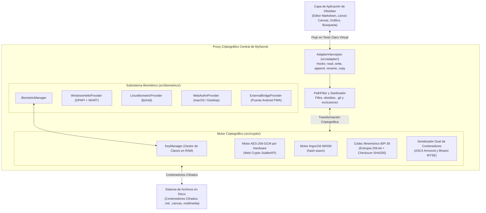

# MySecret — Manual de Arquitectura y Desarrollo Exhaustivo

[English Version](DEVELOPER_GUIDE.md) • **Español**

Bienvenido al **Manual de Programador y Arquitectura de MySecret**. Esta referencia técnica proporciona una guía profunda y detallada sobre la arquitectura interna, algoritmos criptográficos, mecanismos de intercepción de archivos, subsistemas biométricos y pipelines de prueba del plugin MySecret para Obsidian.

---

## Tabla de Contenidos

1. [Visión General de Arquitectura y Topología](#1-visión-general-de-arquitectura-y-topología)
2. [Estructura del Código Fuente](#2-estructura-del-código-fuente)
3. [Motor de Intercepción de Archivos (`src/adapter/`)](#3-motor-de-intercepción-de-archivos)
   - [Técnica de Monkey-patching sobre `VaultAdapter`](#técnica-de-monkey-patching-sobre-vaultadapter)
   - [Lógica de Filtrado y Rutas Excluidas](#lógica-de-filtrado-y-rutas-excluidas)
   - [Normalización de Rutas y Enlace AAD Estricto](#normalización-de-rutas-y-enlace-aad-estricto)
4. [Pipeline Criptográfico y Formatos de Contenedor (`src/crypto/`)](#4-pipeline-criptográfico-y-formatos-de-contenedor)
   - [Jerarquía de Claves y Derivación](#jerarquía-de-claves-y-derivación)
   - [Formatos de Contenedor (Texto Blindado vs. Binario)](#formatos-de-contenedor)
   - [Integración de Argon2id en WebAssembly](#integración-de-argon2id-en-webassembly)
   - [Generador Mnemónico BIP-39 y Checksum](#generador-mnemónico-bip-39-y-checksum)
   - [Patrones de Zeroización de Memoria](#patrones-de-zeroización-de-memoria)
5. [Subsistema Biométrico Multiplataforma (`src/biometrics/`)](#5-subsistema-biométrico-multiplataforma)
   - [Matriz de Proveedores](#matriz-de-proveedores)
   - [Integración de Windows Hello y DPAPI](#integración-de-windows-hello-y-dpapi)
   - [Integración en Linux con fprintd / SecretService](#integración-en-linux-con-fprintd--secretservice)
   - [Protocolo v2 del Puente WebAuthn para Android](#protocolo-v2-del-puente-webauthn-para-android)
6. [Motor de Respaldo y Sanitización de Seguridad (`src/backup/`)](#6-motor-de-respaldo-y-sanitización-de-seguridad)
   - [Mitigación contra Zip Slip y Path Traversal](#mitigación-contra-zip-slip-y-path-traversal)
   - [Respaldos en la Nube (WebDAV, Google Drive, OneDrive)](#respaldos-en-la-nube)
7. [Sistema de Internacionalización (`src/i18n/`)](#7-sistema-de-internacionalización)
8. [Pipeline de Compilación y Suite de Pruebas](#8-pipeline-de-compilación-y-suite-de-pruebas)
   - [Configuración de esbuild](#configuración-de-esbuild)
   - [Suite Automatizada con `obsidian-stub.mjs`](#suite-automatizada)
9. [Especificación de Descifrado Independiente (Python, Node.js y Web Crypto)](#9-especificación-de-descifrado-independiente)
10. [Convenciones de Código y Contribución](#10-convenciones-de-código-y-contribución)

---

## 1. Visión General de Arquitectura y Topología

MySecret actúa como un proxy criptográfico transparente en memoria entre la capa de interfaz de usuario de Obsidian y el sistema de ficheros del sistema operativo:



---

## 2. Estructura del Código Fuente

```
Github/
├── .github/workflows/         # CI/CD: Flujo de release para compilar bundles en tags Git
├── auth-bridge/               # PWA WebAuthn independiente para Android (HTML, JS, CSS, SW)
├── src/
│   ├── adapter/               # Intercepción de adaptadores de archivos y filtrado
│   │   ├── adapter-interceptor.ts   # Monkey-patching de app.vault.adapter
│   │   ├── media-manager.ts         # Gestor de URLs/blobs en RAM para adjuntos
│   │   └── path-filter.ts           # Reglas de exclusión de carpetas del sistema
│   ├── backup/                # Motor de copias de seguridad y sincronización en la nube
│   │   ├── backup-engine.ts         # Generación de ZIPs y restauración segura
│   │   └── cloud/                   # Conectores para WebDAV, Google Drive y OneDrive
│   ├── biometrics/            # Proveedores biométricos multiplataforma
│   │   ├── biometric-manager.ts     # Selector de plataforma y orquestador
│   │   ├── bridge-url.ts            # Sanitizador y validador de URLs de Cloudflare
│   │   ├── device-storage.ts        # Almacenamiento seguro local del dispositivo
│   │   ├── external-bridge-provider.ts # Orquestador del puente Android ECDH P-256
│   │   ├── kdf.ts                   # Derivaciones HKDF y sobre biométrico
│   │   ├── linux-provider.ts        # Integración con fprintd en Linux
│   │   ├── rp-id.ts                 # Cálculo del Relying Party ID fijado
│   │   ├── system-exec.ts           # Ejecutor seguro de subprocesos sin shell injection
│   │   ├── types.ts                 # Contratos y tipos biométricos
│   │   ├── webauthn-assertion.ts    # Verificador de firma WebAuthn
│   │   ├── webauthn-provider.ts     # Proveedor estándar WebAuthn de escritorio
│   │   └── windows-provider.ts      # Windows Hello UserConsentVerifier + DPAPI
│   ├── crypto/                # Algoritmos criptográficos puros y ciclo de claves
│   │   ├── aes.ts                   # Cifrado simétrico autenticado AES-256-GCM con AAD
│   │   ├── argon2.ts                # Wrapper WebAssembly para Argon2id
│   │   ├── bip39.ts                 # Generador, validador y derivador BIP-39
│   │   ├── envelope.ts              # Serializadores para formatos de texto y binario
│   │   ├── key-manager.ts           # Ciclo de vida y estado global de la clave
│   │   └── wordlist-english.ts      # Diccionario oficial de 2048 palabras BIP-39
│   ├── i18n/                  # Sistema de traducción multilingüe
│   │   ├── index.ts                 # Selector de idioma y motor de interpolación
│   │   ├── types.ts                 # Esquema fuertemente tipado de i18n
│   │   └── locales/                 # Diccionarios: en.ts, es.ts, ru.ts, zh.ts
│   ├── ui/                    # Modales, vistas y componentes de interfaz
│   │   ├── lock-screen.ts           # Pantalla de bloqueo modal con glassmorphism
│   │   ├── setup-wizard.ts          # Asistente de bienvenida en 3 pasos
│   │   ├── migration-modal.ts       # Modal de cifrado/descifrado masivo de bóveda
│   │   ├── settings-tab.ts          # Pestaña integral de configuración
│   │   └── ...                      # Modales de exportación, restauración y carpetas
│   ├── utils/                 # Utilidades defensivas y sanitizadores
│   │   ├── buffer.ts                # Conversiones de buffers sin asignación extra (Hex/Base64)
│   │   ├── credential-store.ts      # Almacén cifrado en reposo para credenciales de nube
│   │   ├── http.ts                  # Cliente HTTP con aislamiento estricto de buffers
│   │   ├── path-sanitizer.ts        # Bloqueador de Zip Slip y Directory Traversal
│   │   ├── sha256.ts                # Utilidades SHA-256
│   │   └── zeroize.ts               # Limpiador de memoria RAM criptográfico
│   ├── constants.ts           # Constantes del sistema, límites y cabeceras mágicas
│   ├── main.ts                # Punto de entrada del Plugin y registro de comandos
│   └── types.ts               # Contratos y tipos globales
└── tests/                     # Suites de pruebas automatizadas y de seguridad
```

---

## 3. Motor de Intercepción de Archivos

### Técnica de Monkey-patching sobre `VaultAdapter`
Obsidian interactúa con el sistema de almacenamiento mediante `app.vault.adapter` (instancia de `DataAdapter`). Al iniciarse el plugin (`src/adapter/adapter-interceptor.ts`), MySecret intercepta los métodos primarios del adaptador:

- `read(path: string): Promise<string>`
- `write(path: string, data: string): Promise<void>`
- `readBinary(path: string): Promise<ArrayBuffer>`
- `writeBinary(path: string, data: ArrayBuffer): Promise<void>`
- `append(path: string, data: string): Promise<void>`
- `appendBinary(path: string, data: ArrayBuffer): Promise<void>`
- `rename(normalizedPath: string, normalizedNewPath: string): Promise<void>`
- `copy(normalizedPath: string, normalizedNewPath: string): Promise<void>`

Cuando Obsidian solicita escribir un archivo, el interceptor evalúa `pathFilter.shouldEncrypt(path)`. Si el archivo debe cifrarse y la bóveda está desbloqueada, procesa los datos en memoria mediante `encryptNote()` o `encryptBinary()` y escribe el contenedor resultante en disco.

### Lógica de Filtrado y Rutas Excluidas
Hay rutas críticas que **jamás** deben cifrarse:
- `.obsidian/`: Ajustes de plugins, temas, espacios de trabajo y atajos. Cifrar esta carpeta dañaría el entorno de ejecución de Obsidian.
- `.git/`, `.trash/`: Metadatos de control de versiones y papelera.
- Carpetas excluidas por el usuario: Configurables en la interfaz de ajustes.

### Normalización de Rutas y Enlace AAD Estricto
Para evitar ataques de sustitución de archivos (donde un adversario reemplaza un archivo cifrado en una carpeta por otro de una ruta distinta), MySecret vincula la ruta relativa como Datos Asociados Autenticados (AAD) en el cifrado AES-256-GCM:

```typescript
export function normalizeAadPath(vaultRelativePath: string): Uint8Array {
  const normalized = vaultRelativePath.normalize('NFC').replace(/\\/g, '/');
  return new TextEncoder().encode(normalized);
}
```

Al renombrar o copiar archivos mediante `rename()` o `copy()`, el interceptor descifra el archivo con el AAD de la ruta anterior y lo re-encripta atómicamente con el AAD de la nueva ruta.

---

## 4. Pipeline Criptográfico y Formatos de Contenedor

### Jerarquía de Claves y Derivación

```
[Contraseña Maestra] ──► Argon2id (Sal, Memoria=64MB, Iteraciones=3) ──► [Clave Maestra]
                                                                               │
                                                                   Desenvoltura AES-256-GCM
                                                                               ▼
[Entropía Aleatoria 256-bit] ──────────────────────────────────────────► [Clave de Bóveda]
         │                                                                     │
         ▼                                                       Cifrado AES-256-GCM de Notas
[24 Palabras BIP-39] ──► PBKDF2-HMAC-SHA512 ──► Clave de Auxilio ──────────────┘
```

1. **Clave de Bóveda (`vaultKey`):** Clave de 256 bits generada aleatoriamente al inicializar la bóveda. Permanece constante y se usa para cifrar todos los archivos.
2. **Clave Maestra (`masterKey`):** Derivada de la contraseña maestra del usuario mediante Argon2id. Se usa exclusivamente para envolver/desenvolver la `vaultKey`.
3. **Cambio de Contraseña:** Cambiar la contraseña solo requiere derivar una nueva `masterKey` y volver a envolver la `vaultKey`. Los archivos en disco no requieren re-cifrado.

### Formatos de Contenedor

#### 1. Contenedor de Texto (Notas Markdown y Canvases)
```http
-----BEGIN MYSECRET ENCRYPTED FILE-----
Version: 1
IV: <24 caracteres hexadecimales: IV de 12 bytes>
Tag: <32 caracteres hexadecimales: Tag de Autenticación de 16 bytes>

<Payload cifrado codificado en Base64>
-----END MYSECRET ENCRYPTED FILE-----
```

#### 2. Contenedor Binario (Imágenes, PDFs, Audio, Video)
Cabecera binaria compacta de 32 bytes antepuesta a los bytes cifrados:
- Bytes 0–3: Bytes mágicos ASCII `0x4D 0x59 0x53 0x45` (`MYSE`)
- Byte 4: Versión del contenedor (`0x01`)
- Bytes 5–16: Vector de Inicialización (IV) de 12 bytes
- Bytes 17–32: Tag de Autenticación AES-GCM de 16 bytes
- Bytes 33+: Bytes de texto cifrado en bruto

### Integración de Argon2id en WebAssembly
MySecret utiliza la librería `hash-wasm` para ejecutar Argon2id compilado en WebAssembly:
```typescript
import { argon2id } from 'hash-wasm';

export async function deriveKeyArgon2id(password: Uint8Array, salt: Uint8Array): Promise<Uint8Array> {
  return await argon2id({
    password,
    salt,
    parallelism: 1,
    iterations: 3,
    memorySize: 65536, // 64 MB
    hashLength: 32,    // 256 bits
    outputType: 'binary'
  });
}
```

### Patrones de Zeroización de Memoria
Para mitigar ataques de inspección de memoria RAM, todos los buffers que contienen claves o secretos se sobrescriben con ceros mediante `zeroize()`:

```typescript
export function zeroize(buffer: Uint8Array | ArrayBuffer | null | undefined): void {
  if (!buffer) return;
  const view = buffer instanceof ArrayBuffer ? new Uint8Array(buffer) : buffer;
  view.fill(0);
}
```

---

## 5. Subsistema Biométrico Multiplataforma

### Windows Hello y DPAPI
`WindowsHelloProvider` ejecuta scripts de PowerShell comunicados exclusivamente por `stdin` (`-Command -`). Valida la presencia del usuario mediante `Windows.Security.Credentials.UI.UserConsentVerifier` y cifra el token biométrico utilizando la API de Protección de Datos de Windows (DPAPI).

### Protocolo v2 del Puente WebAuthn para Android
En Android, MySecret sortea las restricciones del WebView coordinando un flujo criptográfico fuera de banda con un PWA en Cloudflare Pages:

1. **Obsidian -> Navegador:** Obsidian abre el navegador móvil con una URL que contiene la clave pública efímera ECDH:
   `https://<tu-proyecto>.pages.dev/#session=<id>&action=verify&pubKey=<ecdh_pub>&salt=<salt>&vb=<vault_binding>`
2. **Ceremonia ECDH P-256:** El puente web genera un par de claves P-256, calcula el secreto compartido, deriva una clave de sesión mediante HKDF-SHA256 y solicita la huella con `navigator.credentials.get()`.
3. **Verificación de Aserción:** El puente retorna la firma WebAuthn a Obsidian mediante el protocolo `obsidian://mysecret-auth`. Obsidian verifica la firma directamente contra la clave pública de la credencial registrada.

---

## 6. Motor de Respaldo y Sanitización

El módulo `BackupEngine` crea instantáneas completas en archivos ZIP utilizando `fflate`.

### Mitigación contra Zip Slip
Al restaurar, cada ruta dentro del ZIP se valida con `sanitizeVaultRelativePath()`:
- Segmentos que contienen `..` son rechazados de inmediato.
- Rutas absolutas (`/` o `C:\`) son bloqueadas.
- Carpetas ocultas que empiezan por `.` (como `.obsidian/plugins/`) son filtradas para impedir la inyección de plugins maliciosos.
- Los diccionarios se crean con prototipo nulo (`Object.create(null)`) contra ataques de Prototype Pollution.

---

## 7. Pipeline de Compilación y Suite de Pruebas

### Configuración de esbuild
El proyecto se compila mediante `esbuild.config.mjs`:
- Genera código optimizado para ES2022 con minificación para producción.
- La API de Obsidian (`obsidian`) y módulos internos de Node se configuran como externos (`external`).

### Suite Automatizada con `obsidian-stub.mjs`
Las pruebas se ejecutan directamente con el test runner nativo de Node.js (`node --test`). Como la API de Obsidian no está en Node.js, `tests/obsidian-stub.mjs` proporciona un simulador completo en memoria del adaptador de archivos, la plataforma y el ciclo de vida del plugin.

Para ejecutar las 81 pruebas:
```bash
npm test
```

---

## 9. Especificación de Descifrado Independiente (Python, Node.js y Web Crypto)

MySecret está deliberadamente diseñado para garantizar **cero dependencia de proveedor (Zero Vendor Lock-in)**. Cualquier lenguaje de programación con primitivas criptográficas estándar puede descifrar los archivos sin depender de Obsidian ni del plugin.

### Parámetros Criptográficos Estándar
- **Algoritmo:** `AES-256-GCM` (NIST SP 800-38D).
- **Longitud de Clave:** 32 bytes (256 bits).
- **Vector de Inicialización (IV):** 12 bytes (96 bits).
- **Tag de Autenticación:** 16 bytes (128 bits).
- **Datos Asociados Autenticados (AAD):** Ruta relativa normalizada en UTF-8 (`vaultRelativePath.normalize('NFC').replace(/\\/g, '/')`).
- **Derivación BIP-39:** PBKDF2 con HMAC-SHA512, sal `mnemonic` (o `mnemonic + passphrase`), 2048 iteraciones, longitud de salida 32 bytes.

### 🐍 Receta en Python (usando `cryptography`)
```python
import base64
import unicodedata
from cryptography.hazmat.primitives.ciphers.aead import AESGCM
from cryptography.hazmat.primitives.kdf.pbkdf2 import PBKDF2HMAC
from cryptography.hazmat.primitives import hashes

def decrypt_file(armored_text: str, relative_path: str, mnemonic: str) -> str:
    # 1. Derivar clave de 32 bytes desde la frase BIP-39
    clean_mnemonic = unicodedata.normalize("NFKD", mnemonic.strip().lower()).encode("utf-8")
    salt = unicodedata.normalize("NFKD", "mnemonic").encode("utf-8")
    kdf = PBKDF2HMAC(algorithm=hashes.SHA512(), length=32, salt=salt, iterations=2048)
    key = kdf.derive(clean_mnemonic)

    # 2. Extraer IV, Tag y Ciphertext del contenedor ASCII
    lines = [line.strip() for line in armored_text.splitlines() if line.strip()]
    iv_b64 = [l.split(":", 1)[1].strip() for l in lines if l.startswith("IV:")][0]
    tag_b64 = [l.split(":", 1)[1].strip() for l in lines if l.startswith("Tag:")][0]
    body_lines = [l for l in lines if not l.startswith("-----") and not ":" in l]
    
    iv = base64.b64decode(iv_b64)
    tag = base64.b64decode(tag_b64)
    ciphertext = base64.b64decode("".join(body_lines))

    # 3. AAD = ruta relativa normalizada en NFC
    aad = unicodedata.normalize("NFC", relative_path.replace("\\", "/")).encode("utf-8")

    # 4. Descifrado AES-256-GCM (en cryptography, ciphertext y tag se concatenan)
    aesgcm = AESGCM(key)
    plaintext_bytes = aesgcm.decrypt(iv, ciphertext + tag, aad)
    return plaintext_bytes.decode("utf-8")
```

### ⚡ Receta en Node.js (usando módulo nativo `crypto`)
```javascript
const crypto = require('crypto');

function decryptFileNode(ivB64, tagB64, cipherB64, relativePath, vaultKey32Bytes) {
  const iv = Buffer.from(ivB64, 'base64');
  const tag = Buffer.from(tagB64, 'base64');
  const ciphertext = Buffer.from(cipherB64, 'base64');
  const aad = Buffer.from(relativePath.normalize('NFC').replace(/\\/g, '/'), 'utf8');

  const decipher = crypto.createDecipheriv('aes-256-gcm', vaultKey32Bytes, iv);
  decipher.setAAD(aad);
  decipher.setAuthTag(tag);

  const decrypted = Buffer.concat([decipher.update(ciphertext), decipher.final()]);
  return decrypted.toString('utf8');
}
```

### 🌐 Herramientas Standalone Incluidas en el Repositorio
- `tools/standalone-decryptor.py`: Script de línea de comandos en Python para descifrar toda la bóveda o notas individuales en lote.
- `tools/offline-decryptor.html`: Herramienta gráfica web que se ejecuta en cualquier navegador sin conexión a internet mediante la Web Crypto API nativa.

---

## 10. Convenciones de Código y Contribución

1. **Tipado Estricto:** Obligatorio el uso de TypeScript en modo estricto (`tsconfig.json`).
2. **Programación Defensiva:** Validar y sanitizar siempre rutas y límites antes de cualquier operación de I/O.
3. **Sin Secretos en Git:** Jamás confirmar credenciales, URLs privadas ni contraseñas en el repositorio.
4. **Pull Requests:** Verificar que las 81 pruebas pasen y agregar pruebas de regresión ante cualquier cambio en el motor criptográfico o en el adaptador.
