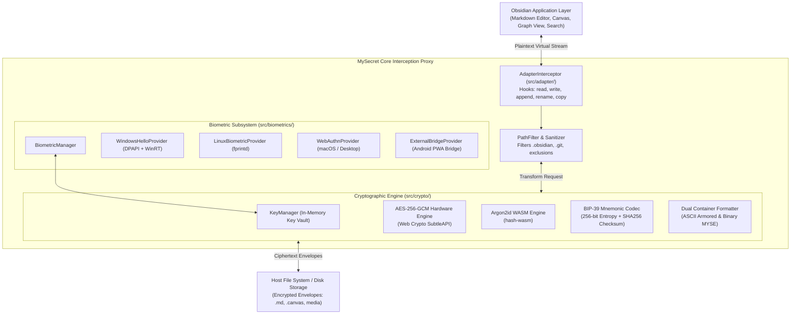

# MySecret — Comprehensive Developer & Architecture Manual

**English** • [Versión en Español](DEVELOPER_GUIDE.es.md)

Welcome to the **MySecret Developer Manual**. This technical reference provides an exhaustive guide to the internal architecture, cryptographic algorithms, file adapter interception mechanisms, biometric subsystems, and testing pipelines of the MySecret Obsidian plugin.

---

## Table of Contents

1. [Architectural Overview & System Topology](#1-architectural-overview--system-topology)
2. [Source Code Directory Structure](#2-source-code-directory-structure)
3. [File Interception Engine (`src/adapter/`)](#3-file-interception-engine)
   - [Monkey-patching `VaultAdapter`](#monkey-patching-vaultadapter)
   - [Path Filtering & Exclusion Logic](#path-filtering--exclusion-logic)
   - [Path Normalization & Strict AAD Binding](#path-normalization--strict-aad-binding)
4. [Cryptographic Pipeline & Container Specs (`src/crypto/`)](#4-cryptographic-pipeline--container-specs)
   - [Key Hierarchy & Derivation Flow](#key-hierarchy--derivation-flow)
   - [Envelope Formats (Armored Text vs. Binary)](#envelope-formats)
   - [Argon2id WASM Integration](#argon2id-wasm-integration)
   - [BIP-39 Mnemonic Generator & Checksum](#bip-39-mnemonic-generator--checksum)
   - [Memory Zeroization Patterns](#memory-zeroization-patterns)
5. [Biometric Architecture (`src/biometrics/`)](#5-biometric-architecture)
   - [Provider Matrix](#provider-matrix)
   - [Windows Hello & DPAPI Integration](#windows-hello--dpapi-integration)
   - [Linux SecretService / fprintd Integration](#linux-secretservice--fprintd-integration)
   - [Android WebAuthn Bridge Protocol v2](#android-webauthn-bridge-protocol-v2)
6. [Backup Engine & Security Sanitization (`src/backup/`)](#6-backup-engine--security-sanitization)
   - [Zip Slip & Path Traversal Mitigations](#zip-slip--path-traversal-mitigations)
   - [Remote Cloud Backups (WebDAV, Google Drive, OneDrive)](#remote-cloud-backups)
7. [Internationalization System (`src/i18n/`)](#7-internationalization-system)
8. [Build Pipeline & Automated Testing](#8-build-pipeline--automated-testing)
   - [esbuild Configuration](#esbuild-configuration)
   - [Automated Test Suite with `obsidian-stub.mjs`](#automated-test-suite)
9. [Standalone Decryption Specification (Python, Node.js & Web Crypto)](#9-standalone-decryption-specification)
10. [Code Conventions & Contributing](#10-code-conventions--contributing)

---

## 1. Architectural Overview & System Topology

MySecret acts as an in-memory transparent cryptographic proxy between Obsidian's application layer and the underlying operating system filesystem:



---

## 2. Source Code Directory Structure

```
Github/
├── .github/workflows/         # CI/CD: Release workflow compiling bundles on Git tags
├── auth-bridge/               # Standalone WebAuthn PWA for Android (HTML, JS, CSS, SW, Manifest)
├── src/
│   ├── adapter/               # Obsidian vault adapter interception and path filtering
│   │   ├── adapter-interceptor.ts   # Core monkey-patching of app.vault.adapter
│   │   ├── media-manager.ts         # In-memory blob/URL manager for media attachments
│   │   └── path-filter.ts           # Filtering rules for vault files vs. system dotfiles
│   ├── backup/                # Vault archive engine and cloud sync providers
│   │   ├── backup-engine.ts         # Full vault snapshot zip generation and safe restore
│   │   └── cloud/                   # WebDAV, Google Drive, and OneDrive integrations
│   ├── biometrics/            # Multi-platform hardware authentication providers
│   │   ├── biometric-manager.ts     # Platform selector and lifecycle coordinator
│   │   ├── bridge-url.ts            # Sanitizer and validator for Cloudflare bridge URLs
│   │   ├── device-storage.ts        # Machine-local envelope storage
│   │   ├── external-bridge-provider.ts # Android ECDH P-256 WebAuthn bridge orchestrator
│   │   ├── kdf.ts                   # HKDF and biometric envelope derivations
│   │   ├── linux-provider.ts        # Linux fprintd / SecretService integration
│   │   ├── rp-id.ts                 # Pinned WebAuthn Relying Party ID calculation
│   │   ├── system-exec.ts           # Safe process runner without shell interpolation
│   │   ├── types.ts                 # Biometric contracts and envelope interfaces
│   │   ├── webauthn-assertion.ts    # WebAuthn cryptographic signature verifier
│   │   ├── webauthn-provider.ts     # Standard desktop WebAuthn provider
│   │   └── windows-provider.ts      # Windows Hello UserConsentVerifier + DPAPI
│   ├── crypto/                # Pure cryptographic algorithms and key lifecycle
│   │   ├── aes.ts                   # AES-256-GCM AEAD encryption/decryption with AAD
│   │   ├── argon2.ts                # WebAssembly Argon2id KDF wrapper
│   │   ├── bip39.ts                 # BIP-39 mnemonic generator, validator, and seed derivation
│   │   ├── envelope.ts              # Serializers/deserializers for armored & binary files
│   │   ├── key-manager.ts           # Global vault key lifecycle and session state
│   │   └── wordlist-english.ts      # Standard BIP-39 2048 English wordlist
│   ├── i18n/                  # Multi-language internationalization system
│   │   ├── index.ts                 # Locale selector, interpolation, and fallback logic
│   │   ├── types.ts                 # Strongly-typed i18n schema
│   │   └── locales/                 # Dictionaries: en.ts, es.ts, ru.ts, zh.ts
│   ├── ui/                    # Obsidian UI modals, views, and settings
│   │   ├── lock-screen.ts           # Fullscreen glassmorphic lock screen modal
│   │   ├── setup-wizard.ts          # 3-step interactive onboarding wizard
│   │   ├── migration-modal.ts       # Bulk vault encrypt/decrypt modal with progress
│   │   ├── settings-tab.ts          # Comprehensive plugin configuration tab
│   │   └── ...                      # Export, restore, folder-picker modals
│   ├── utils/                 # Utility functions and defensive sanitizers
│   │   ├── buffer.ts                # Zero-allocation buffer conversions (Hex, Base64)
│   │   ├── credential-store.ts      # At-rest encrypted storage for cloud credentials
│   │   ├── http.ts                  # Safe HTTP client enforcing isolated array buffers
│   │   ├── path-sanitizer.ts        # Zip Slip and directory traversal blocker
│   │   ├── sha256.ts                # SHA-256 helpers
│   │   └── zeroize.ts               # Cryptographic memory scrubber
│   ├── constants.ts           # Cryptographic bounds, version tags, and magic headers
│   ├── main.ts                # Obsidian Plugin entry point and command registry
│   └── types.ts               # Global plugin settings and type contracts
└── tests/                     # Automated unit and security test suites
```

---

## 3. File Interception Engine

### Monkey-patching `VaultAdapter`
Obsidian interacts with files through `app.vault.adapter` (an instance of `DataAdapter`, typically `FileSystemAdapter`). During plugin initialization (`src/adapter/adapter-interceptor.ts`), MySecret intercepts the core filesystem primitives:

- `read(path: string): Promise<string>`
- `write(path: string, data: string): Promise<void>`
- `readBinary(path: string): Promise<ArrayBuffer>`
- `writeBinary(path: string, data: ArrayBuffer): Promise<void>`
- `append(path: string, data: string): Promise<void>`
- `appendBinary(path: string, data: ArrayBuffer): Promise<void>`
- `rename(normalizedPath: string, normalizedNewPath: string): Promise<void>`
- `copy(normalizedPath: string, normalizedNewPath: string): Promise<void>`

When a write is requested, the interceptor checks `pathFilter.shouldEncrypt(path)`. If eligible and the vault is unlocked, it streams the plaintext through `encryptNote()` or `encryptBinary()`, writing the resulting ciphertext envelope to disk.

### Path Filtering & Exclusion Logic
Certain directories must **never** be encrypted:
- `.obsidian/`: Plugin settings, workspaces, themes, and hotkeys. Encrypting this directory would corrupt Obsidian's internal runtime.
- `.git/`, `.trash/`: Version control metadata and system trash folders.
- User-specified excluded folders: Configurable in plugin settings.

### Path Normalization & Strict AAD Binding
To prevent ciphertext swap attacks (where an attacker moves an encrypted file from `secret/passwords.md` to `public/readme.md`), MySecret binds the file path as Additional Authenticated Data (AAD) in the AES-256-GCM cipher:

```typescript
// Strict Unicode NFC Normalization prevents representation mismatch
export function normalizeAadPath(vaultRelativePath: string): Uint8Array {
  const normalized = vaultRelativePath.normalize('NFC').replace(/\\/g, '/');
  return new TextEncoder().encode(normalized);
}
```

When files are renamed or copied via `rename()` or `copy()`, the interceptor transparently decrypts the payload with the old path's AAD and re-encrypts it with the new path's AAD in a single atomic pass.

---

## 4. Cryptographic Pipeline & Container Specs

### Key Hierarchy & Derivation Flow

```
[Master Password] ─────► Argon2id (Salt, Memory=64MB, Iterations=3) ─────► [Master Key]
                                                                                │
                                                                   AES-256-GCM Key Unwrap
                                                                                ▼
[256-bit Random Entropy] ──────────────────────────────────────────────► [Vault Key (256-bit)]
         │                                                                      │
         ▼                                                         AES-256-GCM File Encryption
[BIP-39 24 Words] ───► PBKDF2-HMAC-SHA512 ───► Emergency Backup Key ───────────┘
```

1. **Vault Key (`vaultKey`):** A 256-bit cryptographically random key generated upon vault initialization. It remains static throughout the life of the vault and is used to encrypt all files.
2. **Master Key (`masterKey`):** Derived from the user's master password using Argon2id. It is used exclusively to wrap/unwrap the `vaultKey` inside the vault envelope (`data.json`).
3. **Password Changes:** Changing the master password only requires deriving a new `masterKey` and re-wrapping the `vaultKey`. No files on disk require re-encryption.

### Envelope Formats

#### 1. Text Container (Markdown Notes & Canvases)
```http
-----BEGIN MYSECRET ENCRYPTED FILE-----
Version: 1
IV: <24 hex characters: 12-byte IV>
Tag: <32 hex characters: 16-byte GCM Auth Tag>

<Base64-encoded ciphertext payload>
-----END MYSECRET ENCRYPTED FILE-----
```

#### 2. Binary Container (Images, PDFs, Audio, Video)
A compact 32-byte binary header directly prepended to raw ciphertext bytes:
- Bytes 0–3: ASCII Magic Bytes `0x4D 0x59 0x53 0x45` (`MYSE`)
- Byte 4: Envelope Version byte (`0x01`)
- Bytes 5–16: 12-byte Initialization Vector (IV)
- Bytes 17–32: 16-byte AES-GCM Authentication Tag
- Bytes 33+: Raw AES-256-GCM Ciphertext

### Argon2id WASM Integration
MySecret leverages `hash-wasm` to execute compiled WebAssembly Argon2id in the renderer thread:
```typescript
import { argon2id } from 'hash-wasm';

export async function deriveKeyArgon2id(password: Uint8Array, salt: Uint8Array): Promise<Uint8Array> {
  const hash = await argon2id({
    password,
    salt,
    parallelism: 1,
    iterations: 3,
    memorySize: 65536, // 64 MB
    hashLength: 32,    // 256 bits
    outputType: 'binary'
  });
  return hash;
}
```

### Memory Zeroization Patterns
To protect against cold-boot attacks and RAM inspection, all sensitive typed arrays are actively scrubbed with zeros using `zeroize()`:

```typescript
export function zeroize(buffer: Uint8Array | ArrayBuffer | null | undefined): void {
  if (!buffer) return;
  const view = buffer instanceof ArrayBuffer ? new Uint8Array(buffer) : buffer;
  view.fill(0);
}
```
This is systematically called in `finally` blocks across all key derivation, authentication, and lock workflows.

---

## 5. Biometric Architecture

The `BiometricManager` coordinates platform-specific biometric implementations:

### Windows Hello & DPAPI Integration
`WindowsHelloProvider` executes a dedicated PowerShell invocation piped via stdin (`-Command -`). It verifies user presence through `Windows.Security.Credentials.UI.UserConsentVerifier` and protects the wrapped biometric token using Windows Data Protection API (DPAPI).

### Android WebAuthn Bridge Protocol v2
Because Obsidian Mobile on Android runs within an Android WebView lacking WebAuthn APIs, MySecret executes an out-of-band cryptographic ceremony via a Cloudflare Pages PWA:

1. **Obsidian -> Browser:** Obsidian launches the external browser with an intent URL:
   `https://<your-project>.pages.dev/#session=<id>&action=verify&pubKey=<ecdh_pub>&salt=<salt>&vb=<vault_binding>`
2. **ECDH P-256 Ceremony:** The browser bridge generates an ephemeral P-256 key pair, computes a shared secret with Obsidian's public key, derives a key via HKDF-SHA256, and invokes `navigator.credentials.get()`.
3. **Assertion Verification:** The browser returns the signed WebAuthn assertion back to Obsidian via custom URI scheme `obsidian://mysecret-auth`. Obsidian verifies the cryptographic signature directly against the registered public key.

---

## 6. Backup Engine & Security Sanitization

The `BackupEngine` creates full snapshot ZIP archives of the vault using `fflate`.

### Zip Slip Defense
During restoration, every archive entry path is validated through `sanitizeVaultRelativePath()`:
- Segments equal to `..` are strictly rejected.
- Absolute paths (`/` or `C:\`) are blocked.
- Hidden paths beginning with `.` (such as `.obsidian/plugins/`) are blocked, preventing malicious archives from dropping arbitrary executable code.
- Object prototypes are preserved using `Object.create(null)` to eliminate prototype pollution.

---

## 7. Build Pipeline & Automated Testing

### esbuild Configuration
The project compiles via `esbuild.config.mjs`:
- Production builds target ES2022 with bundle minification.
- Obsidian API (`obsidian`) and Node built-in modules (`electron`, `crypto`, `fs`, `path`) are marked as external.

### Automated Test Suite
Tests execute using Node.js's native test runner (`node --test`). Because the Obsidian API is an external dependency, `tests/obsidian-stub.mjs` provides a comprehensive, lightweight in-memory mock of `DataAdapter`, `Platform`, and plugin lifecycle interfaces.

To run the complete suite of 81 tests:
```bash
npm test
```

---

## 9. Standalone Decryption Specification (Python, Node.js & Web Crypto)

MySecret is engineered from the ground up for **Zero Vendor Lock-in**. Any programming language or platform supporting standard cryptographic primitives can independently decrypt vault notes and attachments without Obsidian installed.

### Cryptographic Parameters
- **Algorithm:** `AES-256-GCM` (NIST SP 800-38D).
- **Key Length:** 32 bytes (256 bits).
- **Initialization Vector (IV):** 12 bytes (96 bits).
- **Authentication Tag:** 16 bytes (128 bits).
- **Additional Authenticated Data (AAD):** Normalized UTF-8 relative vault path (`vaultRelativePath.normalize('NFC').replace(/\\/g, '/')`).
- **BIP-39 Derivation:** PBKDF2 with HMAC-SHA512, salt `mnemonic` (or `mnemonic + passphrase`), 2048 iterations, output length 32 bytes.

### 🐍 Python Decryption Recipe (`cryptography`)
```python
import base64
import unicodedata
from cryptography.hazmat.primitives.ciphers.aead import AESGCM
from cryptography.hazmat.primitives.kdf.pbkdf2 import PBKDF2HMAC
from cryptography.hazmat.primitives import hashes

def decrypt_file(armored_text: str, relative_path: str, mnemonic: str) -> str:
    # 1. Derive 32-byte key from 24-word BIP-39 phrase
    clean_mnemonic = unicodedata.normalize("NFKD", mnemonic.strip().lower()).encode("utf-8")
    salt = unicodedata.normalize("NFKD", "mnemonic").encode("utf-8")
    kdf = PBKDF2HMAC(algorithm=hashes.SHA512(), length=32, salt=salt, iterations=2048)
    key = kdf.derive(clean_mnemonic)

    # 2. Extract IV, Tag, and Ciphertext from the ASCII envelope
    lines = [line.strip() for line in armored_text.splitlines() if line.strip()]
    iv_b64 = [l.split(":", 1)[1].strip() for l in lines if l.startswith("IV:")][0]
    tag_b64 = [l.split(":", 1)[1].strip() for l in lines if l.startswith("Tag:")][0]
    body_lines = [l for l in lines if not l.startswith("-----") and not ":" in l]
    
    iv = base64.b64decode(iv_b64)
    tag = base64.b64decode(tag_b64)
    ciphertext = base64.b64decode("".join(body_lines))

    # 3. AAD = NFC-normalized relative path
    aad = unicodedata.normalize("NFC", relative_path.replace("\\", "/")).encode("utf-8")

    # 4. Decrypt via standard AES-256-GCM (in cryptography, ciphertext + tag are concatenated)
    aesgcm = AESGCM(key)
    plaintext_bytes = aesgcm.decrypt(iv, ciphertext + tag, aad)
    return plaintext_bytes.decode("utf-8")
```

### ⚡ Node.js Decryption Recipe (Native `crypto` Module)
```javascript
const crypto = require('crypto');

function decryptFileNode(ivB64, tagB64, cipherB64, relativePath, vaultKey32Bytes) {
  const iv = Buffer.from(ivB64, 'base64');
  const tag = Buffer.from(tagB64, 'base64');
  const ciphertext = Buffer.from(cipherB64, 'base64');
  const aad = Buffer.from(relativePath.normalize('NFC').replace(/\\/g, '/'), 'utf8');

  const decipher = crypto.createDecipheriv('aes-256-gcm', vaultKey32Bytes, iv);
  decipher.setAAD(aad);
  decipher.setAuthTag(tag);

  const decrypted = Buffer.concat([decipher.update(ciphertext), decipher.final()]);
  return decrypted.toString('utf8');
}
```

### 🌐 Standalone Tools Included in Repository
- `tools/standalone-decryptor.py`: Complete Python CLI utility to batch-decrypt an entire vault or single files using a master password or 24-word phrase.
- `tools/offline-decryptor.html`: Pure HTML/JS browser utility executing native Web Crypto API offline in any desktop or mobile browser.

---

## 10. Code Conventions & Contributing

1. **TypeScript Strictness:** Strict null checks and explicit typings are mandatory (`tsconfig.json`).
2. **Defensive Coding:** Never assume input files or archive entries are safe. Always sanitize paths and validate bounds.
3. **Zero Secrets in Git:** Never commit API keys, personal endpoints, or unencrypted test credentials.
4. **Pull Requests:** Ensure all 81 automated tests pass and add regression unit tests for any new cryptographic or adapter features.
