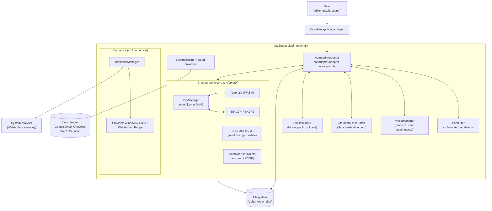

# MySecret — Comprehensive Developer & Architecture Guide

**English** • [Versión en Español](DEVELOPER_GUIDE.es.md)

Welcome to the **MySecret Developer & Architecture Guide**: the complete engineering reference for the
`obsidian-mysecret` plugin — a transparent, at-rest encryption layer for Obsidian vaults.

This document is written for engineers who will **modify, review, audit or extend** the plugin.

> 📖 **Looking for the step-by-step user manual?** See the **[User Manual (USER_GUIDE.md)](USER_GUIDE.md)** ([Versión en Español](USER_GUIDE.es.md)).  
> 🛡️ **Looking for the threat model or formal audit?** See **[SECURITY.md](SECURITY.md)** and **[SECURITY_AUDIT.md](SECURITY_AUDIT.md)**.

Its job is to make the *actual* code legible: where each responsibility lives, which invariants a change must not break, how to build and test deterministically, and how to decrypt a vault without Obsidian.

> **Provenance of this document.** Every statement below was verified against the source tree at
> **plugin version 1.0.6** (`package.json` / `manifest.json`). Code snippets are excerpts of the real
> implementation, not illustrations. Where the code and older documentation disagree, **the code wins** and
> the difference is called out explicitly in the section *"Corrections against previous revisions"*.

---

## Table of Contents

1. [Orientation: what MySecret is — and what it is not](#1-orientation-what-mysecret-is--and-what-it-is-not)
2. [Repository anatomy](#2-repository-anatomy)
3. [Build, run and test](#3-build-run-and-test)
4. [Runtime topology](#4-runtime-topology)
5. [Plugin lifecycle](#5-plugin-lifecycle)
6. [The interception engine (`src/adapter/`)](#6-the-interception-engine-srcadapter)
7. [The cryptographic core (`src/crypto/`)](#7-the-cryptographic-core-srccrypto)
8. [On-disk container formats](#8-on-disk-container-formats)
9. [The vault envelope (`vault-envelope.json`)](#9-the-vault-envelope-vault-envelopejson)
10. [Biometric subsystem (`src/biometrics/`)](#10-biometric-subsystem-srcbiometrics)
11. [Backup & restore engine (`src/backup/`)](#11-backup--restore-engine-srcbackup)
12. [Cloud providers & retention](#12-cloud-providers--retention)
13. [Internationalization (`src/i18n/`)](#13-internationalization-srcicn)
14. [UI layer (`src/ui/`)](#14-ui-layer-srcui)
15. [Publishing pipeline & release](#15-publishing-pipeline--release)
16. [The test suite](#16-the-test-suite)
17. [Standalone decryption (Python, Node.js, Web Crypto)](#17-standalone-decryption-python-nodejs-web-crypto)
18. [The ECHO Protocol package (`packages/echo-protocol/`)](#18-the-echo-protocol-package-packagesecho-protocol)
19. [Security invariants — the "do not break this" list](#19-security-invariants--the-do-not-break-this-list)
20. [Extension playbook](#20-extension-playbook)
21. [Troubleshooting](#21-troubleshooting)
22. [Known limitations (read before you promise anything)](#22-known-limitations-read-before-you-promise-anything)
23. [Appendix A — constants reference](#23-appendix-a--constants-reference)
24. [Appendix B — glossary](#24-appendix-b--glossary)
25. [Corrections against previous revisions](#25-corrections-against-previous-revisions)

---

## 1. Orientation: what MySecret is — and what it is not

### 1.1 The one-paragraph summary

MySecret is an Obsidian plugin that installs a **transparent cryptographic proxy** between Obsidian's file
API and the operating system's filesystem. From inside Obsidian, the user sees normal, readable notes; on disk,
every note, canvas and attachment is an authenticated ciphertext container. The master key never leaves the
device's RAM, and the plugin's own source code is published so that anyone can verify there is no backdoor.

### 1.2 What the plugin actually does

| Capability | Mechanism | Source of truth |
| :--- | :--- | :--- |
| Encrypt notes (`.md`, `.canvas`, `.txt`) | ASCII "armored" container, AES-256-GCM | `src/crypto/envelope.ts` |
| Encrypt attachments (images, PDF, audio…) | Compact binary container (`MYSE`), AES-256-GCM | `src/crypto/envelope.ts` |
| Bind ciphertext to its path | Path normalized to NFC is the AES-GCM **AAD** | `src/adapter/path-filter.ts` |
| Wrap the vault key with the user's password | Argon2id → AES-256-GCM, AAD `vault-envelope` | `src/crypto/key-manager.ts` |
| Offer a 24-word disaster-recovery phrase | BIP-39 mnemonic → PBKDF2-HMAC-SHA512 → AES-256-GCM, AAD `recovery-envelope` | `src/crypto/bip39.ts` |
| Unlock without typing the password | Platform biometric providers, or a WebAuthn bridge on mobile | `src/biometrics/` |
| Back up the vault | ZIP snapshots (`fflate`) to disk, Google Drive, OneDrive, WebDAV or a local folder | `src/backup/` |
| Keep Obsidian Sync safe | Decryption happens **only** in `Vault.readBinary`, never in `DataAdapter.readBinary` | `src/adapter/adapter-interceptor.ts` |

### 1.3 What the plugin is *not*

* **It is not a filesystem encryption tool.** Obsidian's own metadata cache, other plugins and the editor may
  still hold plaintext in RAM. The lock is a *UI lock* (see §22).
* **It is not a password manager.** The master password is never stored, hashed for verification or transmitted.
  It is used to *derive* a key that unwraps the vault key.
* **It is not multi-user.** One vault = one master key = one owner.
* **It is not ECHO Protocol.** See §18: the repository contains a second, independent biometric library
  (`packages/echo-protocol/`) that is **not** imported by the plugin. Do not confuse the two systems.

### 1.4 How to read this guide

| If you are… | Read first | Then |
| :--- | :--- | :--- |
| A new contributor | §2, §3 | §16 (how tests are written) |
| Reviewing a crypto change | §7, §8, §9, §19 | §22 |
| Touching the file hooks | §6 | §19 (invariants 1–8) |
| Building a new UI flow | §14 | §13 (every string goes through `t()`) |
| Auditing the plugin | §19 | §17 (independent decryption) |
| Shipping a release | §15 | §16 |

---

## 2. Repository anatomy

The working tree contains **three independent deliverables**. Confusing them is the most common source of
wasted time in this repository.

```text
MySecret/
├── src/                     ← (A) THE PLUGIN. The only thing that ships as main.js
├── tests/                   ← (A) Plugin test suite (node:test, no framework)
├── tools/                   ← (A) Standalone decryptors + publication sync script
├── auth-bridge/             ← (B) Static PWA deployed to Cloudflare Pages (mobile biometrics)
├── packages/echo-protocol/  ← (C) Independent Apache-2.0 library (NOT used by the plugin)
├── Github/                  ← (D) Publication mirror: a separate git repository
├── styles.css               # Plugin stylesheet (shipped as-is, never bundled)
├── manifest.json            # Obsidian plugin manifest
├── package.json             # Build/test scripts and dependencies
├── esbuild.config.mjs       # Bundler configuration
├── tsconfig.json            # TypeScript configuration
├── eslint.config.mjs        # ESLint flat config (see the caveat in §3.5)
├── main.js                  # Build artifact (committed; ~750 KB)
├── .github/workflows/       # CI: release, CodeQL, OSV-Scanner
├── SECURITY.md              # Security architecture + known limitations
├── SECURITY_AUDIT.md        # Full audit reports (very long; read before auditing)
├── USER_GUIDE.md            # End-user manual
├── DEVELOPER_GUIDE.md       # ← this file
└── COMPARISON.md            # Product comparison vs. other approaches
```

### 2.1 (A) The plugin source tree

```text
src/
├── main.ts                       # Plugin lifecycle, commands, settings, lock/unlock orchestration
├── constants.ts                  # Cryptographic parameters, magic bytes, hard bounds
├── types.ts                      # PluginSettings, VaultEnvelopeConfig, backup contracts
├── adapter/
│   ├── adapter-interceptor.ts    # ★ The core: monkey-patches DataAdapter + Vault.readBinary
│   ├── decrypt.ts                # Container detection & decryption helpers (shared)
│   ├── path-filter.ts            # Decides what is encrypted, and normalizes paths (the AAD)
│   ├── media-manager.ts          # Blob-URL media rendering, MutationObserver patching
│   ├── metadata-hash-patch.ts    # Aligns metadataCache hash with Obsidian Sync's hash
│   └── publish-guard.ts          # Blocks Obsidian Publish from uploading cleartext
├── crypto/
│   ├── aes.ts                    # AES-256-GCM wrapper over window.crypto.subtle
│   ├── argon2.ts                 # Argon2id (hash-wasm/WASM) + cost-parameter bounds
│   ├── bip39.ts                  # 24-word mnemonic generation, validation, PBKDF2
│   ├── envelope.ts               # Armored (text) and binary (MYSE) serializers
│   ├── hash.ts                   # SHA-256 hex, byte-compatible with Obsidian
│   ├── key-manager.ts            # Key lifecycle: init, unlock, lock, password change
│   └── wordlist-english.ts       # The 2048-word BIP-39 English wordlist
├── biometrics/
│   ├── biometric-manager.ts      # Provider selection + enrollment orchestration
│   ├── types.ts                  # BiometricProvider contract, envelope interface
│   ├── kdf.ts                    # HKDF-SHA256, biometric AAD, constant-time compare
│   ├── device-storage.ts         # localStorage envelope store, device identity
│   ├── windows-provider.ts       # Windows Hello + DPAPI (PowerShell over stdin)
│   ├── linux-provider.ts         # fprintd verification + Secret Service keyring
│   ├── webauthn-provider.ts      # Platform WebAuthn with PRF extension
│   ├── webauthn-assertion.ts     # WebAuthn assertion signature verification
│   ├── external-bridge-provider.ts # Mobile ceremony through an out-of-band PWA
│   ├── rp-id.ts                  # Registrable-domain computation (RP ID pinning)
│   ├── bridge-url.ts             # Bridge URL validation (HTTPS only)
│   └── system-exec.ts            # Shell-free process runner
├── backup/
│   ├── backup-engine.ts          # ZIP creation, restore, manifest
│   └── cloud/
│       ├── provider-interface.ts # CloudProvider contract
│       ├── index.ts              # createCloudProvider() factory
│       ├── google-drive.ts  onedrive.ts  webdav.ts  local-sync.ts
│       └── retention.ts           # Which old backups may be deleted
├── i18n/
│   ├── index.ts                  # Locale detection, t() lookup, interpolation
│   ├── types.ts                  # TranslationDictionary (strongly typed)
│   └── locales/                  # en.ts, es.ts, ru.ts, zh.ts
├── ui/
│   ├── settings-tab.ts           # Settings tab (8 headings)
│   ├── lock-screen.ts            # Unlock modal (password / recovery phrase / biometrics)
│   ├── setup-wizard.ts           # 3–4 step onboarding wizard
│   ├── migration-modal.ts        # Bulk encrypt / decrypt with progress
│   ├── export-modal.ts  restore-modal.ts  cloud-backup-modal.ts
│   ├── change-password-modal.ts  reauth-modal.ts  recovery-phrase-modal.ts
│   ├── folder-picker-modal.ts  assets.ts
└── utils/
    ├── buffer.ts                 # Hex/Base64/Base64URL conversions, constant-time compare
    ├── credential-store.ts       # At-rest encryption of cloud credentials
    ├── http.ts                   # requestUrl/fetch wrapper with URL scheme validation
    ├── path-sanitizer.ts         # Zip Slip / traversal rejection for untrusted paths
    ├── sha256.ts                 # Pure-JS SHA-256 (fallback when WebCrypto is absent)
    └── zeroize.ts                # Memory scrubbing
```

### 2.2 (B) The mobile bridge (`auth-bridge/`)

A dependency-free static PWA (HTML + CSS + JS + service worker) that performs the WebAuthn ceremony in a real
browser, where the embedded Obsidian WebView cannot. It contains **no secret material** and talks to Obsidian
over the `obsidian://mysecret-auth` custom scheme. Its `auth.js` is the browser half of the protocol
described in §10.4. The `_headers` file is applied automatically by Cloudflare Pages and is **required**
(it carries the CSP and anti-clickjacking headers — see §15.4).

### 2.3 (C) `packages/echo-protocol/`

A separately versioned Apache-2.0 library with its own `tsup` build, its own tests and its own documentation
(`packages/echo-protocol/DEVELOPER_GUIDE.md`, `SPECIFICATION.md`). It implements a generic out-of-band
biometric handshake with pluggable transports (deep link, postMessage, loopback).

> ⚠️ **The plugin does not use it.** There is not a single import from `packages/` anywhere in `src/`.
> The plugin's own biometric stack (`src/biometrics/` + `auth-bridge/`) is an *independent implementation*.
> If you are changing one, do not assume the other's invariants apply. See §18 for the differences.

### 2.4 (D) `Github/` — the publication mirror

`Github/` is a **separate git repository** containing the files that are actually published to users. It is
refreshed by `npm run sync:gh` (§15.2). Do not hand-edit files in `Github/`; they will be overwritten. The
only place where the mirror is intentionally *not* a copy is the tests: `tests/bundle-*.mjs` build artifacts are
excluded from the mirror.

---

## 3. Build, run and test

### 3.1 Prerequisites

| Requirement | Version | Notes |
| :--- | :--- | :--- |
| Node.js | **18+** (20 LTS recommended) | `node --test` and the native test runner are required |
| npm | 9+ | `npm ci` reproduces the lockfile exactly |
| Obsidian | 1.5.0+ | `minAppVersion` in `manifest.json` |

Runtime dependencies are intentionally tiny: **`fflate`** (ZIP) and **`hash-wasm`** (Argon2id in WASM). There
is no framework, no state manager and no crypto library — all primitives come from the platform
(`window.crypto.subtle`) or from WASM.

### 3.2 Common commands

```bash
npm install            # or: npm ci  (reproducible, what CI uses)
npm run dev            # esbuild in watch mode → main.js (inline sourcemaps)
npm run build          # production bundle → main.js (no sourcemap)
npm test               # bundle + run the whole suite with node:test
npm run sync:gh        # mirror the publishable files into Github/
```

### 3.3 `npm run dev` / `npm run build`

`esbuild.config.mjs` produces a **single CommonJS file** (`main.js`) that Obsidian loads directly:

```javascript
const context = await esbuild.context({
  entryPoints: ['src/main.ts'],
  bundle: true,
  external: [
    'obsidian', 'electron',
    '@codemirror/autocomplete', '@codemirror/collab', '@codemirror/commands',
    '@codemirror/language', '@codemirror/lint', '@codemirror/search',
    '@codemirror/state', '@codemirror/view',
    '@lezer/common', '@lezer/highlight', '@lezer/lr',
    ...builtinModules,
  ],
  format: 'cjs',
  target: 'es2020',
  logLevel: 'info',
  sourcemap: prod ? false : 'inline',
  treeShaking: true,
  outfile: 'main.js',
});
```

Points worth knowing:

* `obsidian` and the CodeMirror/Lezer packages are **external**: Obsidian provides them at runtime, so
  bundling them would duplicate the host's own copies.
* Node built-ins are external too, which is why desktop-only code paths must be guarded (see §10.2).
* `target: 'es2020'` is chosen for the Obsidian/Electron baseline; `es2022` features (top-level `await`,
  `.at()`) are **not** safe to use.
* `treeShaking: true` and no `minify` flag: the shipped `main.js` stays readable, which is deliberate for
  an auditable plugin.

### 3.4 Type checking

```bash
npx tsc --noEmit
```

`tsconfig.json` is strict where it matters for a security plugin:

```json
{
  "compilerOptions": {
    "module": "ESNext", "target": "ES6", "moduleResolution": "node",
    "noImplicitAny": true,
    "strictNullChecks": true,
    "isolatedModules": true,
    "importHelpers": true,
    "lib": ["DOM", "ES5", "ES6", "ES7", "ES2017", "ES2020", "ES2021", "ES2022"]
  },
  "include": ["src/**/*.ts"]
}
```

`strict` itself is **not** enabled, so `strictPropertyInitialization` is off — hence the common
`public settings!: PluginSettings;` definite-assignment assertions on the plugin class. New code should still
avoid `any` outside of the deliberate `as any` casts that bridge Obsidian's untyped internals.

### 3.5 ESLint — current status (read this before you rely on it)

`eslint.config.mjs` exists and is a standard flat config:

```javascript
export default tseslint.config(
  js.configs.recommended,
  ...tseslint.configs.recommended,
  {
    ignores: ["main.js", "node_modules/**", "Github/**", "backup/**", "tests/**", "tools/**"],
    rules: {
      "@typescript-eslint/no-explicit-any": "warn",
      "@typescript-eslint/no-unused-vars": ["warn", { "argsIgnorePattern": "^_" }],
      "no-console": "off"
    }
  }
);
```

However, **`eslint`, `@eslint/js` and `typescript-eslint` are not listed in `package.json` `devDependencies`**,
so a fresh `npm install` does not provide the linter binary. There is no `lint` script in `package.json`
either. Treat ESLint as *available configuration, not as an enforced gate*; `tsc --noEmit` plus `npm test` are
the gates that actually run today. (Adding the missing dev-dependencies is a small, self-contained
improvement — see §20.6.)

### 3.6 Running the plugin locally

1. `npm run dev` (watch mode).
2. Copy `main.js`, `manifest.json` and `styles.css` into
   `<vault>/.obsidian/plugins/mysecret/`.
3. Reload Obsidian (⌘/Ctrl+P → "Reload app without saving") and enable the plugin.

For mobile testing, deploy `auth-bridge/` (see `auth-bridge/README.md`) and paste the resulting
`https://<project>.pages.dev` URL into **Settings → MySecret → Biometrics**.

---

## 4. Runtime topology



### 4.1 The two-layer read model (the single most important design decision)

Obsidian exposes **two** APIs that can read a file, and MySecret treats them differently on purpose:

| Entry point | Who calls it | What MySecret returns |
| :--- | :--- | :--- |
| `DataAdapter.readBinary(path)` | **Obsidian Sync** (direct), plugins | **Raw ciphertext**, exactly as on disk |
| `Vault.readBinary(file)` | Metadata indexer, Obsidian Publish, the editor | **Plaintext** (decrypted in memory) |

The reason is in the code comments of `src/adapter/adapter-interceptor.ts` and it is worth repeating here,
because inverting it silently uploads plaintext to the user's cloud:

* If `DataAdapter.readBinary` decrypted, Sync would upload **cleartext** notes.
* Obsidian Publish reads through `Vault.readBinary`, so a `PublishGuard` is required to stop it from
  publishing cleartext to a public website (§10 of `SECURITY.md`).
* Decrypting at the `Vault` layer also fixes a real corruption bug: Sync downloads ciphertext and writes it
  back with `writeBinary`. If the write hook encrypted again, every synced file would become
  doubly-encrypted and permanently unreadable. `isAuthenticContainer()` (§6.6) prevents that.

The metadata indexer therefore sees plaintext (search, links, footnotes work), while Sync sees ciphertext
(cloud storage stays opaque).

---
## 5. Plugin lifecycle

`src/main.ts` (1 320 lines) is the orchestrator. Its `onload()` order is load-bearing — several hooks depend on
objects created earlier.

### 5.1 `onload()` — ordered sequence

```typescript
await this.loadSettings();
initI18n(this.settings.language);

this.pathFilter = new PathFilter(this.settings.excludedFolders, this.settings.encryptAttachments);
this.keyManager = new KeyManager();
this.biometricManager = new BiometricManager(this.settings.biometrics?.bridgeUrl);
this.mediaManager = new MediaManager(this.app, this.pathFilter, this.keyManager);

this.registerObsidianProtocolHandler('mysecret-auth', async (params) => { /* → biometricManager */ });

await this.loadVaultEnvelope();                 // §9.3

this.interceptor = new AdapterInterceptor(
  this.app.vault.adapter, this.pathFilter, this.keyManager, this.mediaManager, this.app.vault
);
this.interceptor.install();                     // DataAdapter hooks
this.interceptor.setPendingRebinds(this.settings.pendingRebinds, list => { /* persist */ });
this.interceptor.installVaultHooks();           // Vault.readBinary hook  (§4.1)

this.metadataHashPatch = new MetadataHashPatch(this.app);
this.metadataHashPatch.install();
this.interceptor.setMetadataHashPatch(this.metadataHashPatch);

this.publishGuard = new PublishGuard(this.app);
this.publishGuard.install();
this.registerInterval(window.setInterval(() => this.publishGuard?.refresh(), 15_000));

this.registerMarkdownPostProcessor(el => this.mediaManager.scanAndPatch(el));
this.registerEvent(this.app.vault.on('rename', (file, oldPath) => {
  void this.interceptor.handleVaultRename(file, oldPath);
}));
```

Then it registers the ribbon icon, seven commands (§5.3), the settings tab, the activity trackers for
auto-lock, the file-explorer context menu, the auto-backup timer, and finally the boot decision in
`onLayoutReady()`.

### 5.2 The boot decision (and the most dangerous branch in the plugin)

```typescript
this.app.workspace.onLayoutReady(() => {
  if (!this.keyManager.isInitialized) {
    if (this.envelopeLoadError) {
      // An envelope EXISTS but is unusable → DO NOT create a new vault.
      new Notice('⚠️ MySecret: vault-envelope.json existe pero está dañado …', 0);
      return;
    }
    void this.openSetupWizard();
  } else {
    this.preserveAndCloseOpenNotes();
    document.body.classList.add('is-mysecret-locked');
    this.openLockScreen();
  }
});
```

* If the envelope is **missing** → the setup wizard runs (creating a brand-new vault key).
* If the envelope exists but is **corrupt** → the wizard is *not* offered. Creating a new vault key over an
  existing encrypted vault would make every note permanently unreadable, so the plugin refuses and asks the
  user to restore `vault-envelope.json` or its `.bak`.
* `openSetupWizard()` additionally calls `countEncryptedFiles(500)`; if encrypted files exist without an
  envelope, it warns explicitly and requires a confirmation before proceeding.

### 5.3 Commands

| Command ID | Effect |
| :--- | :--- |
| `mysecret-lock-vault` | Locks the vault (only offered when unlocked) |
| `mysecret-unlock-vault` | Opens the lock screen (only offered when locked) |
| `mysecret-change-password` | Opens the masked change-password modal |
| `mysecret-bulk-encrypt` | Opens the migration modal in "encrypt" mode |
| `mysecret-export-zip` | Exports a ZIP backup |
| `mysecret-cloud-backup` | Configures the cloud backup provider |
| `mysecret-restore-backup` | Restores from a ZIP archive |

### 5.4 Locking (`lockVault()`)

The lock sequence is ordered, and reordering it introduces subtle bugs:

1. `mediaManager.revokeAll()` — revoke every in-memory Blob URL.
2. `preserveAndCloseOpenNotes()` — snapshot and detach open editor leaves (markdown, image, canvas, pdf).
3. `document.body.classList.add('is-mysecret-locked')` — CSS cloak of the workspace.
4. **Capture** the vault key *before* wiping it, if an "on-lock" auto-backup is pending, so the backup can
   still encrypt files that are plaintext on disk.
5. `dropPlaintextCaches()` — best-effort `file.cache(null)` on encrypted files so `vault.cachedRead()` stops
   returning note bodies.
6. `keyManager.lock()` — wipe the raw key, drop the `CryptoKey` reference, clear the recovery mnemonic.
7. `reauthValidUntil = 0` — a re-authentication grace period earned in this session **must not** carry over to
   the next unlock (e.g. one performed with a fingerprint).
8. Refresh the ribbon icon, show a notice, open the lock screen.

The auto-backup started in step 4 continues in the background *after* the key has been wiped.

### 5.5 Unlocking (`unlockVaultSuccess()`)

1. Remove the lock CSS class, refresh the ribbon icon, reset the inactivity timer.
2. `interceptor.processPendingRebinds()` — replay renames/copies whose AAD re-binding could not be completed
   while the vault was locked (§6.7).
3. `restoreSavedOpenNotes()` — reopen the notes that were open before the lock, with their view state.
4. Re-index encrypted notes whose metadata cache entry is missing or incomplete, via
   `metadataCache.computeFileMetadataAsync()`.

### 5.6 `onunload()`

`onunload()` must leave the host exactly as it found it: clear the timers, destroy the `MediaManager`, remove
the lock CSS class, `keyManager.lock()`, `interceptor.uninstall()` (restores **every** patched method),
`metadataHashPatch.uninstall()` and `publishGuard.uninstall()`. Obsidian calls `onunload()` on plugin disable,
on vault switch and on update, so a leak here is not cosmetic.

---

## 6. The interception engine (`src/adapter/`)

`adapter-interceptor.ts` is 1 158 lines and is the heart of the plugin. It replaces methods on the live
`DataAdapter` instance and on the `Vault` instance.

### 6.1 The exact set of patched methods

| Method | Behaviour | Notes |
| :--- | :--- | :--- |
| `getResourcePath(path)` | Returns a decrypted Blob URL for attachments | Falls back to the original |
| `read(path)` | Returns plaintext | Throws if the vault is locked |
| `write(path, data)` | Encrypts | Serialized per path |
| `readBinary(path)` | **Returns raw ciphertext** | Deliberate — see §4.1 |
| `writeBinary(path, data)` | Encrypts | Detects already-encrypted payloads |
| `append(path, data)` | Read‑modify‑write, encrypted | Serialized per path |
| `appendBinary(path, data)` | Read‑modify‑write, encrypted | Serialized per path |
| `process(path, fn)` | Read‑transform‑write, encrypted | Serialized per path |
| `copy(path, newPath)` | Copies **and re-binds the AAD** | §6.8 |
| `Vault.readBinary(file)` | Returns plaintext | The only decryption point |

`rename()` is **not** patched. Renames are handled through Obsidian's public `vault.on('rename')` event
(§6.8), because that event fires for every rename path — drag & drop, the file explorer, the rename command,
sync plugins — whereas patching `DataAdapter.rename` would miss the ones that bypass the adapter.

`uninstall()` restores all of them, including the `Vault.readBinary` patch.

### 6.2 The lock guard

Every read/write path that needs the key checks the lock state first:

```typescript
if (self.keyManager.isLocked) {
  throw new Error(`[MySecret] Access denied: Vault is locked (${path})`);
}
```

The lock is therefore *enforced*, not merely cosmetic: encrypted files cannot be read (nor written) while the
vault is locked, even from inside Obsidian.

### 6.3 What counts as "encryptable" (`PathFilter`)

`src/adapter/path-filter.ts` is the single decision point:

```typescript
public isSystemExcluded(path: string): boolean {
  const normalized = this.normalizePath(path);
  for (const prefix of SYSTEM_EXCLUDED_PREFIXES) {          // '.obsidian/', '.git/', '.trash/'
    if (normalized.startsWith(prefix) || normalized === prefix.replace('/', '')) return true;
  }
  const segments = normalized.split('/');
  // A hidden DIRECTORY at any depth is never user content.
  for (let i = 0; i < segments.length - 1; i++) {
    if (segments[i].startsWith('.')) return true;
  }
  const baseName = segments[segments.length - 1] || '';
  if (baseName.startsWith('.')) {
    // A hidden TEXT NOTE inside a folder IS user content and must not be left
    // in cleartext; any other nested dotfile stays excluded.
    if (segments.length === 1 || !this.isTextNote(normalized)) return true;
  }
  return false;
}

public shouldEncrypt(path: string): boolean {
  if (this.isSystemExcluded(path)) return false;
  if (this.isUserExcluded(path)) return false;
  if (this.isTextNote(path)) return true;        // .md, .canvas, .txt → always
  return this.encryptAttachments;                // binary → user setting
}
```

Key points for reviewers:

* `.obsidian/`, `.git/` and `.trash/` are **never** encrypted (encrypting the config directory would break the
  host application).
* Hidden **directories** at any depth are excluded.
* A hidden **text note** inside a folder (`Notes/.private.md`) **is** encrypted — it is user content. This
  asymmetry is deliberate and is covered by a regression test.
* `isTextNote()` recognises `.md`, `.canvas` and `.txt` (case-insensitive).

### 6.4 Path normalization — the AAD contract

```typescript
public normalizePath(path: string): string {
  return (path || '').normalize('NFC').replace(/^[/\\]+/, '').replace(/[/\\]+$/, '').replace(/\\/g, '/');
}
```

This single function defines the **Additional Authenticated Data** of every file: the normalized vault-relative
path, UTF-8 encoded. Two consequences follow, and both are load-bearing:

* **Unicode NFC.** A note named `café.md` may be represented on disk as NFC or NFD depending on the OS and
  the sync client. Normalizing means the same note decrypts under either representation.
* **Path binding.** Because the path is authenticated, ciphertext cannot be moved to another path and still
  decrypt. A file copied from `secret/passwords.md` to `public/readme.md` fails authentication — that is what
  makes the re-binding logic in §6.8 mandatory.

> The old guide documented a helper named `normalizeAadPath()` that returns `Uint8Array`. **No such function
> exists in the source.** The AAD is produced by `PathFilter.normalizePath()` (a `string`), which
> `encryptAesGcm()`/`decryptAesGcm()` encode internally with `stringToBytes()`. See §25.

### 6.5 Per-path serialization (`withPathLock`)

`process()`, `append()` and `appendBinary()` are read‑modify‑write cycles. The native implementations are
atomic; the hooked versions are three separate I/O steps, so two concurrent calls on the same note would lose
one update. The interceptor therefore serializes them per path:

```typescript
private pathQueues: Map<string, Promise<unknown>> = new Map();

private withPathLock<T>(path: string, task: () => Promise<T>): Promise<T> { /* chains onto pathQueues */ }
```

`write()`, `rebindAad()` and the compound operations share the same queue for a given path, so a rename cannot
interleave with a write to the same file.

### 6.6 `isAuthenticContainer()` — the double-encryption guard

When Obsidian Sync writes a downloaded file back to disk, the payload is **already a ciphertext**. If the write
hook encrypted it again, the file would be encrypted twice and could never be read again.

The check is cryptographic, not structural:

```typescript
export async function isAuthenticContainer(
  rawBytes: Uint8Array, aad: string, keyManager: KeyManager
): Promise<boolean> {
  const format = detectContainerFormat(rawBytes);
  if (format === 'plain') return false;
  const vaultKey = keyManager.getVaultKey();
  if (!vaultKey) return false;
  try {
    /* decrypt with the AAD bound to the target path */
    return true;   // the tag verified → it is a container produced by MySecret
  } catch {
    return false;  // not authentic → encrypt it normally
  }
}
```

A file that merely *looks* like a container (e.g. a PNG whose first bytes happen to be `MYSE`) fails
authentication and is therefore encrypted normally — it never leaks in cleartext.

### 6.7 Deferred re-binds (`pendingRebinds`)

If a file is renamed while the vault is **locked**, the plugin cannot re-bind the AAD (no key in RAM). Leaving
it as-is would make the note permanently unreadable, so the rename is queued:

```typescript
private pendingRebinds: Array<{ from: string; to: string }> = [];
```

* The queue is **persisted** through `setPendingRebinds()` / `onPendingRebindsChanged()` into
  `settings.pendingRebinds` (part of `data.json`), so it survives a crash.
* `processPendingRebinds()` replays the queue on the next unlock and is **idempotent**: an entry that is
  already bound is skipped (`authenticatesUnder()` check), and only the entries that remain are persisted.
* Duplicate entries are rejected at insertion time.

### 6.8 Rename handling and AAD re-binding

`handleVaultRename(file, oldPath)`:

1. Computes the new normalized path.
2. If the renamed entry is a **file** → `rebindOrQueue(oldPath, newPath)`.
3. If it is a **folder** → snapshots the subtree (`collectSubtreeFiles()`, which uses `adapter.list()` and
   returns **absolute** paths, per Obsidian's contract) and re-binds every descendant.

`rebindAadLocked()` reads the raw bytes and branches on the container type:

```typescript
const oldAad = this.pathFilter.normalizePath(fromAbs);
const newAad = this.pathFilter.normalizePath(toAbs);

// binary container → decrypt with oldAad, re-encrypt with newAad
// armored container → decrypt with oldAad, re-encrypt with newAad
// plaintext file    → encrypt it with newAad
```

Two subtleties in that function are easy to break:

* If decryption with the **old** AAD fails, the code checks whether the payload already authenticates under
  the **new** AAD (`authenticatesUnder()`). If it does, the re-bind already happened (e.g. it was replayed
  from the queue) and the function returns without touching the file.
* If the destination must **not** be encrypted any more (the user excluded that folder), the file is written
  back as **plaintext**, decrypted with the old AAD.

The binary/plaintext distinction must be decided on the **raw bytes**. A historical bug read the file as
UTF-8 first, which made an encrypted *binary* attachment decode to mojibake and get treated as plaintext —
permanently corrupting the attachment. `detectContainerFormat()` in `src/adapter/decrypt.ts` exists precisely
to avoid that class of bug and is shared with the media manager.

### 6.9 `MediaManager` — attachments in the editor

Attachments are encrypted on disk, so Obsidian cannot render them. `MediaManager` solves this with in-memory
Blob URLs:

* `getOrResolveMediaBlob(path)` — decrypts the container and creates a `Blob` with the MIME type derived from
  the extension (`MIME_MAP`).
* `registerPlaintextMedia(path, data)` — registers the plaintext *before* the file is encrypted, so a pasted
  image appears instantly.
* `patchDomForPath()` / `scanAndPatch()` — a `MutationObserver` that rewrites `` attributes to the
  Blob URL in the reading view and in markdown cards.
* `invalidate(path)` — drops a stale Blob URL when the bytes changed behind the plugin's back (e.g. Sync wrote
  the ciphertext) and re-resolves it.
* `revokeAll()` — revokes every URL on lock (no plaintext blob survives the lock).
* `handleRename(oldPath, newPath)` — moves the cache entry to the new path.

### 6.10 `MetadataHashPatch` — keeping Obsidian Sync sane

Obsidian computes **two** hashes for the same file:

* the metadata indexer hashes the **plaintext** (`vault.readBinary`, now decrypted), and
* Obsidian Sync hashes the **ciphertext** (`adapter.readBinary`).

Sync reuses the hash cached by the indexer to decide whether a file changed. If the two never match, Sync would
consider that *every* file changed on *every* run: it would re-download and re-write the whole vault forever.

`MetadataHashPatch` replaces `metadataCache.getFileInfo()` so the hash exposed to Sync is the hash of the
ciphertext:

```typescript
metadataCache.getFileInfo = function (path: string): any {
  const info = self.origGetFileInfo!(path);
  if (!info) return info;
  const ciphertextHash = self.ciphertextHashes.get(path);
  if (!ciphertextHash || info.hash === ciphertextHash) return info;
  // A COPY is returned: the original hash is the key of the map that holds
  // the parsed metadata, so mutating it in place would break links/footnotes.
  return { ...info, hash: ciphertextHash };
};
```

Returning a **copy** is essential: `metadataCache[hash]` is the index of the parsed metadata.

### 6.11 `PublishGuard` — blocking public uploads

Obsidian Publish uploads notes to a **public website**, reading them through `vault.readBinary()` — the very
hook that hands out plaintext. `PublishGuard` wraps `instance.apiUploadFile` and rejects the upload of any file
that is encrypted on disk, with an actionable error message.

Design choices worth preserving:

* It does **not** disable the Publish plugin (that would silently mutate the user's configuration and depend on
  unstable internals).
* It does **not** upload the ciphertext either (the published page would show an envelope, and the hash Publish
  computes over the plaintext would not match the uploaded bytes).
* It **follows the plugin instance**: `refresh()` runs every 15 seconds and re-installs the guard if Publish was
  enabled *after* MySecret loaded, or disabled and re-enabled (which creates a new instance).
* The escape hatch is explicit: "Decrypt everything" in MySecret converts notes to plaintext and Publish then
  works normally.

---

## 7. The cryptographic core (`src/crypto/`)

### 7.1 AES-256-GCM (`aes.ts`)

```typescript
export async function encryptAesGcm(
  plainBytes: Uint8Array, key: CryptoKey, aad?: string
): Promise<AesGcmResult> {
  const iv = generateIv();                                   // 12 random bytes
  const additionalData = aad ? stringToBytes(aad) : undefined;
  const encryptedBuffer = await window.crypto.subtle.encrypt(
    { name: 'AES-GCM', iv, additionalData, tagLength: 128 }, key, plainBytes
  );
  // WebCrypto appends the 16-byte tag to the ciphertext.
  const ciphertextLength = encryptedBytes.length - AES_GCM_TAG_LENGTH;
  return { iv, tag: encryptedBytes.slice(ciphertextLength), ciphertext: encryptedBytes.slice(0, ciphertextLength) };
}
```

* `importAesKey()` imports the raw key with `extractable: false` — the `CryptoKey` cannot be exported back to
  raw bytes by WebCrypto.
* `decryptAesGcm()` re-concatenates `ciphertext + tag` because that is what WebCrypto expects.
* Any mismatch in key, AAD or a tampered byte raises an `OperationError` — the AEAD integrity guarantee is
  what makes silent corruption detectable.

### 7.2 Argon2id (`argon2.ts`)

```typescript
export async function deriveKeyArgon2id(
  password: string, salt: Uint8Array,
  memoryKib = ARGON2_MEMORY_KIB,   // 65536 KiB = 64 MiB
  iterations = ARGON2_ITERATIONS,   // 3
  parallelism = ARGON2_PARALLELISM  // 1
): Promise<Uint8Array> {
  assertArgon2CostParams({ memoryKib, iterations, parallelism });   // ← security control
  return new Uint8Array(await argon2id({ password, salt, parallelism, iterations, memorySize: memoryKib,
    hashLength: 32, outputType: 'binary' }));
}
```

`assertArgon2CostParams()` is **not** a sanity check, it is a security control. The cost parameters live inside
`vault-envelope.json`, which lives inside the vault and is therefore attacker-controlled for anyone who can
copy the vault off the disk. Without the floors, an attacker could rewrite the envelope to `memory=8 KiB,
iterations=1` and turn a ~240 ms derivation into a ~2 ms one, making an offline dictionary attack trivial.

| Bound | Min | Max | Rationale |
| :--- | :--- | :--- | :--- |
| `memoryKib` | 65 536 (64 MiB) | 1 048 576 (1 GiB) | Floor = anti-downgrade; ceiling = anti-DoS |
| `iterations` | 3 | 20 | Same |
| `parallelism` | 1 | 16 | Same |

Envelopes with out-of-range parameters are **rejected**, never silently upgraded (upgrading would derive a
different key and make the vault undecryptable).

### 7.3 BIP-39 (`bip39.ts`)

* **Generation**: 32 bytes of CSPRNG entropy → 24 words (256 bits + 8-bit SHA-256 checksum).
* **Validation**: word count, wordlist membership and the checksum are all verified.
* **Derivation**: PBKDF2-HMAC-**SHA512**, 2 048 iterations, 32-byte output, over the *normalized* phrase
  (`trim().toLowerCase()` with whitespace collapsed).

> The SHA-256 checksum is computed by a **compact pure-JS implementation** (`computeSha256FirstByte`) rather
> than WebCrypto, because the generator must stay synchronous. It only needs the first byte of the digest and
> processes a single 64-byte block, so the implementation is deliberately minimal.

### 7.4 `KeyManager` — the key lifecycle

```typescript
export class KeyManager {
  private _isLocked = true;
  private vaultKey: CryptoKey | null = null;       // non-extractable
  private rawVaultKey: Uint8Array | null = null;   // only while unlocked
  private envelope: VaultEnvelopeConfig | null = null;
  private recoveryMnemonic: string | null = null;  // RAM only, never persisted
}
```

Public surface:

| Method | Behaviour |
| :--- | :--- |
| `isLocked` / `isInitialized` | State getters |
| `getVaultKey()` | The `CryptoKey`, or `null` when locked |
| `getRawVaultKey()` | A **copy** of the 32 raw bytes, or `null` when locked |
| `initializeVault(password, withRecovery)` | Creates the envelope; returns `{ mnemonic, envelope, commit }` |
| `unlockWithPassword(pw)` / `unlockWithRecoveryPhrase(m)` / `unlockWithRawVaultKey(k)` | The three unlock paths |
| `verifyPassword(pw)` | Checks a password **without** unlocking |
| `changeMasterPassword(new, current)` | Re-wraps the vault key (§7.5) |
| `addRecoveryPhrase()` / `removeRecoveryPhrase()` | Manages the recovery envelope |
| `snapshotRecoveryState()` / `restoreRecoveryState(s)` | Rollback support for the UI |
| `lock()` | Wipes everything (§7.6) |

The `commit()` callback returned by `initializeVault()` is significant: the caller persists the envelope and
only then commits it to the manager, so a failed disk write does not leave the manager holding an envelope that
does not exist on disk.

### 7.5 Changing the master password

```typescript
public async changeMasterPassword(newPassword: string, currentPassword: string): Promise<VaultEnvelopeConfig> {
  if (this._isLocked || !this.rawVaultKey || !this.envelope) {
    throw new Error('[MySecret] Vault must be unlocked to change password');
  }
  if (!(await this.verifyPassword(currentPassword))) {
    throw new Error('[MySecret] The current password is incorrect');
  }
  assertArgon2CostParams({ /* the envelope's own parameters */ });

  const newSalt = generateSalt();
  try {
    newPassKeyBytes = await deriveKeyArgon2id(newPassword, newSalt, /* same cost params */);
    const vaultKeyEnc = await encryptAesGcm(this.rawVaultKey, newPassKey, 'vault-envelope');
    if (!this.envelope.vaultId) {
      // Legacy envelopes used the salt as the identifier; keep it stable so
      // existing biometric enrollments keep working.
      this.envelope.vaultId = this.envelope.argon2.salt;
    }
    this.envelope.argon2.salt = bytesToHex(newSalt);
    this.envelope.vaultKeyEnvelope = { /* new iv/tag/ciphertext */ };
    this.envelope.updatedAt = Date.now();
  } finally {
    zeroize(newPassKeyBytes);   // wiped on the success path AND on failure
  }
}
```

Three properties matter:

1. **The current password is required.** Being unlocked (via biometrics, or an unattended session) is not enough
   to replace the credential that protects the vault.
2. **The vault key is not rotated.** Only its wrapping changes, so no file on disk is re-encrypted. The
   consequence — an old copy of the envelope plus the old password still decrypts the vault — is documented in
   §22.
3. **`vaultId` is pinned before the salt changes**, so biometric enrollments are not orphaned by a password
   change.

### 7.6 Locking and zeroization

```typescript
public lock(): void {
  this._isLocked = true;
  this.vaultKey = null;
  this.recoveryMnemonic = null;      // the recovery phrase is secret material too
  if (this.rawVaultKey) {
    zeroize(this.rawVaultKey);
    this.rawVaultKey = null;
  }
}
```

`zeroize()` (`src/utils/zeroize.ts`) overwrites the buffer with zeros, with a per-byte fallback for frozen
buffers. It is called in `finally` blocks throughout the key-derivation and authentication paths, so temporary
key material is wiped on **both** the success and the failure path.

> Realistic caveat: JavaScript gives no guarantee that the garbage collector never copied the buffer, and the
> OS may have paged it to disk. Zeroization is a best-effort mitigation, not a guarantee.

---

## 8. On-disk container formats

Two formats, chosen by file type. Both are versioned (`CURRENT_ENVELOPE_VERSION = 1`).

### 8.1 Armored container (text notes: `.md`, `.canvas`, `.txt`)

```text
-----BEGIN MYSECRET ENCRYPTED FILE-----
Version: 1
IV: <base64 of 12 bytes>
Tag: <base64 of 16 bytes>

<base64 ciphertext, wrapped at 64 characters per line>
-----END MYSECRET ENCRYPTED FILE-----
```

* The **IV and Tag are base64**, not hex. (An older revision of this guide documented them as hex — see §25.)
* The payload is wrapped at 64 columns so the file stays readable/diffable.
* `deserializeArmored()` tolerates a missing body separator (a freshly created, empty note) and accepts both LF
  and CRLF line endings.
* `isArmoredBytesEncrypted()` skips a UTF-8 BOM and leading whitespace before comparing the header, so a note
  edited by another tool is still detected as encrypted.

### 8.2 Binary container (attachments)

A **33-byte** header (not 32) prepended to the raw ciphertext:

| Offset | Size | Content |
| :--- | :--- | :--- |
| 0–3 | 4 | Magic `MYSE` (`0x4D 0x59 0x53 0x45`) |
| 4 | 1 | Envelope version (`0x01`) |
| 5–16 | 12 | IV |
| 17–32 | 16 | AES-GCM authentication tag |
| 33+ | … | Ciphertext |

```typescript
export const BINARY_HEADER_LENGTH = 33; // 4 + 1 + 12 + 16
```

> The old guide said "32-byte header". The constant in `src/constants.ts` is **33**: the header is magic (4) +
> version (1) + IV (12) + tag (16).

### 8.3 Detection rules

`detectContainerFormat(rawBytes)` returns `'binary' | 'armored' | 'plain'`:

* `binary` — the first five bytes are `MYSE` + version `1`.
* `armored` — the bytes start (after an optional BOM and whitespace) with
  `-----BEGIN MYSECRET ENCRYPTED FILE-----`.
* `plain` — anything else.

Detection **must** run on the raw bytes. Deciding after a UTF-8 decode produces mojibake that no longer matches
the magic header and silently corrupts binary attachments.

---

## 9. The vault envelope (`vault-envelope.json`)

### 9.1 Location

```typescript
export const VAULT_ENVELOPE_PATH = '.obsidian/plugins/mysecret/vault-envelope.json';
```

The plugin writes it to `this.manifest.dir` (the real plugin folder) and also keeps the
`.obsidian/plugins/mysecret/` copy in sync as a fallback. On load, both locations and their `.bak` copies are
tried, in order.

### 9.2 Shape

```jsonc
{
  "version": 1,
  "vaultId": "<hex>",            // stable identifier; survives password changes
  "argon2": {
    "memory": 65536,             // KiB
    "iterations": 3,
    "parallelism": 1,
    "salt": "<32 hex chars>"     // 16 bytes
  },
  "vaultKeyEnvelope": {          // the vault key, wrapped with the password-derived key
    "iv": "<24 hex chars>",      // 12 bytes
    "tag": "<32 hex chars>",     // 16 bytes
    "ciphertext": "<64 hex chars>" // 32 bytes = the wrapped vault key
  },
  "recoveryEnvelope": {          // optional: the vault key, wrapped with the recovery key
    "salt": "<32 hex chars>",
    "iv": "<24 hex chars>",
    "tag": "<32 hex chars>",
    "ciphertext": "<64 hex chars>"
  },
  "createdAt": 1750000000000,
  "updatedAt": 1750000000000
}
```

All binary fields are **hex**. The AADs are fixed strings: `'vault-envelope'` for the password envelope and
`'recovery-envelope'` for the recovery envelope. They are different contexts on purpose, so an envelope can
never be confused with a file or with the other envelope.

### 9.3 Validation and atomic writes

* **Validation on load**: `isValidEnvelopeShape()` checks the structure and the exact byte lengths of every
  hex field. The envelope lives inside the vault, so it is **untrusted input**: a malformed file must produce a
  clear error instead of a `TypeError` deep inside the unlock flow.
* **Atomic write**: `writeEnvelopeFile()` writes to `<path>.tmp`, reads it back and compares it byte for byte,
  copies the previous version to `<path>.bak`, then renames. If the rename fails (some platforms refuse to
  rename over an existing file), it falls back to a direct write, leaving the `.bak` and `.tmp` in place.

### 9.4 The key hierarchy

```text
[Master password] ──Argon2id(64 MiB, 3)──► [passKey 32B] ──┐
                                                           ├─AES-256-GCM, AAD "vault-envelope"──► [vaultKey 32B]
[Random 256-bit entropy] ────────────────────────────────────┘        │
                                                                    │ AES-256-GCM, AAD = normalized path
[24-word BIP-39] ──PBKDF2-HMAC-SHA512(2048, recSalt)──► [recoveryKey 32B] ──AES-256-GCM, AAD "recovery-envelope"──► [vaultKey 32B]
```

The **vault key** encrypts the files. The password and the recovery phrase only ever *wrap* it.

---
## 10. Biometric subsystem (`src/biometrics/`)

### 10.1 Provider selection

`BiometricManager.selectProvider()` picks the provider from Obsidian's `Platform`:

```typescript
if (Platform.isWin)                                  → new WindowsHelloProvider()
else if (Platform.isLinux && !Platform.isAndroidApp) → new LinuxBiometricProvider()
else if (Platform.isAndroidApp || Platform.isIosApp || Platform.isMobile)
                                                     → new ExternalBridgeProvider(bridgeUrl)
else                                                  → new WebAuthnProvider()
```

`BiometricProvider` is a two-method contract:

```typescript
export interface BiometricProvider {
  readonly type: BiometricProviderType;
  readonly name: string;
  isAvailable(): Promise<boolean>;
  enroll(rawVaultKey: Uint8Array, deviceId: string, vaultId: string): Promise<DeviceBiometricEnvelope>;
  verifyAndDecrypt(envelope: DeviceBiometricEnvelope, vaultId: string): Promise<Uint8Array | null>;
}
```

### 10.2 The provider matrix

| Provider | Platform | Gate | Secret storage | Notes |
| :--- | :--- | :--- | :--- | :--- |
| `windows-hello` | Windows | `UserConsentVerifier` (Hello) | DPAPI (`CurrentUser`) | PowerShell piped via **stdin** (`-Command -`), never on the command line |
| `linux-secret-service` | Linux | **`fprintd` fingerprint match** | Secret Service keyring | The keyring alone is *not* an acceptable gate (§10.3) |
| `webauthn` | macOS / desktop | Platform WebAuthn + PRF | Browser authenticator | RP ID and origin pinned in the envelope |
| `external-bridge` | Android / iOS | WebAuthn in an **external browser** | Nothing local; the ceremony is out-of-band | Mobile WebViews have no native WebAuthn |
| `none` | — | — | — | Reported as "not compatible" |

### 10.3 Linux: the gate must authenticate somebody

The provider supports two modes, and only one is acceptable:

* `fprintd` — a real fingerprint match via `fprintd-verify`. **This is the only mode that can be enrolled.**
* `secret-service` — legacy mode. It only read a secret from the OS keyring, which is normally already unlocked
  in a logged-in session: it authenticated *nobody*. Enrolling with it is refused and existing enrollments
  **fail closed**.

Additional Linux hardening:

* Binaries (`fprintd-verify`, `fprintd-list`, `secret-tool`) are resolved to **absolute paths in root-owned
  system directories**, so a hostile `$PATH` entry cannot impersonate them.
* The wrapping secret is a **CSPRNG-generated random value** stored in the keyring. The previous implementation
  derived it from `SHA256("/etc/machine-id" + deviceId + USER)` — every one of those inputs is public, so any
  process able to read the plugin's storage could recompute the key and decrypt the vault key without any
  biometric check.

### 10.4 The mobile bridge protocol (v2)

Because the Obsidian mobile WebView cannot call WebAuthn for a custom scheme, the ceremony is moved to the
system browser:

1. **Obsidian → Browser.** Obsidian opens `https://<bridge>/#session=…&action=verify&pub=…&ch=…&vb=…` in the
   system browser. The parameters live in the **URL fragment**, which is never sent to the server.
2. **ECDH P-256.** Obsidian generates an ephemeral key pair; the browser generates another. The shared secret
   goes through **HKDF-SHA256** before being used as an AES key.
3. **Ceremony.** The browser calls `navigator.credentials.get()` with the PRF extension; the platform shows the
   biometric prompt.
4. **Callback.** The browser encrypts `{prfSecret, credentialId, assertion}` with the session key and redirects
   to `obsidian://mysecret-auth?session=…&pub=…&iv=…&tag=…&data=…`.
5. **Verification.** Obsidian decrypts, then **verifies the WebAuthn assertion signature** against the public
   key stored at enrollment time. Only then is the vault key unwrapped.

The verification step is the subtle part. The bridge is a **remote, third-party page**: if Obsidian trusted the
PRF secret blindly, a compromised bridge could return any 32 bytes and the vault would unlock without any
biometric check ever happening. Because only the enrolled authenticator holds the private key, a valid
signature proves the secret came from a real user-verifying ceremony.

Additional guarantees:

* The AAD binds the protocol version, the session, the action and the vault.
* The vault identifier never leaves the plugin: only a one-way SHA-256 binding (`vb`) travels to the browser.
* The session token is compared in **constant time**, and every protocol parameter is validated (strict hex,
  exact lengths).
* The **challenge is generated by the plugin** and must be used verbatim by the browser ceremony; otherwise the
  relying party could not verify it and the assertion could be replayed.
* `BRIDGE_PROTOCOL_VERSION = 2` is embedded in every message and in the AAD, so a downgrade to the weaker
  protocol cannot happen silently.
* Ceremony timeout: **75 seconds** (`BRIDGE_TIMEOUT_MS`).

### 10.5 The biometric envelope

```typescript
export const BIOMETRIC_ENVELOPE_VERSION = 2;

export function biometricAad(providerType: string, vaultId: string): string {
  return `mysecret-bio:v${BIOMETRIC_ENVELOPE_VERSION}:${providerType}:${vaultId}`;
}
```

The AAD **binds the envelope to exactly one vault and one provider**. Copying an envelope (or its `localStorage`
entry) to another vault on the same machine makes the decryption fail closed instead of silently installing a
wrong key. Version 1 envelopes are rejected and must be re-enrolled.

Storage is device-local (`localStorage`), keyed by the vault id:

```typescript
const DEVICE_ID_KEY = 'mysecret_device_id_v1';
const ENVELOPE_PREFIX = 'mysecret_bio_envelope_v1_';
```

The device id is generated with the CSPRNG and persisted; when `localStorage` is unavailable, a session-scoped
id is derived from the CSPRNG — **never** from `Math.random()`, and if no CSPRNG exists the provider refuses to
work rather than degrading to a predictable identifier.

### 10.6 `vaultId` — one identifier per vault

```typescript
public getVaultId(): string {
  const envelope = this.keyManager.getEnvelope();
  if (envelope?.vaultId) return envelope.vaultId;          // stable, survives password changes
  if (envelope?.argon2?.salt) return envelope.argon2.salt;  // legacy fallback
  return this.getVaultPathFingerprint();                    // SHA-256 of the absolute vault path
}
```

The previous fallback was `app.appId`, a **constant shared by every vault** opened with the same Obsidian
installation: two vaults would have shared the same biometric slot, and unlocking vault A would also unlock
vault B. The vault path fingerprint fixes that; SHA-256 is used because the identifier takes part in an AAD
(where a 32-bit hash would make collisions realistic).

### 10.7 Re-authentication gate

Being unlocked is **not** proof that the person at the keyboard knows the master password. `requireReauth()`
therefore asks for it again (via the masked `ReauthModal`) before sensitive actions:

* revealing or removing the recovery phrase,
* enabling/disabling biometrics (enrolment hands the vault key to a device-local unlock path),
* exporting plaintext,
* changing the master password (which additionally requires the *current* password).

A successful check is remembered for a **2-minute grace period** (`REAUTH_GRACE_MS`) so a sequence of related
actions does not nag the user. The grace period is **reset on every lock** — a grace period earned in one
session must not carry over to the next unlock.

---

## 11. Backup & restore engine (`src/backup/`)

### 11.1 Creating a backup

`BackupEngine.createVaultZip(plugin, options, onProgress?)` produces a ZIP with `fflate`:

| Option | Default | Meaning |
| :--- | :--- | :--- |
| `mode` | — | `'encrypted'` or `'decrypted'` |
| `includeAttachments` | `true` | Include binary attachments |
| `includeEnvelope` | `mode === 'encrypted'` | Include `vault-envelope.json` |
| `vaultKey` | `keyManager.getVaultKey()` | Key used to encrypt files still in plaintext |

The archive contains:

* the vault files (encrypted containers, or plaintext in `'decrypted'` mode),
* `mysecret-manifest.json` — `{ version, plugin, mode, createdAt, vaultName, totalFiles, files[] }`,
* in encrypted mode, `vault-envelope.json` **twice**: at its real path and at the archive root as a convenience
  copy.

The file name encodes the vault and the moment:

```typescript
const dateStr = new Date(startTime).toISOString().replace(/[:.]/g, '-').slice(0, 19);
const modeTag = mode === 'encrypted' ? 'Cifrado' : 'Descifrado';
const filename = `MySecret_${manifest.vaultName}_${modeTag}_${dateStr}.zip`;
```

That name is also the contract used by the retention policy (§12.2).

### 11.2 Nothing is dropped silently

Any file that cannot be packaged is recorded in `BackupStats.skippedFiles` with a reason, and the user is told:

```typescript
skipped.push({ path, reason: 'plaintext file and the vault key is not available' });
```

The "on-lock" auto-backup is the interesting case: it runs *after* the key has been wiped from the manager, so
`lockVault()` captures the key **before** `keyManager.lock()` and hands it to the backup task. Without that,
plaintext files would have been silently excluded from the archive.

### 11.3 Restoring — the archive is untrusted input

`BackupEngine.restoreFromZip()` applies, in order:

1. **The vault must be unlocked.** Entries are judged by what they *contain*, which requires the key.
2. **Size limits**: archive ≤ 512 MiB, entries ≤ 50 000, single entry ≤ 512 MiB, total uncompressed ≤ 2 GiB.
3. **Pre-inflation budget.** The `unzipSync({ filter })` callback receives each entry's **declared** size
   *before* it is inflated. The total is checked there, because measuring after inflation is too late — a small
   ZIP can expand to gigabytes and crash the renderer before any limit applies.
4. **Path validation** for every entry name (§11.4).
5. **Content-based validation**: a ciphertext is only accepted when it authenticates with *this* vault's key and
   *this* path. Plaintext entries are encrypted on the way in. The manifest's own `mode` claim is **never**
   trusted.

Every rejected entry is reported in `RestoreResult.errors`.

### 11.4 Zip Slip and traversal defence (`path-sanitizer.ts`)

`sanitizeVaultRelativePath()` **rejects** rather than repairs. A path containing `..` is never rewritten into
something safe: silently repairing it would hide an attack instead of stopping it.

Rejected:

| Rule | Example |
| :--- | :--- |
| Absolute POSIX paths | `/etc/passwd` |
| Absolute Windows paths | `C:\Windows` |
| UNC paths | `\\server\share` |
| Traversal segments | `../../tmp/pwned.txt` |
| Hidden / system segments | `.obsidian/plugins/…`, `.git/…` |
| Null bytes | `a\0b` |
| Reserved segment names | `__proto__` |
| Illegal characters | `< > : " \| ? *` and control characters |
| Excessive length / depth | > 1024 chars, > 64 segments |

The `__proto__` rule deserves a note: only `__proto__` is special (assigning it mutates the prototype instead
of creating a property). `constructor` and `prototype` are ordinary own properties when assigned, so rejecting
them would make legitimate folders vanish from backups.

### 11.5 Policy changes decrypt first

Excluding a folder, or turning attachment encryption off, first converts the already-encrypted files back to
plaintext on disk (`decryptBeforePolicyChange()`). Otherwise Obsidian would keep serving raw ciphertext and the
next save would corrupt the file. If any file fails to decrypt, **the whole policy change is aborted** and the
user is told which file failed.

---

## 12. Cloud providers & retention

### 12.1 The provider contract

```typescript
export interface CloudProvider {
  readonly id: CloudProviderType;
  readonly name: string;
  testConnection(): Promise<CloudTestResult>;
  uploadBackup(filename: string, data: Uint8Array): Promise<CloudUploadResult>;
  pruneBackups(filenamePrefix: string, keep: number): Promise<CloudPruneResult>;
}
```

`createCloudProvider(settings)` is the factory; it returns `null` for `'none'`.

| Provider | Transport | Notes |
| :--- | :--- | :--- |
| `google-drive` | Drive REST API | Deletions go to the trash, not to permanent deletion |
| `onedrive` | Microsoft Graph | Same trash-style protection |
| `webdav` | `PROPFIND` / `MKCOL` / `PUT` | Falls back to `OPTIONS` when a proxy filters `PROPFIND` |
| `local-sync` | `fs` via `window.require` | Desktop only; validates the destination is inside the configured base directory |

Outbound requests go through `requestHttp()` (`src/utils/http.ts`), which validates the URL scheme
(`https:`/`http:` only) **before** attaching any credential, and prefers Obsidian's `requestUrl` over `fetch`.

### 12.2 Retention — deleting remote files is the dangerous part

`retention.ts` isolates the decision as a pure function and keeps it deliberately narrow:

* Only files named exactly like the ones this plugin uploads are candidates
  (`MySecret_<vault>_Cifrado_<YYYY-MM-DDTHH-mm-ss>.zip`).
* Only files of the **same vault** (same prefix) — another vault sharing the folder is never touched.
* The age comes from the **timestamp in the name**, not from remote metadata (which a provider may rewrite).
* The newest `keep` files are kept; `keep` is normalized to an integer ≥ 1, so "delete everything" is impossible.
* If the remote listing fails, **nothing is deleted** (fail-safe).

### 12.3 Credentials at rest

`data.json` is plain JSON inside the vault, so the OAuth tokens and the WebDAV password are encrypted with the
**vault key** under a distinct AAD:

```typescript
export const ENCRYPTED_CREDENTIAL_PREFIX = 'enc:v1:';
const CREDENTIAL_AAD = 'mysecret-credential-v1';
```

* The prefix makes the format self-describing; `isEncryptedCredential()` detects it.
* Because the vault key does not change when the password changes, the credentials survive a password change
  without re-encryption.
* While the vault is locked the credentials cannot be decrypted — which is why the "on-lock" backup resolves
  them **before** the key is wiped.
* The settings UI never displays an encrypted credential in cleartext; it shows an empty field instead.

---

## 13. Internationalization (`src/i18n/`)

Four locales: `en`, `es`, `ru`, `zh`.

```typescript
export function detectObsidianLocale(): SupportedLanguage {
  // 1. localStorage 'language'  2. window.moment.locale()  3. navigator.language  → 'en'
}

export function t(path: string, params?: Record<string, string | number>): string {
  // dot-notation lookup, English fallback, then the path itself
}
```

### 13.1 Rules for new strings

1. Add the key to **`src/i18n/types.ts`** (the `TranslationDictionary` interface) — the schema is strongly typed.
2. Add it to **all four** locales. A test asserts that every dictionary has the same top-level structure, but
   only the *top level* is checked: a missing nested key silently falls back to English.
3. Use `t('section.key')` everywhere. Hard-coded user-facing strings are a bug (the settings language selector
   itself is the only documented exception).
4. For interpolation use placeholders: `t('notices.backupFailed', { error })`.

### 13.2 Interpolation is deliberately safe

```typescript
text = text.replace(new RegExp(`\\{${escapeRegExp(key)}\\}`, 'g'), () => String(val));
```

Two hardening details:

* The **key** is regex-escaped, so a parameter name like `a.b` or `a{1,2}` cannot turn the lookup into an
  unintended pattern (or throw a `SyntaxError`).
* The **value** is applied through a replacer *function*, so `$&`, `` $` `` and `$'` in the value are inserted
  literally instead of being expanded as replacement patterns (which would corrupt the message and leak the
  surrounding template into it).

### 13.3 Prototype-pollution-safe lookup

The lookup rejects the segments `__proto__`, `constructor` and `prototype`, and only reads **own** properties
(`Object.prototype.hasOwnProperty.call`). A missing key returns the path itself, which makes typos visible
instead of rendering `undefined`.

---

## 14. UI layer (`src/ui/`)

| File | Responsibility |
| :--- | :--- |
| `settings-tab.ts` | The settings tab (8 headings: auto-lock, biometrics, exclusions, password & recovery, cloud backups, export & restore, maintenance, language) |
| `lock-screen.ts` | Unlock modal: password, recovery phrase (24-word textarea with a live counter), biometric button |
| `setup-wizard.ts` | Onboarding: password & mode → recovery phrase → verification → optional fingerprint step |
| `migration-modal.ts` | Bulk encrypt/decrypt with a progress bar and an error list |
| `export-modal.ts` | ZIP export (encrypted or decrypted) with attachment options |
| `restore-modal.ts` | Restore from a ZIP with per-entry reporting |
| `cloud-backup-modal.ts` | Provider configuration, connection test, manual backup |
| `change-password-modal.ts` | Current + new password, with an explicit warning that the vault key is **not** rotated |
| `reauth-modal.ts` | Masked master-password prompt for sensitive actions |
| `recovery-phrase-modal.ts` | Reveals the recovery phrase (requires re-auth) |
| `folder-picker-modal.ts` | Fuzzy folder chooser for exclusions |
| `assets.ts` | The inlined logo as a data URL |

### 14.1 Conventions

* Modals extend `Modal` (or `PluginSettingTab` / `FuzzySuggestModal`) and never touch the filesystem directly:
  they call methods on `MySecretPlugin`.
* Long-running operations (migration, export, restore, backup) show progress and disable their button while
  running (`this.isProcessing` guards).
* The settings tab **debounces** credential fields: they used to re-encrypt and rewrite `data.json` on every
  keystroke.
* User-facing text always goes through `t()`.

### 14.2 The setup wizard steps

The wizard is a stepper whose length depends on the chosen mode:

* With a recovery phrase: `1. Contraseña y modo` → `2. Frase de auxilio` → `3. Verificación` →
  `4. Huella digital` (optional).
* Without: `1. Contraseña y modo` → `2. Bóveda protegida` → `3. Huella digital` (optional).

Step 3 is a **verification challenge**: the user is asked to type a few random words, which proves the phrase was
actually written down before the vault key is committed.

### 14.3 A11y hooks

Interactive elements carry `data-mysecret-testid` attributes (e.g. `reauth-password-input`, `reauth-confirm`),
which is what the end-to-end tests drive.

---

## 15. Publishing pipeline & release

### 15.1 What ships

Obsidian installs exactly three files:

```text
<vault>/.obsidian/plugins/mysecret/
├── main.js       # built by esbuild
├── manifest.json
└── styles.css
```

### 15.2 `npm run sync:gh`

`tools/sync-to-github.mjs` copies the publishable files from the working tree into `Github/`:

* Root files: `main.js`, `manifest.json`, `styles.css`, `package.json`, `package-lock.json`, `tsconfig.json`,
  `esbuild.config.mjs`, `LICENSE`, `.gitignore`, `README*.md`, `SECURITY*.md`, `SECURITY_AUDIT*.md`,
  `USER_GUIDE*.md`, `DEVELOPER_GUIDE*.md`, `COMPARISON*.md`, `logo.webp`.
* Directories: `src/`, `auth-bridge/`, `tools/` (minus `sync-*`), `docs/`, `.github/`, `media/`, `tests/`
  (minus `bundle-*`).
* `node_modules/` and `.git` are never copied.

The script is deterministic and idempotent: run it after every change that must reach users.

### 15.3 CI workflows (`.github/workflows/`)

| Workflow | Trigger | What it does |
| :--- | :--- | :--- |
| `release.yml` | Push of a **semantic-version tag** (`[0-9]+.[0-9]+.[0-9]+`, no `v` prefix) | `npm ci` → `npm test` → `npm run build` → publish `main.js`, `manifest.json`, `styles.css` |
| `codeql.yml` | Push/PR to `main`, weekly | CodeQL analysis for `javascript-typescript` |
| `osv-scanner.yml` | Push/PR to `main`, tags, weekly, manual | OSV-Scanner with `fail-on-vuln: true` |

All third-party actions are **pinned to commit SHAs**, and the release workflow refuses to publish unless the
whole test suite passes.

> The `v` prefix matters: Obsidian's convention is a bare `1.0.6` tag. A `v1.0.6` tag will not trigger a
> release.

### 15.4 The bridge `_headers` file is not optional

`auth-bridge/_headers` carries the CSP, `X-Frame-Options`, `Referrer-Policy`, `Cross-Origin-Opener-Policy` and
the `Permissions-Policy` that restricts `publickey-credentials-*` to the page itself. Cloudflare Pages applies it
automatically **only if the whole folder is deployed**.

Two traps:

* `frame-ancestors` only works as an **HTTP header**; inside a `<meta>` CSP it is ignored.
* The service worker must always be revalidated (`/sw.js` → `Cache-Control: no-cache`), or a fixed bridge would
  keep being served to users.

---

## 16. The test suite

### 16.1 How it runs

`npm test` does two things: it **bundles** each test file with esbuild, then runs them with Node's native test
runner.

```bash
esbuild tests/test-crypto.mjs --bundle --platform=node --format=esm --outfile=tests/bundle-test.mjs && … &&
node --test tests/bundle-test.mjs tests/bundle-security.mjs tests/bundle-adapter.mjs \
         tests/bundle-biometrics.mjs tests/bundle-i18n.mjs tests/bundle-hardening.mjs \
         tests/bundle-recovery-tools.mjs tests/bundle-release-integrity.mjs
```

Why bundle first? The tests import the TypeScript sources directly (`../src/crypto/aes.ts`), which Node cannot
execute. Bundling compiles them (and transpiles the `.ts` extension away) into plain ESM.

Some bundles use `--alias:obsidian=./tests/obsidian-stub.mjs` to replace the Obsidian API with a stub.

The `tests/bundle-*.mjs` artifacts are **git-ignored** (`.gitignore` line 11).

### 16.2 The files and what they cover

| File | Tests | Focus |
| :--- | :--- | :--- |
| `test-crypto.mjs` | 19 | AES-GCM, envelopes, BIP-39, Argon2id, PathFilter, ZIP round-trip, cloud factory |
| `test-security.mjs` | 23 | Path sanitizer, prototype pollution, credential store, i18n injection, URL validation |
| `test-adapter.mjs` | 25 | AAD re-binding on rename/copy, `vault.readBinary` transparency, media blobs |
| `test-biometrics.mjs` | 30 | Device id, envelope versioning, provider selection, bridge URL validation, RP ID |
| `test-i18n.mjs` | 7 | Dictionary parity, locale switching, interpolation safety |
| `test-hardening.mjs` | 41 | Regressions for the second security audit (findings A2, A3, W, F, R, B, I, P, X) |
| `test-recovery-tools.mjs` | 3 (+4 skipped) | The Python decryptor against a real generated vault |
| `test-release-integrity.mjs` | 5 | The published tree: `main.js` freshness, `_headers` tracked, CSP correctness |

**Total: 153 passing, 4 skipped, 0 failing** (measured on this tree).

The 4 skipped tests are the Python ones: they need `cryptography` and `argon2-cffi`:

```bash
pip install cryptography argon2-cffi   # then: npm test  → 157 passing
```

### 16.3 The Obsidian stub

`tests/obsidian-stub.mjs` provides an in-memory `DataAdapter`, `Platform`, `Vault`, `TFile`, `Notice` and a plugin
lifecycle stub. Tests that need a browser-ish environment also polyfill `window.crypto` with Node's `webcrypto`,
plus `localStorage`, `document` and `MutationObserver`.

### 16.4 Writing a new test

```javascript
import assert from 'node:assert';
import test from 'node:test';

test('Adapter: renaming a file re-binds the AAD so the content stays readable', async () => {
  // arrange → act → assert
});
```

Conventions in this repository:

* Name the test after the **behaviour**, not the function: `"Adapter: renaming a folder re-binds the AAD of every
  descendant"`.
* Put the regression test next to the other tests of the same area (`test-adapter.mjs`, `test-hardening.mjs`, …).
* If the test needs the Obsidian API, import it through the `--alias:obsidian=./tests/obsidian-stub.mjs` bundle.
* If the fix came from an audit finding, add a comment block naming the finding, the way `test-hardening.mjs`
  does. The audit docs are the institutional memory of the project; a test without that link loses it.

### 16.5 The release-integrity tests

`test-release-integrity.mjs` is unusual and worth understanding: it inspects the **published** tree, not the
working tree. It resolves `Github/` locally (or the checkout itself in CI), decodes the git object database
directly (the CI image may not ship the `git` binary) and asserts that:

* the shipped `main.js` is the one built from the current sources,
* `auth-bridge/_headers` is tracked by git (without it there is **no** anti-clickjacking),
* the bridge CSP does not rely on `frame-ancestors` inside a `<meta>` tag.

This is why `npm run sync:gh` must be run before publishing: these tests fail otherwise.

---
## 17. Standalone decryption (Python, Node.js, Web Crypto)

MySecret is designed for **zero vendor lock-in**: the on-disk format is documented by the code, so any language
with standard primitives can read the vault without Obsidian.

### 17.1 Parameters (the contract)

| Element | Value |
| :--- | :--- |
| Algorithm | AES-256-GCM (NIST SP 800-38D) |
| Key length | 32 bytes |
| IV | 12 bytes (96 bits), random per file |
| Tag | 16 bytes (128 bits) |
| File AAD | `NFC(vaultRelativePath)` with `\` → `/`, UTF-8 |
| Envelope AAD (password) | the literal string `vault-envelope` |
| Envelope AAD (recovery) | the literal string `recovery-envelope` |
| Credential AAD | the literal string `mysecret-credential-v1` |
| Password KDF | Argon2id, `memory` KiB / `iterations` / `parallelism` from the envelope |
| Recovery KDF | PBKDF2-HMAC-SHA512, 2 048 iterations, salt = `recoveryEnvelope.salt` |

> **Note on the recovery KDF.** The plugin derives the recovery key with PBKDF2 over the *normalized phrase*,
> using the **random per-vault salt stored in `recoveryEnvelope.salt`** — not the BIP-39 `"mnemonic"` salt.
> The phrase is not the vault key; it wraps it.

### 17.2 Python recipe

```python
import base64, json, unicodedata
from cryptography.hazmat.primitives.ciphers.aead import AESGCM
from cryptography.hazmat.primitives.kdf.pbkdf2 import PBKDF2HMAC
from cryptography.hazmat.primitives import hashes

envelope = json.load(open("vault-envelope.json"))

# --- A. Unwrap the vault key with the recovery phrase ---
rec = envelope["recoveryEnvelope"]
salt = bytes.fromhex(rec["salt"])
kdf = PBKDF2HMAC(algorithm=hashes.SHA512(), length=32, salt=salt, iterations=2048)
clean = " ".join("phrase words here".strip().lower().split())     # exactly 24 words
recovery_key = kdf.derive(clean.encode("utf-8"))
vault_key = AESGCM(recovery_key).decrypt(
    bytes.fromhex(rec["iv"]),
    bytes.fromhex(rec["ciphertext"]) + bytes.fromhex(rec["tag"]),
    b"recovery-envelope",
)

# --- B. Decrypt an armored note ---
lines = [l.strip() for l in armored_text.splitlines() if l.strip()]
iv_b64  = next(l for l in lines if l.startswith("IV:" )).split(":", 1)[1].strip()
tag_b64 = next(l for l in lines if l.startswith("Tag:")).split(":", 1)[1].strip()
body    = "".join(l for l in lines if not l.startswith("-----") and ":" not in l)

aad = unicodedata.normalize("NFC", relative_path.replace("\\", "/")).encode("utf-8")
plain = AESGCM(vault_key).decrypt(
    base64.b64decode(iv_b64),
    base64.b64decode(body) + base64.b64decode(tag_b64),
    aad,
)
print(plain.decode("utf-8"))
```

> The armored header carries the IV and the tag in **base64** (not hex). The *envelope* fields are hex. Mixing
> the two up is the most common mistake when writing an independent decryptor.

With the **master password** instead, the only difference is the key derivation:

```python
from argon2.low_level import Type, hash_secret_raw
p = envelope["argon2"]
pass_key = hash_secret_raw(
    secret=password.encode("utf-8"),
    salt=bytes.fromhex(p["salt"]),
    time_cost=p["iterations"], memory_cost=p["memory"],
    parallelism=p["parallelism"], hash_len=32, type=Type.ID,
)
vault_key = AESGCM(pass_key).decrypt(
    bytes.fromhex(envelope["vaultKeyEnvelope"]["iv"]),
    bytes.fromhex(envelope["vaultKeyEnvelope"]["ciphertext"])
        + bytes.fromhex(envelope["vaultKeyEnvelope"]["tag"]),
    b"vault-envelope",
)
```

### 17.3 Node.js recipe (native `crypto`)

```javascript
const crypto = require('crypto');

function unwrapVaultKeyWithMnemonic(envelope, mnemonic) {
  const rec = envelope.recoveryEnvelope;
  const clean = mnemonic.trim().toLowerCase().normalize('NFKD');
  const recoveryKey = crypto.pbkdf2Sync(clean, Buffer.from(rec.salt, 'hex'), 2048, 32, 'sha512');
  const d = crypto.createDecipheriv('aes-256-gcm', recoveryKey, Buffer.from(rec.iv, 'hex'));
  d.setAAD(Buffer.from('recovery-envelope', 'utf8'));
  d.setAuthTag(Buffer.from(rec.tag, 'hex'));
  return Buffer.concat([d.update(Buffer.from(rec.ciphertext, 'hex')), d.final()]);
}

function decryptNotePayload(armoredText, relativePath, vaultKey32) {
  const lines = armoredText.split('\n').map(l => l.trim()).filter(Boolean);
  const ivB64  = lines.find(l => l.startsWith('IV:')).split(':', 2)[1].trim();
  const tagB64 = lines.find(l => l.startsWith('Tag:')).split(':', 2)[1].trim();
  const body   = lines.filter(l => !l.startsWith('-----') && !l.includes(':')).join('');

  const d = crypto.createDecipheriv('aes-256-gcm', vaultKey32, Buffer.from(ivB64, 'base64'));
  d.setAAD(Buffer.from(relativePath.normalize('NFC').replace(/\\/g, '/'), 'utf8'));
  d.setAuthTag(Buffer.from(tagB64, 'base64'));
  return Buffer.concat([d.update(Buffer.from(body, 'base64')), d.final()]).toString('utf8');
}
```

### 17.4 The tools shipped in the repository

| Tool | Requirements | Usage |
| :--- | :--- | :--- |
| `tools/standalone-decryptor.py` | `cryptography` (always), `argon2-cffi` (only for `--password`) | `python tools/standalone-decryptor.py --vault <path> --mnemonic "…" --output <dir>` |
| `tools/offline-decryptor.html` | A browser, nothing else | Open the file, paste the envelope and the phrase; the page loads **nothing** from the network (its CSP is `default-src 'none'`) |

The Python tool refuses to write its output **inside** the vault, and it applies the same Argon2id parameter
bounds as the plugin (refusing a tampered envelope).

### 17.5 Round-trip check

The repository's own `test-recovery-tools.mjs` does exactly this: it generates a real vault with the plugin's
code, then decrypts it with the standalone Python tool and compares the plaintext. That test is the strongest
possible guarantee that the documented format is the real format.

---

## 18. The ECHO Protocol package (`packages/echo-protocol/`)

A separate Apache-2.0 library, versioned independently (`1.0.0`), built with `tsup`:

```bash
cd packages/echo-protocol
npm install
npm run build      # tsup → dist/index.mjs, dist/index.cjs, dist/index.d.ts
npm test          # node --test tests/*.test.mjs
npm run lint      # tsc --noEmit
```

Its public API (`src/index.ts`) exports `EchoClient`, `EchoSessionManager`, the crypto helpers
(`generateEphemeralEcdhKeyPair`, `deriveSharedAesGcmKey`, `buildEchoAad`, …), the assertion verifier
(`verifyWebAuthnAssertion`) and four transports (deep link, postMessage, loopback) from `echo-protocol/transports`.

### 18.1 How it differs from the plugin's own biometric stack

| | `packages/echo-protocol` | `src/biometrics/` + `auth-bridge/` |
| :--- | :--- | :--- |
| Scope | Generic library for any app | Obsidian-specific |
| Binding | `appBinding = SHA-256(appId)` | `vaultId` (stable per vault) |
| Transports | deep link, postMessage, loopback | Only the deep link (`obsidian://mysecret-auth`) |
| Packaging | npm package, ESM + CJS + `.d.ts` | Bundled into `main.js` |
| Documentation | Its own `README`, `USER_GUIDE`, `DEVELOPER_GUIDE`, `SPECIFICATION` | This guide + `SECURITY.md` |

They share the *shape* of the protocol (ephemeral ECDH → HKDF → AES-GCM envelope → assertion verification) but
**not the code**. If you port a fix between them, port the *reasoning*, not the code, and re-verify the
constants (AAD strings, version numbers, timeout) on both sides.

---

## 19. Security invariants — the "do not break this" list

These are the properties the test suite and the audits protect. If a change breaks one, the change is wrong
even if the tests still pass.

1. **The AAD is the normalized path.** `PathFilter.normalizePath()` (NFC, `/` separators, no leading/trailing
   slashes) is the *only* accepted form. Never encrypt a file without it.
2. **A rename or copy must re-bind the AAD.** Otherwise the content becomes permanently undecryptable — silent,
   irreversible data loss.
3. **Never decrypt in `DataAdapter.readBinary`.** Decryption belongs to `Vault.readBinary` only, so Obsidian
   Sync never sees plaintext.
4. **Detect the container on the raw bytes.** Never decode as UTF-8 first.
5. **A payload that authenticates must not be encrypted again** (`isAuthenticContainer()`), or synced files
   become doubly encrypted.
6. **Never accept attacker-controlled KDF parameters.** `assertArgon2CostParams()` must guard every derivation.
7. **The recovery phrase is never persisted to disk.** It lives in RAM for the session only and is wiped on lock.
8. **A damaged envelope must never trigger the setup wizard.** That would replace the vault key.
9. **The current password is required to change the password.** Being unlocked is not enough.
10. **`vaultId` must not change when the password changes**, or biometric enrollments are orphaned.
11. **Envelopes are bound to one vault and one provider** (biometric AAD). Cross-vault or cross-provider use
    must fail closed.
12. **A biometric unlock must have a real user-verification gate.** The keyring alone authenticates nobody.
13. **Untrusted paths are rejected, never repaired** (`sanitizeVaultRelativePath()`).
14. **Restore must validate content, not the manifest's claim**, and must require an unlocked vault.
15. **Never drop files silently.** Report them.
16. **Policy changes decrypt first**, and abort atomically if any file fails.
17. **The re-auth grace period must not survive a lock.**
18. **Credentials are encrypted at rest** with the vault key and never displayed in cleartext.
19. **Every user-facing string goes through `t()`.**
20. **`onunload()` must restore every patched method.** Obsidian calls it on disable, vault switch and update.

---

## 20. Extension playbook

### 20.1 Adding a file type (e.g. `.csv`)

1. `src/adapter/path-filter.ts` → extend `isTextNote()` (it decides armored vs. binary).
2. `src/adapter/adapter-interceptor.ts` → the write path uses `isTextNote()` to choose the container; extend it
   consistently.
3. `src/adapter/media-manager.ts` → add the MIME type to `MIME_MAP` if it is renderable.
4. `src/backup/backup-engine.ts` → the backup uses `isTextNote()` too.
5. `tools/standalone-decryptor.py` → add the extension to `TEXT_EXTENSIONS`.
6. Add a regression test.

### 20.2 Adding a cloud provider

1. Implement `CloudProvider` in `src/backup/cloud/<name>.ts`.
2. Register it in `src/backup/cloud/index.ts` (`createCloudProvider`) and export it.
3. Add the option to `CloudBackupSettings` (`src/types.ts`) and to `DEFAULT_SETTINGS` (`src/main.ts`).
4. Encrypt the new credential in `src/utils/credential-store.ts` **and** in `main.ts`'s
   `encryptCredentialsInSettings()` / `getDecryptedBackupSettings()`.
5. Add the provider to the settings tab and to the i18n dictionaries.

### 20.3 Adding a biometric provider

1. Implement `BiometricProvider` (`isAvailable`, `enroll`, `verifyAndDecrypt`).
2. Register it in `BiometricManager.selectProvider()`.
3. Add the `type` to `BiometricProviderType` (`src/biometrics/types.ts`).
4. The envelope AAD embeds the provider type → envelopes are **not** interchangeable between providers. That is
   intentional; do not "fix" it.

### 20.4 Adding a setting

1. `src/types.ts` → `PluginSettings`.
2. `src/main.ts` → `DEFAULT_SETTINGS`.
3. `src/ui/settings-tab.ts` → the UI control.
4. `src/i18n/types.ts` + the four locales → the labels.
5. If the setting changes the encryption policy, route it through `decryptBeforePolicyChange()` (§11.5).

### 20.5 Adding a command

`this.addCommand({ id: 'mysecret-<verb>', name: t('commands.<key>'), callback })` in `src/main.ts`, plus the
`commands.<key>` entry in the four locale files.

### 20.6 Small improvements worth doing

* Add `eslint`, `@eslint/js` and `typescript-eslint` to `devDependencies` and a `lint` script, so the existing
  `eslint.config.mjs` actually runs (§3.5).
* Add a `typecheck` script (`tsc --noEmit`) so the type gate is a first-class command.
* Consider a `test:watch` script for the fast loop.
* `playwright` is in `devDependencies` but is not referenced by any test in `src/`, `tests/` or `tools/`: either
  remove it or add the end-to-end suite it was clearly intended for.

---

## 21. Troubleshooting

| Symptom | Likely cause | Where to look |
| :--- | :--- | :--- |
| `Access denied: Vault is locked` | A read/write reached a hook while locked | §6.2 — is the caller holding the lock open? |
| A note renders as `-----BEGIN MYSECRET…` | The metadata cache holds ciphertext | `Vault.readBinary` must overwrite `file.cache(decoded)` with the plaintext (§6) |
| Obsidian Sync re-downloads everything | The metadata hash is not aligned | `MetadataHashPatch` (§6.10) — is `recordCiphertextHashFromBytes` being called? |
| A renamed note is unreadable | The AAD was not re-bound | §6.8 — was the vault locked during the rename? Check `settings.pendingRebinds` |
| A file is silently left in cleartext | It matched the exclusion rules | `PathFilter.isSystemExcluded()` (§6.3) — hidden directories, `.obsidian/`, user exclusions |
| "vault-envelope.json está dañado" | The envelope failed `isValidEnvelopeShape()` | Restore `vault-envelope.json.bak`; do **not** run the wizard |
| The wizard warns about encrypted files | The envelope is missing but files are encrypted | Restore the envelope from a backup before continuing (§5.2) |
| `npm test` skips the Python tests | `cryptography` / `argon2-cffi` are missing | `pip install cryptography argon2-cffi` |
| `test-release-integrity` fails | `Github/` is out of sync | Run `npm run sync:gh` |
| The release workflow does not trigger | The tag has a `v` prefix | Tag `1.0.7`, not `v1.0.7` (§15.3) |
| The bridge is blocked by clickjacking | `_headers` was not deployed | Deploy the **whole** `auth-bridge/` folder (§15.4) |

---

## 22. Known limitations (read before you promise anything)

These are documented in `SECURITY.md` and reproduced here because a developer will hit them.

1. **Changing the master password does not rotate the vault key.** Anyone holding an older copy of
   `vault-envelope.json` (sync history, a backup) together with the *old* password can still decrypt the notes.
   If a password was exposed, treat the vault as exposed.
2. **The lock is a UI lock.** The key is wiped and the open notes are closed, but Obsidian, its metadata cache
   and other plugins may still hold plaintext in memory. It protects against casual access, not against a
   debugger or a malicious plugin.
3. **The AAD binds the path only.** Someone who can write to your vault can restore an older ciphertext of the
   same file, or replace a note with plaintext. The plugin cannot detect that.
4. **The vault envelope is inside the vault.** It is protected by the master password, but it is not protected
   from someone who can *read* it — that is exactly what the Argon2id cost floor (§7.2) defends against.
5. **`zeroize()` is best effort.** JavaScript does not guarantee that the GC never copied a buffer, and the OS
   may have paged it out.
6. **Biometric enrollment is per device.** It is stored in `localStorage` and never synced; a new device must
   enroll again.
7. **The mobile bridge requires a third-party page.** The cryptographic guarantees come from the assertion
   verification, not from trusting the bridge (§10.4), but the bridge still participates in the ceremony.

---

## 23. Appendix A — constants reference

All of these live in `src/constants.ts`.

| Constant | Value | Meaning |
| :--- | :--- | :--- |
| `PLUGIN_ID` / `PLUGIN_NAME` | `mysecret` / `MySecret` | Plugin identity |
| `CURRENT_ENVELOPE_VERSION` | `1` | Container format version |
| `ARMORED_HEADER_START` / `_END` | `-----BEGIN/END MYSECRET ENCRYPTED FILE-----` | Armored delimiters |
| `BINARY_MAGIC` | `0x4D 0x59 0x53 0x45` (`MYSE`) | Binary container magic |
| `BINARY_HEADER_LENGTH` | `33` | 4 magic + 1 version + 12 IV + 16 tag |
| `AES_GCM_IV_LENGTH` | `12` | 96-bit IV |
| `AES_GCM_TAG_LENGTH` | `16` | 128-bit tag |
| `AES_KEY_BIT_LENGTH` | `256` | AES-256 |
| `ARGON2_MEMORY_KIB` | `65536` | 64 MiB |
| `ARGON2_ITERATIONS` | `3` | Time cost |
| `ARGON2_PARALLELISM` | `1` | Lanes |
| `ARGON2_HASH_LENGTH` | `32` | 256-bit output |
| `ARGON2_SALT_LENGTH` | `16` | 128-bit salt |
| `MIN_ARGON2_MEMORY_KIB` | `65536` | Anti-downgrade floor |
| `MIN_ARGON2_ITERATIONS` | `3` | Anti-downgrade floor |
| `MIN_ARGON2_PARALLELISM` | `1` | Anti-downgrade floor |
| `MAX_ARGON2_MEMORY_KIB` | `1048576` | Anti-DoS ceiling (1 GiB) |
| `MAX_ARGON2_ITERATIONS` | `20` | Anti-DoS ceiling |
| `MAX_ARGON2_PARALLELISM` | `16` | Anti-DoS ceiling |
| `MIN_MASTER_PASSWORD_LENGTH` | `12` | Enforced in the wizard *and* on password change |
| `MAX_RESTORE_ENTRIES` | `50000` | Restore limit |
| `MAX_RESTORE_ENTRY_BYTES` | `512 MiB` | Restore limit |
| `MAX_RESTORE_TOTAL_BYTES` | `2 GiB` | ZIP-bomb budget |
| `MAX_RESTORE_ARCHIVE_BYTES` | `512 MiB` | Archive size limit |
| `BIP39_WORD_COUNT` / `BIP39_ENTROPY_BITS` | `24` / `256` | Mnemonic parameters |
| `VAULT_ENVELOPE_FILENAME` / `_PATH` | `vault-envelope.json` / `.obsidian/plugins/mysecret/vault-envelope.json` | Envelope location |
| `SYSTEM_EXCLUDED_PREFIXES` | `.obsidian/`, `.git/`, `.trash/` | Never encrypted |

Other magic values worth memorising:

| Value | Where | Meaning |
| :--- | :--- | :--- |
| `'vault-envelope'` | `src/crypto/key-manager.ts` | AAD of the password envelope |
| `'recovery-envelope'` | `src/crypto/key-manager.ts` | AAD of the recovery envelope |
| `'mysecret-credential-v1'` | `src/utils/credential-store.ts` | AAD of a stored cloud credential |
| `mysecret-bio:v2:<provider>:<vaultId>` | `src/biometrics/kdf.ts` | AAD of a biometric envelope |
| `BIOMETRIC_ENVELOPE_VERSION` | `2` | Biometric envelope format version |
| `BRIDGE_PROTOCOL_VERSION` | `2` | Mobile bridge protocol version |
| `BRIDGE_TIMEOUT_MS` | `75000` | Ceremony timeout |
| `REAUTH_GRACE_MS` | `120000` | Re-authentication grace period |
| `PUBLISH_GUARD_REFRESH_MS` | `15000` | Publish guard refresh interval |
| `ENCRYPTED_CREDENTIAL_PREFIX` | `enc:v1:` | Marker of an encrypted credential |

---

## 24. Appendix B — glossary

| Term | Meaning in this codebase |
| :--- | :--- |
| **Vault key** | The 256-bit key that encrypts the files. Wrapped by the password and by the recovery phrase. |
| **Master key / passKey** | The Argon2id output used to wrap the vault key. |
| **Envelope** | The JSON file holding the wrapped vault key (`vault-envelope.json`), or generically a key container. |
| **AAD** | Additional Authenticated Data — data authenticated but not encrypted. Here: the file path. |
| **Container** | The on-disk format of an encrypted file (armored or binary). |
| **Rebind** | Decrypting a file with its old path's AAD and re-encrypting it with the new one. |
| **Deferred rebind** | A rebind that could not be performed (locked vault) and is queued in `pendingRebinds`. |
| **Interception** | Replacing `DataAdapter` / `Vault` methods to insert encryption transparently. |
| **Provider** | A platform-specific biometric backend. |
| **Bridge** | The out-of-band PWA that performs WebAuthn on mobile. |
| **RP ID** | The WebAuthn relying-party identifier, pinned per enrollment. |
| **PRF** | The WebAuthn PRF extension, which derives a symmetric secret from an authenticator. |
| **Manifest** | `mysecret-manifest.json`, the index inside a backup ZIP. |
| **Mirror** | The `Github/` directory, the published copy of the repository. |

---

## 25. Corrections against previous revisions

This guide replaces an earlier version whose description no longer matched the code. For the benefit of anyone
who read the old one, here is what changed and where the truth now lives.

| Old claim | Reality | Source of truth |
| :--- | :--- | :--- |
| `normalizeAadPath()` returns a `Uint8Array` | **No such function exists.** The AAD is `PathFilter.normalizePath()` (a string), encoded inside `aes.ts` | `src/adapter/path-filter.ts`, `src/crypto/aes.ts` |
| The armored container stores the IV and tag in **hex** | They are **base64** | `src/crypto/envelope.ts` |
| The binary container header is **32 bytes** | It is **33 bytes** (4 + 1 + 12 + 16) | `src/constants.ts` |
| The vault envelope lives in `data.json` | It lives in `vault-envelope.json` (inside the plugin folder); `data.json` holds the settings | `src/constants.ts`, `src/main.ts` |
| The binary container is used for images only | It is used for every non-text attachment | `src/adapter/path-filter.ts` |
| `rename()` is hooked on the adapter | It is **not**; renames go through `vault.on('rename')` | `src/adapter/adapter-interceptor.ts` (§6.1) |
| "Run the complete suite of 81 tests" | The suite has **153 passing** tests (157 with the Python dependencies installed) | §16.2 |
| The build targets ES2022 with minification | It targets **ES2020**, CJS, **without** minification | `esbuild.config.mjs` |
| The test runner is invoked directly on the `.mjs` files | The files are **bundled with esbuild first** (they import `.ts` sources) | `package.json` §16.1 |
| The `.obsidian/plugins/` folder is encrypted | It is **excluded** by `SYSTEM_EXCLUDED_PREFIXES` | `src/constants.ts` |
| The vault key is stored in `data.json` | The vault key is **never** stored in cleartext; only its wrapped form is | `src/crypto/key-manager.ts` |
| `VAULT_ENVELOPE_PATH` is the only location | The plugin folder (`manifest.dir`) is primary; `.obsidian/plugins/mysecret/` is kept in sync as a fallback | `src/main.ts` §9.1 |

The corrections above are also why the release-integrity tests exist: the *published* artifact is what users
run, and `test-release-integrity.mjs` fails when the published tree drifts from the audited sources.

---

**Related documents:** [SECURITY.md](SECURITY.md) · [SECURITY_AUDIT.md](SECURITY_AUDIT.md) ·
[USER_GUIDE.md](USER_GUIDE.md) · [COMPARISON.md](COMPARISON.md) · [auth-bridge/README.md](auth-bridge/README.md)
