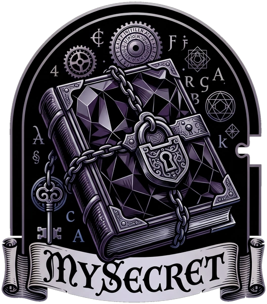

<div align="center">



# MySecret — Transparent Vault Encryption for Obsidian

[](https://obsidian.md)
[](LICENSE)
[](tests/)
[](SECURITY.md)
[](tsconfig.json)

**Zero-Knowledge, on-the-fly encryption for your Obsidian notes and media files.**  
*AES-256-GCM • Argon2id (WASM) • BIP-39 Mnemonic Recovery • WebAuthn & Biometrics • Multi-Cloud Backups*

[English](README.md) • [Español](README.es.md)

</div>

---

## 🌟 Overview

**MySecret** is an advanced security and privacy plugin for [Obsidian](https://obsidian.md). It transparently intercepts Obsidian's file adapter (`app.vault.adapter`) to encrypt and decrypt notes (`.md`), canvases (`.canvas`), and binary attachments (images, PDFs, audio, video) in real-time.

On disk, your files remain fully encrypted at rest. When unlocked, you interact with Obsidian normally—with full search, graph view, links, and editing capabilities.

---

## 🎬 Video Overview & Architecture Walkthrough

Watch the complete video overview of MySecret explaining how transparent at-rest encryption protects your Obsidian vault:

| 🇬🇧 English Walkthrough | 🇪🇸 Explicación en Español |
| :---: | :---: |
| 🌐 [**Watch Online Streaming (No Download)**](https://abismalmx.github.io/MySecret/docs/interactive-infographic.html) | 🌐 [**Ver Online sin Descargar (Streaming)**](https://abismalmx.github.io/MySecret/docs/interactive-infographic.html) |
| 🧠 [**Watch on Google NotebookLM**](https://notebook.google.com/notebook/d5794d82-48a8-4e4b-b4b8-69b288423f72/artifact/ef0d6ffc-dc85-48e2-b52d-11fdbaf5e533) | 🧠 [**Ver en Google NotebookLM**](https://notebook.google.com/notebook/d5794d82-48a8-4e4b-b4b8-69b288423f72/artifact/e06b57d7-18c5-4e3a-8e99-a25dc10c2804) |
| 💾 [Download MP4 File](media/MySecret_en.mp4) | 💾 [Descargar Archivo MP4](media/MySecret_es.mp4) |

> [!TIP]
> 🌐 **Interactive Security Infographic (Web)**: Explore the interactive architecture, stream videos, and test the crypto simulator at **[abismalmx.github.io/MySecret](https://abismalmx.github.io/MySecret/docs/interactive-infographic.html)**.  
> 🧠 **Interactive NotebookLM Guide**:
> - 🇬🇧 [Explore on NotebookLM (English)](https://notebook.google.com/notebook/d5794d82-48a8-4e4b-b4b8-69b288423f72/artifact/30901254-af54-4f59-96ac-2c865a5d6e7b)
> - 🇪🇸 [Explorar en NotebookLM (Español)](https://notebook.google.com/notebook/d5794d82-48a8-4e4b-b4b8-69b288423f72/artifact/be9105e9-f902-4a92-89ac-e67e6ef72d2c)

---

## 🔒 Security & Cryptographic Architecture

- **Zero-Knowledge Architecture:** Decryption keys are derived exclusively in memory using your master password. Neither unencrypted keys nor plaintext files ever leave your device.
- **AES-256-GCM:** Authenticated Encryption with Associated Data (AEAD) using hardware-accelerated Web Crypto API (`window.crypto.subtle`).
- **AAD Path Binding:** The relative file path is strictly bound as Additional Authenticated Data (AAD) preventing ciphertext relocation or swap attacks.
- **Argon2id (WASM):** State-of-the-art key derivation function resistant to GPU/ASIC attacks, powered by WebAssembly via `hash-wasm`.
- **BIP-39 Emergency Recovery:** Deterministic 24-word recovery phrase allows emergency vault recovery if you ever forget your password.
- **Memory Zeroization:** Sensitive cryptographic buffers (keys, master password bytes, mnemonic secrets) in RAM are actively scrubbed (`zeroize()`) upon lock, idle timeout, or app exit.
- **Biometric WebAuthn Bridge:** Native biometric support (Touch ID, Face ID, Windows Hello) and cross-platform Android biometric unlock via our standalone WebAuthn PWA bridge on Cloudflare Pages.

---

## ✨ Features

- 🛡️ **Transparent On-the-Fly Encryption:** Automatically secures markdown notes and binary media files without altering your daily Obsidian workflow.
- 🔐 **Dual-Container Envelope:**
  - **Text notes:** ASCII-armored format (`-----BEGIN MYSECRET ENCRYPTED FILE-----`).
  - **Binary attachments:** Compact 32-byte header with magic bytes `MYSE`.
- ⏱️ **Auto-Lock Timer:** Locks automatically after a configurable period of inactivity.
- 📦 **Automated Encrypted Backups:** Full vault snapshot export and restore with built-in Zip-Slip path sanitization protection.
- ☁️ **Remote Cloud Backups:** Directly upload encrypted vault snapshots to:
  - WebDAV / Nextcloud / ownCloud
  - Google Drive
  - Microsoft OneDrive
- 👆 **Biometric Authentication:**
  - Desktop: Native WebAuthn (Touch ID, Windows Hello, Security Keys).
  - Android & Mobile: Secure bridge via Cloudflare Pages PWA using ECDH key exchange and HMAC-SHA256 assertion validation.
- 🌍 **Internationalization (i18n):** Native support for:
  - English (en)
  - Español (es)
  - Русский (ru)
  - 中文 (zh)

---

## 🚀 Installation

### Option 1: Via Obsidian Community Plugins *(Pending review)*
1. Open Obsidian **Settings** → **Community Plugins**.
2. Turn off **Restricted mode**.
3. Search for **MySecret** and click **Install**, then **Enable**.

### Option 2: Via BRAT (Beta Reviewer's Auto-update Tester)
1. Install the [BRAT](https://github.com/TfTHacker/obsidian42-brat) plugin in Obsidian.
2. Go to **Options** → **BRAT** → **Add Beta plugin**.
3. Enter: `https://github.com/abismalmx/MySecret`
4. Enable the plugin under **Community plugins**.

### Option 3: Manual Installation
1. Download the latest release (`main.js`, `manifest.json`, `styles.css`) from the [Releases](https://github.com/abismalmx/MySecret/releases) page.
2. Navigate to your Obsidian vault directory: `<vault>/.obsidian/plugins/`
3. Create a folder named `mysecret` and place the three downloaded files inside:
   ```
   <vault>/.obsidian/plugins/mysecret/
   ├── main.js
   ├── manifest.json
   └── styles.css
   ```
4. Reload Obsidian, go to **Settings** → **Community plugins**, and toggle on **MySecret**.

---

## 🛠️ Building & Development

### Prerequisites
- Node.js 18+ (Node 20 LTS recommended)
- npm or pnpm

### Clone & Install
```bash
git clone https://github.com/abismalmx/MySecret.git
cd obsidian-mysecret
npm install
```

### Development Build (Watch Mode)
```bash
npm run dev
```

### Production Build
```bash
npm run build
```

### Run Automated Security & Unit Tests
```bash
npm test
```
> All 81 unit, integration, and cryptographic regression tests pass with 100% success rate.

---

## 📱 Android Biometric Bridge (`auth-bridge/`)

Obsidian Mobile on Android runs inside a restricted WebView where `navigator.credentials.get()` / WebAuthn is unavailable.

MySecret solves this via a companion **WebAuthn PWA Bridge**:
1. You deploy the static files inside the `auth-bridge/` folder to a free **Cloudflare Pages** site (zero setup, 1 click).
2. The plugin uses deep-linking / intent with ECDH (P-256) ephemeral key exchange and HMAC verification.
3. The vault key never leaves the device.

See [auth-bridge/README.md](auth-bridge/README.md) for step-by-step setup instructions.

---

## 📚 Documentation

- 📖 **[User Manual](USER_GUIDE.md)** ([Versión en Español](USER_GUIDE.es.md)) — Complete step-by-step user guide.
- 💻 **[Developer Manual](DEVELOPER_GUIDE.md)** ([Versión en Español](DEVELOPER_GUIDE.es.md)) — Deep-dive architecture and API reference.
- 🛡️ **[Security Architecture](SECURITY.md)** ([Versión en Español](SECURITY.es.md)) — Cryptographic primitives and audited defenses.
- 📊 **[Why MySecret / Comparison](COMPARISON.md)** ([Versión en Español](COMPARISON.es.md)) — Key advantages vs. traditional encryption tools.
- 📱 **[Android Biometric Bridge](auth-bridge/README.md)** — Cloudflare Pages deployment guide.

---

## 🇪🇸 Documentación en Español

Puedes consultar la versión completa en español de este documento en [README.es.md](README.es.md).

---

## 📄 License

Copyright (c) 2026 Anthony Rios Licea (@abismalmx).  
Licensed under the **MySecret Non-Commercial Software License**. Free for personal, academic, and non-commercial use. Commercial use or redistribution is strictly prohibited without prior written authorization from the author. See [LICENSE](LICENSE) for full legal terms.
