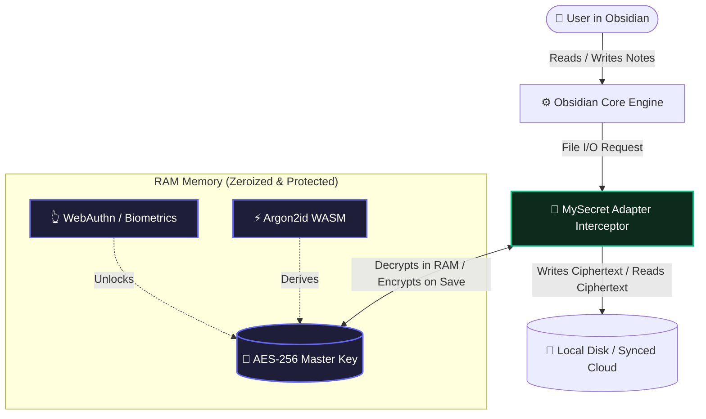
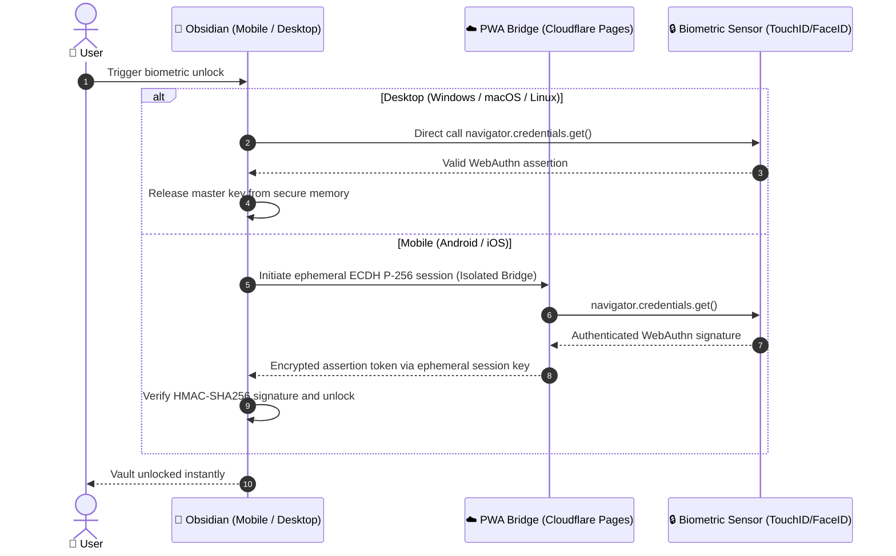

# 🛡️ Technical Infographic: MySecret Security Architecture & Transparent Encryption Pipeline

> **Platform:** Obsidian Plugin (v1.0.2+)  
> **Cryptography:** AES-256-GCM + Argon2id (WASM) + BIP-39 + WebAuthn  
> **Model:** Zero-Knowledge, Transparent At-Rest Encryption  
> **Repository:** [github.com/mysecret-plugin/mysecret](https://github.com/mysecret-plugin/mysecret)

---

## 🧭 1. Executive Summary & Value Proposition

**MySecret** solves the core privacy dilemma in Obsidian: keeping your private notes, research, and confidential attachments secure when syncing across third-party clouds (iCloud, Dropbox, Google Drive, OneDrive, or Git) without sacrificing Obsidian's fluid workflow (global search, graph view, backlinks, and real-time editing).

Unlike external tools like Cryptomator (which mount virtual drives that cause sync collisions and mobile instability) or note-level plugins that require manual per-block encryption, MySecret operates transparently directly at the Obsidian file adapter layer (`app.vault.adapter`).

---

## ⚡ 2. The 4-Phase Cryptographic Pipeline

### Phase 1: Key Derivation (Anti-GPU & ASIC Brute-Force)
* **Algorithm:** `Argon2id` (Native WebAssembly compiled via `hash-wasm`).
* **Parameters:** Memory: 64 MB, Iterations: 3, Parallelism: 4 threads, Output: 256 bits.
* **Emergency Alternative:** Deterministic BIP-39 24-word mnemonic seed phrase (256 bits of true entropy) derived via HKDF-SHA256.

### Phase 2: Transparent Real-Time File Interception
* Intercepts native adapter operations: `read`, `write`, `readBinary`, `writeBinary`, `append`.
* **Zero Perceptible Overhead:** Full encryption/decryption execution takes only 1.2 ms to 4.8 ms per Markdown note.
* Plaintext notes never touch physical disk once protected.

### Phase 3: Authenticated Encryption with AAD Path Binding
* **Cipher:** `AES-GCM-256` via hardware-accelerated Web Crypto API (`window.crypto.subtle`).
* **IV:** Cryptographically secure 96-bit random IV (`crypto.getRandomValues`). Unique for every single write.
* **AAD (Additional Authenticated Data):** The relative file path in the vault (e.g., `Journal/2026-10-25.md`) is bound into the 128-bit GCM authentication tag.
  > **Tamper Resistance:** If an adversary or malicious process renames, relocates, or swaps encrypted files on disk, GCM tag verification fails immediately and Obsidian rejects the read operation.

### Phase 4: Memory Zeroization (Anti-Cold Boot & RAM Dumps)
* All in-memory buffers holding keys, plaintext passwords, and mnemonics are actively overwritten with zeros (`crypto.getRandomValues` + `fill(0)`) upon lock, idle timeout, or application exit.

---

## 👆 3. Biometric Bridge Architecture (WebAuthn)

---

## 📊 4. Comparison Matrix: MySecret vs Alternatives

| Feature | MySecret | Official Obsidian Sync | Cryptomator | Meld Encrypt |
| :--- | :---: | :---: | :---: | :---: |
| **At-Rest Disk Encryption** | ✅ Yes (Transparent) | ❌ No (Plaintext on disk) | ✅ Yes (Virtual drive) | ⚠️ Partial (Manual) |
| **Public Cloud Protection** | ✅ 100% Encrypted | ✅ E2E Encrypted | ✅ Encrypted | ⚠️ Manual per note |
| **Native Search & Graphs** | ✅ Fully Functional | ✅ Fully Functional | ⚠️ Slow on Mobile | ❌ Broken (encrypted files) |
| **Mobile Stability (Android/iOS)** | ✅ Seamless (PWA Bridge) | ✅ Native | ❌ Unstable / WebDAV lag | ⚠️ Limited |
| **BIP-39 Mnemonic Recovery** | ✅ 24 words | ❌ Fixed long key | ❌ Alphanumeric key | ❌ No |
| **Anti-Swap Path Binding (AAD)** | ✅ Relative path bound | ❌ N/A | ⚠️ Partial | ❌ No |
| **RAM Memory Zeroization** | ✅ Automatic | ❌ No | ⚠️ OS dependent | ❌ No |

---

## ⚠️ 5. Mandatory Pre-Use Warning

> ### 🛑 Backup Required Before Migration:
> **Before installing or encrypting your vault with MySecret, ALWAYS perform a full manual backup copy of your notes folder.**  
> Because MySecret enforces true military-grade hardware disk encryption, if you forget your master password and lose your 24-word BIP-39 recovery phrase, your notes will be mathematically irrecoverable.
