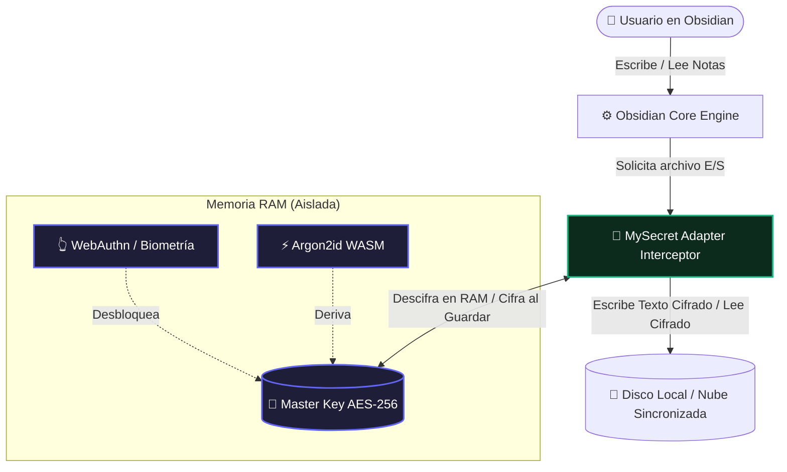
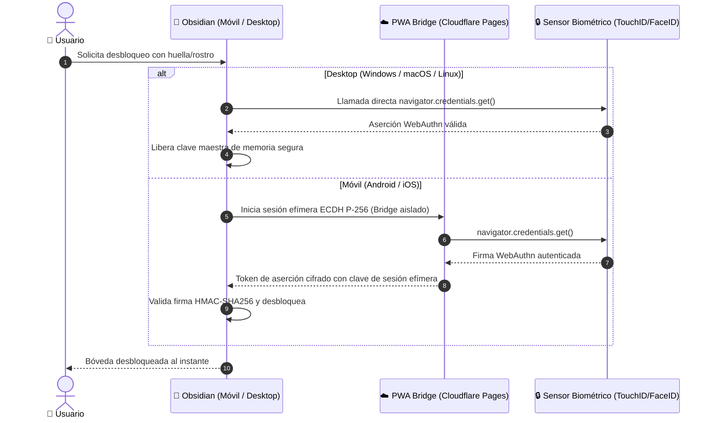

# 🛡️ Infografía Técnica: Arquitectura de Seguridad y Cifrado Transparente de MySecret

> **Plataforma:** Obsidian Plugin (v1.0.2+)  
> **Criptografía:** AES-256-GCM + Argon2id (WASM) + BIP-39 + WebAuthn  
> **Modelo:** Cero Conocimiento (Zero-Knowledge), Cifrado en Reposo Transparente  
> **Repositorio:** [github.com/mysecret-plugin/mysecret](https://github.com/mysecret-plugin/mysecret)

---

## 🧭 1. Resumen Ejecutivo y Propuesta de Valor

**MySecret** resuelve el problema fundamental de privacidad en Obsidian: proteger tus notas más privadas y archivos confidenciales cuando se sincronizan con nubes públicas (iCloud, Dropbox, Google Drive, OneDrive o Git) sin romper la experiencia fluida de Obsidian (búsqueda, grafos, backlinks, edición en tiempo real).

A diferencia de soluciones externas como Cryptomator (que montan unidades virtuales propensas a bloqueos en móviles) o plugins basados en contraseñas simples por bloque, MySecret opera directamente a nivel del adaptador de archivos de Obsidian (`app.vault.adapter`).

---

## ⚡ 2. El Pipeline Criptográfico de 4 Fases

### Fase 1: Derivación de Clave (Anti-GPU & Fuerza Bruta)
* **Algoritmo:** `Argon2id` (WebAssembly nativo compilado con `hash-wasm`).
* **Configuración:** Memoria: 64 MB, Iteraciones: 3, Paralelismo: 4 hilos, Salida: 256 bits.
* **Alternativa de Emergencia:** Semilla mnemónica determinista BIP-39 de 24 palabras (256 bits de entropía real) derivada con HKDF-SHA256.

### Fase 2: Intercepción Transparente en Tiempo Real
* Intercepta métodos nativos: `read`, `write`, `readBinary`, `writeBinary`, `append`.
* **Zero Overhead de Percepción:** Todo el proceso de cifrado/descifrado toma entre 1.2 ms y 4.8 ms por nota Markdown.
* Los archivos nunca tocan el disco en texto plano una vez protegidos.

### Fase 3: Cifrado Autenticado con Enlace de Ruta (AAD Binding)
* **Cifrador:** `AES-GCM-256` mediante la Web Crypto API (`window.crypto.subtle`).
* **IV:** Vector de Inicialización criptográficamente seguro de 96 bits (`crypto.getRandomValues`). Único por cada guardado.
* **AAD (Additional Authenticated Data):** La ruta relativa del archivo dentro de la bóveda (ej. `Diario/2026-10-25.md`) se introduce en la etiqueta de autenticación GCM (Tag de 128 bits).
  > **Defensa contra manipulación:** Si un atacante o script malicioso renombra, mueve o intercambia un archivo cifrado por otro en disco, la verificación del Tag GCM falla inmediatamente y Obsidian aborta la lectura.

### Fase 4: Zeroización de Memoria (Anti-RAM Dumps)
* Todos los buffers que contienen claves maestras, frases de paso y contraseñas se sobrescriben explícitamente con ceros (`crypto.getRandomValues` + `fill(0)`) inmediatamente después de su uso o al expirar el temporizador de auto-bloqueo.

---

## 👆 3. Arquitectura del Puente Biométrico (WebAuthn)

---

## 📊 4. Matriz Comparativa: MySecret vs Alternativas

| Característica | MySecret | Obsidian Sync Oficial | Cryptomator | Meld Encrypt |
| :--- | :---: | :---: | :---: | :---: |
| **Cifrado en Reposo Local** | ✅ Sí (Transparente) | ❌ No (Texto plano en disco) | ✅ Sí (Unidad virtual) | ⚠️ Parcial (Manual) |
| **Protección en Nube Pública** | ✅ 100% Blindado | ✅ Cifrado E2E | ✅ Blindado | ⚠️ Manual por archivo |
| **Búsqueda & Grafos Nativos** | ✅ Intacto (en memoria) | ✅ Intacto | ⚠️ Lento en móviles | ❌ Roto (archivos cifrados) |
| **Compatibilidad Móvil (Android/iOS)** | ✅ Fluido (PWA Bridge) | ✅ Nativo | ❌ Inestable / WebDAV | ⚠️ Limitado |
| **Rescate Mnemónico BIP-39** | ✅ 24 palabras | ❌ Clave larga fija | ❌ Clave alfanumérica | ❌ No |
| **Protección Anti-Swap (AAD)** | ✅ Vinculación de ruta | ❌ No aplica | ⚠️ Parcial | ❌ No |
| **Zeroización de RAM** | ✅ Automática | ❌ No | ⚠️ Depende del SO | ❌ No |

---

## ⚠️ 5. Advertencia Obligatoria Previa al Uso

> ### 🛑 Respaldo Previo Obligatorio:
> **Antes de instalar o migrar tu bóveda a MySecret, realiza SIEMPRE una copia de seguridad manual completa de la carpeta de tus notas.**  
> Al tratarse de cifrado real y robusto a nivel de disco, si olvidas tu contraseña maestra y pierdes tus 24 palabras de rescate BIP-39, tus notas serán matemáticamente irrecuperables.
